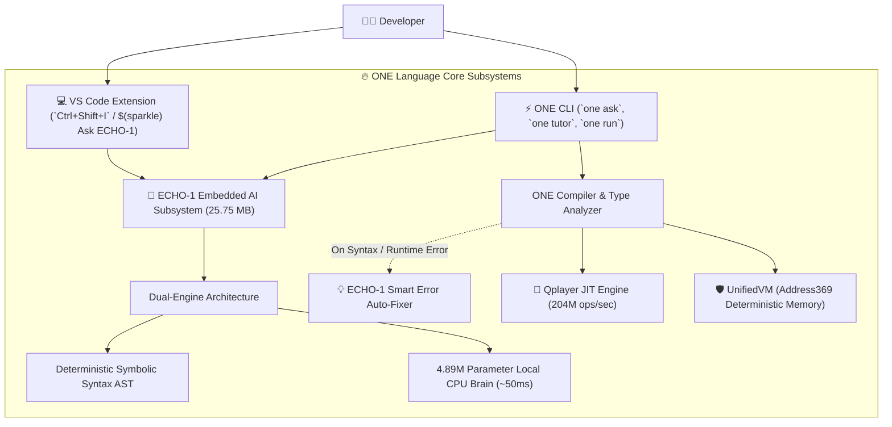

<div align="center">


# ONE Language (v1.3.0 Stable)
### The World's First Sovereign Computational Language with Built-In Offline AI (ECHO-1)

[](https://github.com/aayyaz3d-166/CUBiO-Intelligence)
[](https://github.com/aayyaz3d-166/CUBiO-Intelligence)
[](https://github.com/aayyaz3d-166/CUBiO-Intelligence)
[](https://github.com/aayyaz3d-166/CUBiO-Intelligence)
[](https://github.com/aayyaz3d-166/CUBiO-Intelligence)
[](LICENSE)

<br/>

**ONE Language** is a next-generation sovereign programming language engineered for high-throughput discrete computing, deterministic 3D spatial memory architectures, and native in-language artificial intelligence. 

</div>

---

## 🌟 What's New in v1.3.0: Built-in ECHO-1 Offline AI Copilot

Unlike conventional languages that depend on cloud-based AI APIs (requiring internet access, monthly subscriptions, and token latency), **ONE Language v1.3.0 embeds its own autonomous 4.89M parameter neural intelligence (ECHO-1) directly into the compiler, CLI, and VS Code extension**.



---

## 🤖 1. ECHO-1 Autonomous AI Assistant Capabilities

### ⚡ Instant Terminal Assistant (`one ask`)
Ask questions directly from your terminal with zero internet connection:

```powershell
$ one ask "how do I define a function?"
```

```text
================================================================
🤖 ECHO-1 Assistant (Offline Sovereign AI)
================================================================
Question: how do I define a function?

Answer: In ONE Language, you define functions using the `function` keyword with typed parameters and return types.

Example Code (.one):
function add(a: number, b: number): number {
    return a + b;
}

let result = add(10, 20);
print result;

💡 Tip: Function banane ke liye `function` likhein aur parameters ki types (number, string) declare karein.

[Latency: 0ms | Status: CANONICAL_SYNTAX | Offline Local CPU]
================================================================
```

### 🎓 Interactive Learning Shell (`one tutor`)
Launch an interactive conversational shell right in your console:
```powershell
$ one tutor
```

### 💡 Smart Compiler Error Auto-Fixer
When your code has a syntax mistake, the compiler does not just throw raw stacktraces. ECHO-1 immediately intervenes with contextual, actionable guidance:

```text
Check Error: [Parser Error] Compilation halted with 1 error(s):
[E1011: Syntax Error] Unexpected token ';' (SEMICOLON) in expression at line 1, column 14

  💡 ECHO-1 Assistant: Unexpected Token / Syntax Error: Compiler ko aesa token mila jo expected nahi tha.
  👉 Suggested Fix:   Expression check karein: missing semicolon ya invalid character door karein.
  📌 Problematic Code: let broken = ;
```

---

## 💻 2. Visual Studio Code Extension (v1.3.0)

The official **ONE Language VS Code Extension** is now an all-in-one package with the **25 MB ECHO-1 AI model bundled directly inside**:

* **Standalone VSIX Package**: `dist/one-language-1.3.0.vsix` (**24.59 MB**)
* **Global Shortcut**: Press `Ctrl + Shift + I` (or `Cmd + Shift + I` on macOS) anywhere to ask ECHO-1.
* **One-Click Actions**: Insert generated code directly into the editor or copy to clipboard.
* **Status Bar Item**: Click `$(sparkle) Ask ECHO-1` at the bottom of your IDE.
* **Full LSP Support**: Real-time syntax diagnostics, document outline, breadcrumbs, and format on save.

```powershell
# Install directly in VS Code:
code --install-extension "dist\one-language-1.3.0.vsix" --force
```

---

## 🚀 3. Dual Execution Runtimes

| Feature | Qplayer Runtime | UnifiedVM |
| :--- | :--- | :--- |
| **Target Workload** | High-Throughput OBI Bytecode | Spatial Computing & Formal Verification |
| **Peak Throughput** | **204.08 Million ops/sec** | Zero-Variance Spatial VM ($\sigma^2 = 0.0$) |
| **Bytecode Format** | One Binary Intelligence (`.obi`) | ONEX Container (`.ox`) |
| **Container Size** | **~95 to 110 bytes (94.9% reduction)** | Full Merkle sealed state |
| **Safety Invariants** | Strict Boundary Validation | `ACTUATION_LOCK` & Address369 `[0..368]` |

### Running with Qplayer Engine:
```powershell
# Execute source with JIT micro-kernel:
bin\one.cmd run examples\02_qplayer_obi\compute.one --engine=qplayer

# Compile to ultra-compact binary (.obi):
bin\one.cmd build examples\02_qplayer_obi\compute.one --target=obi

# Execute compiled .obi binary:
bin\one.cmd run examples\02_qplayer_obi\compute.obi
```

---

## 🛡️ 4. Sovereign Safety Invariants

1. **Hardware Actuation Lock (`ACTUATION_LOCK`)**:
   Hardware actuation interfaces remain locked fail-closed at compile-time and runtime.
2. **Address369 Sovereign Spatial Boundary**:
   Spatial virtual memory is strictly restricted to addresses `[0..368]`. Any out-of-bounds attempt fails closed instantly with compiler error `E8005`.
3. **Deterministic Protection**:
   Deterministic ceiling limits (1,000,000 instructions) prevent infinite execution loops.

---

## 📁 5. Repository & Distribution Layout

```text
ONE Language Release v1.3.0/
├── bin/
│   ├── one.exe                # Native Windows x64 standalone executable
│   ├── one.cjs                # Developer CLI runner
│   └── one.cmd                # Windows Command wrapper
├── data/
│   └── models/                # Embedded 25.75 MB ECHO-1 neural checkpoint
├── dist/
│   ├── one-language-1.3.0.vsix # Packaged All-in-One VS Code extension (24.59 MB)
│   ├── one-language-1.3.0.vsix.sha256
│   └── one.exe                # Standalone PE binary (SEA postject)
├── editors/
│   └── vscode/                # VS Code extension source, models, and manifests
├── examples/                  # Verified sample programs (.one & .obi)
├── src/                       # Core compiler, Lexer, Parser, VM, Qplayer & ECHO-1
├── tests/                     # 100% passing test suites across all 13 verification stages
└── RELEASE_NOTES_v1.3.0.md    # Comprehensive release notes
```

---

## 📜 License
Licensed under either the **Apache License, Version 2.0** ([LICENSE-APACHE](LICENSE-APACHE)) or the **MIT License** ([LICENSE-MIT](LICENSE-MIT)) at your option.
