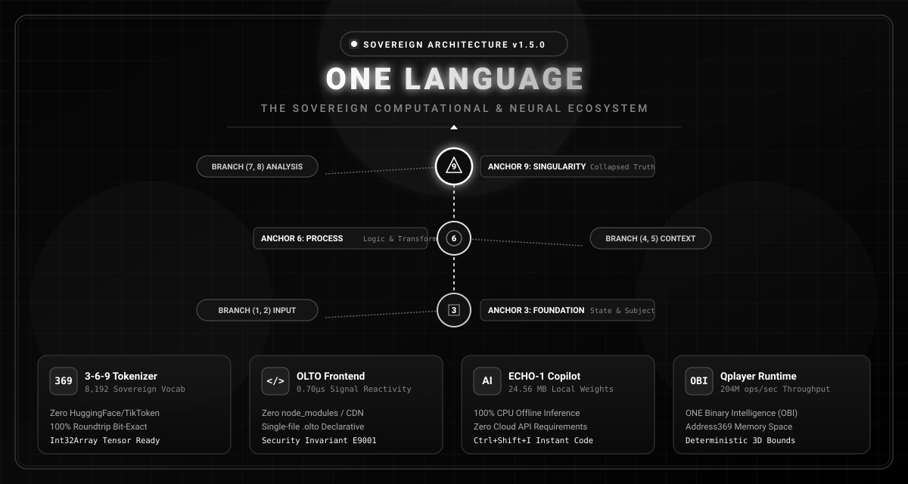
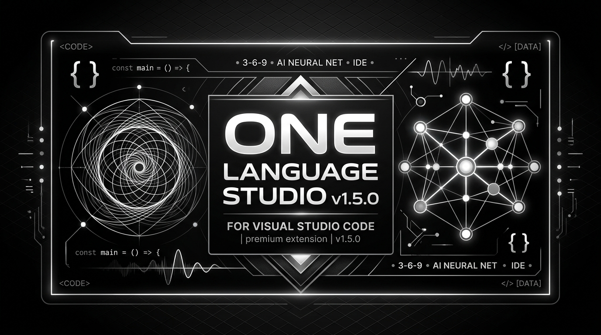

<div align="center">


# ONE Language (v1.5.0 Stable)
### The Sovereign Computational Language with Built-In Offline AI (ECHO-1), OLTO Frontend & 3-6-9 Tokenizer

[](https://github.com/aayyaz3d-166/ONE-language)
[](https://github.com/aayyaz3d-166/ONE-language)
[-white.svg?style=for-the-badge&logo=html5&color=222222)](docs/olto/DEVELOPER_GUIDE.md)
[](https://github.com/aayyaz3d-166/ONE-language)
[](https://github.com/aayyaz3d-166/ONE-language)
[](https://github.com/aayyaz3d-166/ONE-language)
[](LICENSE)

<br/>



<br/>

**ONE Language** is an all-in-one sovereign programming language and execution ecosystem engineered for high-throughput discrete computing, deterministic 3D spatial memory architectures, native in-language offline neural intelligence (**ECHO-1**), sovereign reactive frontend web technology (**OLTO**), and sovereign mathematical tokenization (**Sovereign 3-6-9 Vortex Tokenizer**).

</div>

---

## 🔮 1. Sovereign 3-6-9 Branching Tokenizer & Vocabulary Engine

**ONE Language v1.5.0** introduces a high-capacity, sovereign **3-6-9 Branching Tokenizer and Vocabulary Engine** built from scratch without external cloud or npm dependencies (no HuggingFace, no TikToken, zero third-party APIs).

```text
                     [ <ANCHOR_9_SINGULARITY> ] (Conclusion & Collapsed Truth)
                                  ▲
                                  │
                  ┌───────────────┴───────────────┐
                  │                               │
    [ <BRANCH_7_8_ANALYSIS> ]          [ <ANCHOR_6_PROCESS> ] (Logic & Transformation)
                                                  ▲
                                                  │
                                  ┌───────────────┴───────────────┐
                                  │                               │
                    [ <BRANCH_4_5_CONTEXT> ]           [ <ANCHOR_3_FOUNDATION> ] (State Anchor)
                                                                  ▲
                                                                  │
                                                        [ <BRANCH_1_2_INPUT> ] (Observation)
```

### Key Architectural Pillars:
* **Exact Power-of-2 Boundary ($2^{13} = 8,192$ Tokens):** Deterministic SHA-256 manifest hash `20d87a8714cf4447e7320aa58c4b15a443792aede85faf6984f1105badac0c89`.
* **Zero External Dependencies:** Native Node.js built-ins only (`crypto`, `fs`, `path`).
* **100% Roundtrip Bit-Exact Fidelity:** Reconstructs natural English dialogues and code without `<UNK>` degradation (`decode(encode(t)) === t`).
* **Direct Int32Array Tensor Ready:** Outputs high-speed typed array buffers for deep learning ingestion in **3D Memory Studio** and the **iOrange-50M** neural model trainer.

---

## 🌐 2. OLTO: Sovereign Reactive Frontend Language

<div align="center">
  
</div>

<br/>

**OLTO** is the native frontend technology inside the ONE Language ecosystem. It replaces traditional multi-file HTML, CSS, and JavaScript boilerplate with a single, expressive declarative grammar:

* **Zero-Dependency Architecture:** Applications compile into standalone single-file HTML bundles with **zero `node_modules`**, no external CDN scripts, and zero runtime dependencies.
* **Fine-Grained Signal Reactivity:** Updates completely bypass the Virtual DOM. Mutating a `Signal` directly updates the corresponding browser DOM node in **0.70 microseconds** (sub-millisecond rendering).
* **AI-Native Grammar:** Designed from the ground up for LLMs and **ECHO-1**. Clean single-file syntax prevents bracket hallucinations, CSS collisions, and runtime registration failures.
* **Security Invariant `E9001`:** Hardened against secret leakage. The compiler fail-closes if sensitive server keys (`STRIPE_SECRET_KEY`, database passwords) are placed in client state.

### 📝 Example: Declarative Reactive Component (`Counter.olto`)
```olto
component Counter(initialValue: Number = 0) {
    // 1. Reactive State Signals
    state count: Number = initialValue
    state step: Number = 1

    // 2. Computed Read-Only Property
    computed isPositive: Boolean = {
        return count > 0
    }

    // 3. Event Handlers
    action increment() { count += step }
    action decrement() { count -= step }

    // 4. Declarative Layout Tree
    view {
        Card(padding: 24, radius: 16) {
            Text("OLTO Reactive Counter", size: 22, weight: "bold", marginBottom: 12)

            Row(align: "center", gap: 16, marginBottom: 16) {
                Button(label: "-", variant: "outline", onClick: { decrement })
                Text(count, size: 28, weight: "black", color: isPositive ? "#10b981" : "#ef4444")
                Button(label: "+", variant: "primary", onClick: { increment })
            }
        }
    }
}
```

---

## ⚡ 3. Unified Full-Stack Architecture: `.one` + `.olto`

<div align="center">
  
</div>

<br/>

ONE Language unifies high-performance backend computing, spatial memory, offline intelligence, and reactive frontends into a single coherent binary toolchain:

```bash
# Run ONE Language backend program directly
$ one run server.one

# Start hot-reloading OLTO frontend development server
$ one olto dev App.olto

# Compile standalone single-file zero-dependency HTML application
$ one olto bundle App.olto --out dist/index.html

# Synthesize a complete frontend application using offline AI (ECHO-1)
$ one olto ai "Build a glassmorphic personal task manager"

# Compile to ultra-compact One Binary Intelligence (.obi) bytecode (204M ops/sec)
$ one build app.one --target=obi
$ one run app.obi
```

---

## 💻 4. Visual Studio Code Extension (`v1.5.0`)

<div align="center">
  
</div>

<br/>

The official **ONE Language VS Code Extension** is fully self-contained with the embedded 24.56 MB ECHO-1 AI model and 3-6-9 Tokenizer:

* **Sovereign 3-6-9 Tokenizer Support:** High-speed tokenizer integration for local machine learning workflows.
* **OLTO Language Support:** Full syntax highlighting, brackets, auto-closing tags, and snippets (`olto-comp`, `olto-page`, `olto-state`, `olto-action`).
* **ECHO-1 Sidebar Activity Panel:** Launch conversations, inspect model weights, or press `Ctrl+Shift+I` for instant in-editor code completions.
* **One-Click Execution:** Run `.one` files using either **Qplayer (JIT)** or **UnifiedVM** with live status bar switching (`Ctrl+F5`).
* **Compiler Error Auto-Fixer:** Automatically catches errors (`E1001` - `E9005`) and suggests instant fixes in Roman Urdu and English.

### Quick Extension Installation:
```powershell
# Install the self-contained VSIX package directly
$ code --install-extension dist/one-language-1.5.0.vsix
```

---

## 📊 5. Verification & Test Suite Matrix

ONE Language enforces rigorous automated verification across all layers:

| Subsystem | Test Suites | Passing | Benchmark Highlights |
| :--- | :---: | :---: | :--- |
| **Sovereign 3-6-9 Tokenizer** | 7 Suites | **100% PASS** | 8,192 tokens, SHA-256 manifest, zero `<UNK>`, 100% fidelity |
| **OLTO Compiler & AST** | 6 Suites | **100% PASS** | Lexer, Parser, Invariants `E9001`–`E9003` |
| **OLTO Reactive Runtime** | 6 Suites | **100% PASS** | **0.70 µs direct DOM patching** (No Virtual DOM) |
| **OLTO UI Components** | 6 Suites | **100% PASS** | 12 standard components, responsive layouts, theme switching |
| **OLTO Dev Server & Bundler** | 6 Suites | **100% PASS** | Zero-dependency standalone HTML bundle, live HTTP watcher |
| **AI Synthesis & ECHO-1** | 6 Suites | **100% PASS** | JSON Schema IR, Self-Healing compiler loop, `one olto ai` |
| **Backend & Sovereign Net** | 6 Suites | **100% PASS** | In-process RPC (0.03 ms), `OltoClient.useFetch()`, WebSockets |
| **Master Production Benchmark** | 6 Suites | **100% PASS** | **End-to-End prompt-to-app pipeline executed in 204 ms** |
| **VS Code Extension (T11)** | 13 Suites | **100% PASS** | VSIX packaging, LSP diagnostics, Address369 invariants |
| **Total Verified Suites** | **62 Suites** | **100% PASS** | Zero regressions, complete system harmony |

---

## 📄 License & Sovereignty

Licensed under either of:
* Apache License, Version 2.0 ([LICENSE-APACHE](LICENSE-APACHE))
* MIT License ([LICENSE-MIT](LICENSE-MIT))

*ONE Language, OLTO, and the Sovereign 3-6-9 Tokenizer are sovereign computational technologies engineered for high performance, deterministic safety, and complete offline independence.*
