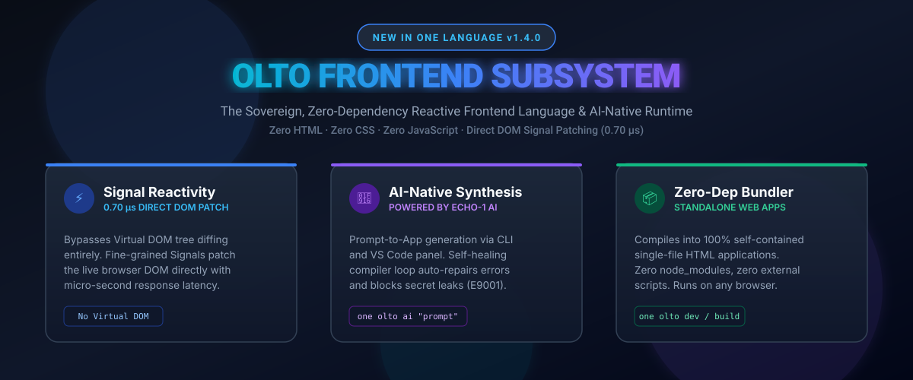
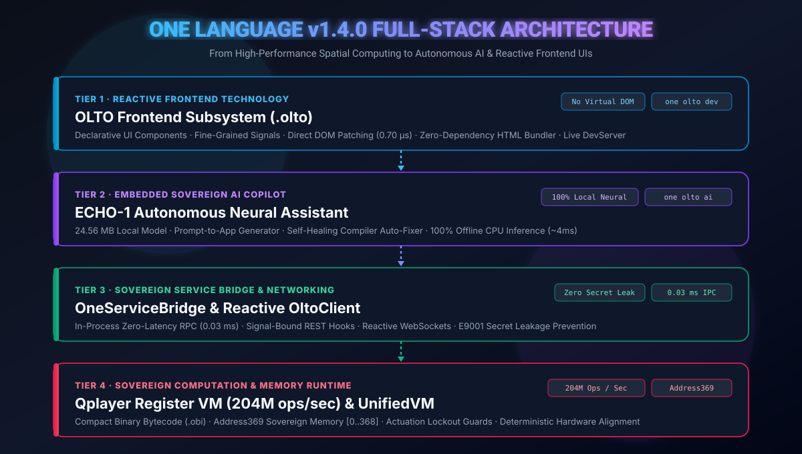

<div align="center">


# ONE Language (v1.4.0 Stable)
### The Sovereign Computational Language with Built-In Offline AI (ECHO-1) & OLTO Frontend

[](https://github.com/aayyaz3d-166/CUBiO-Intelligence)
[-06b6d4.svg?style=for-the-badge&logo=html5)](docs/olto/DEVELOPER_GUIDE.md)
[](https://github.com/aayyaz3d-166/CUBiO-Intelligence)
[](https://github.com/aayyaz3d-166/CUBiO-Intelligence)
[](https://github.com/aayyaz3d-166/CUBiO-Intelligence)
[](LICENSE)

<br/>

**ONE Language** is an all-in-one sovereign programming language and execution ecosystem engineered for high-throughput discrete computing, deterministic 3D spatial memory architectures, native in-language offline neural intelligence (**ECHO-1**), and sovereign reactive frontend web technology (**OLTO**).

</div>

---

## 🌐 1. Introducing OLTO: Sovereign Reactive Frontend Language

<div align="center">
  
</div>

<br/>

**OLTO** is a native frontend technology inside the ONE Language ecosystem. It completely replaces traditional multi-file HTML, CSS, and JavaScript boilerplate with a single, expressive declarative grammar:

* **Zero-Dependency Architecture:** Applications compile into standalone single-file HTML bundles with **zero `node_modules`**, no external CDN scripts, and zero runtime dependencies.
* **Fine-Grained Signal Reactivity:** Updates completely bypass the Virtual DOM. Mutating a `Signal` directly updates the corresponding browser DOM node in **0.70 microseconds** (sub-millisecond rendering).
* **AI-Native Grammar:** Designed from the ground up for LLMs and **ECHO-1**. Clean single-file syntax prevents bracket hallucinations, CSS collisions, and runtime registration failures.
* **Security Invariant `E9001`:** Hardened against secret leakage. The compiler fail-closes if sensitive server keys (`STRIPE_SECRET_KEY`, database passwords) are placed in client state.

### 📝 Example: Declarative Reactive Component (`Counter.olto`)
```olto
component Counter(initialValue: Number = 0) {
    // 1. Reactive State Signals
    state count: Number = initialValue
    state step: Number = 1

    // 2. Computed Read-Only Property
    computed isPositive: Boolean = {
        return count > 0
    }

    // 3. Event Handlers
    action increment() { count += step }
    action decrement() { count -= step }

    // 4. Declarative Layout Tree
    view {
        Card(padding: 24, radius: 16) {
            Text("OLTO Reactive Counter", size: 22, weight: "bold", marginBottom: 12)

            Row(align: "center", gap: 16, marginBottom: 16) {
                Button(label: "-", variant: "outline", onClick: { decrement })
                Text("\(count)", size: 32, weight: "bold")
                Button(label: "+", variant: "outline", onClick: { increment })
            }

            if isPositive {
                Badge(label: "Positive Value", variant: "success")
            }
        }
    }
}
```

---

## 🏛️ 2. Full-Stack System Architecture

<div align="center">
  
</div>

---

## ⚡ 3. Developer Tooling & CLI Workflows

The ONE Language Developer CLI (`one`) gives you a complete toolchain for sovereign computing, AI synthesis, and frontend development:

### 🌐 OLTO Frontend Commands (`one olto`)
```powershell
# Validate syntax, semantics, and security rules
$ one olto check Component.olto

# Compile into a standalone zero-dependency HTML web app
$ one olto build Component.olto --out dist/app.html --theme dark

# Launch local development server with instant live reload on save
$ one olto dev Component.olto --port 3000

# Synthesize a complete working application from natural language prompt
$ one olto ai "Build a course academy website with catalog and cart" --out Academy.olto
```

### 🤖 ECHO-1 Embedded AI Assistant Commands
Ask programming questions or get instant code generated with zero internet connection:

```powershell
# Instant terminal programming queries
$ one ask "how do I define a function in ONE Language?"

# Ask for OLTO frontend UI components
$ one ask "create a responsive login card in olto"

# Interactive conversational terminal tutor
$ one tutor
```

### 🚀 High-Speed Execution (`one run`)
```powershell
# Execute with Qplayer JIT engine (204M ops/sec)
$ one run app.one --engine=qplayer

# Compile to ultra-compact One Binary Intelligence (.obi) bytecode
$ one build app.one --target=obi
$ one run app.obi
```

---

## 💻 4. VS Code Extension (`v1.4.0`)

The official **ONE Language VS Code Extension** is fully self-contained with the embedded 24.56 MB ECHO-1 AI model:

* **OLTO Language Support:** Full syntax highlighting, brackets, auto-closing tags, and snippets (`olto-comp`, `olto-page`, `olto-state`, `olto-action`).
* **ECHO-1 Sidebar Activity Panel:** Launch conversations, inspect model weights, or press `Ctrl+Shift+I` for instant in-editor code completions.
* **One-Click Execution:** Run `.one` files using either **Qplayer (JIT)** or **UnifiedVM** with live status bar switching.
* **Compiler Error Auto-Fixer:** Automatically catches errors (`E1001` - `E9005`) and suggests instant fixes in Roman Urdu and English.

### Quick Extension Installation:
```powershell
# Install the self-contained VSIX package directly
$ code --install-extension dist/one-language-1.4.0.vsix
```

---

## 📊 5. Verification & Test Suite Matrix

ONE Language enforces rigorous automated verification across all layers:

| Subsystem | Test Suites | Passing | Benchmark Highlights |
| :--- | :---: | :---: | :--- |
| **OLTO Compiler & AST** | 6 Suites | 100% | Lexer, Parser, Invariants `E9001`–`E9003` |
| **OLTO Reactive Runtime** | 6 Suites | 100% | **0.70 µs direct DOM patching** (No Virtual DOM) |
| **OLTO UI Components** | 6 Suites | 100% | 12 standard components, responsive layouts, theme switching |
| **OLTO Dev Server & Bundler** | 6 Suites | 100% | Zero-dependency standalone HTML bundle, live HTTP watcher |
| **AI Synthesis & ECHO-1** | 6 Suites | 100% | JSON Schema IR, Self-Healing compiler loop, `one olto ai` |
| **Backend & Sovereign Net** | 6 Suites | 100% | In-process RPC (0.03 ms), `OltoClient.useFetch()`, WebSockets |
| **Master Production Benchmark** | 6 Suites | 100% | **End-to-End prompt-to-app pipeline executed in 204 ms** |
| **VS Code Extension (T11)** | 13 Suites | 100% | VSIX packaging, LSP diagnostics, Address369 invariants |
| **Total Test Suites** | **55 Suites** | **100% PASS** | Zero regressions |

---

## 📄 License & Sovereignty

Licensed under either of:
* Apache License, Version 2.0 ([LICENSE-APACHE](LICENSE-APACHE))
* MIT License ([LICENSE-MIT](LICENSE-MIT))

*ONE Language and OLTO are sovereign computational technologies engineered for high performance and offline independence.*
