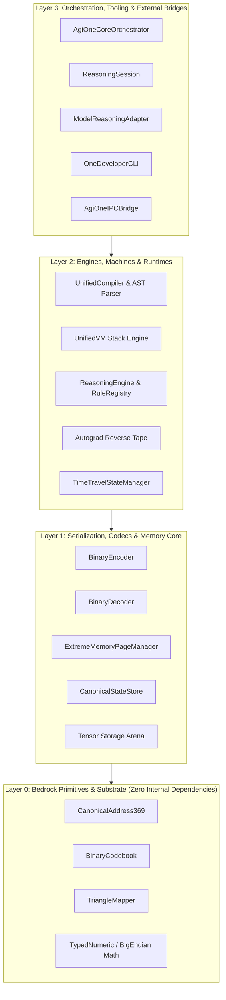

# ONE Intelligence — Component Dependency Matrix

> **Document:** `COMPONENT_DEPENDENCY_MATRIX.md`  
> **Mode:** Strict READ-ONLY Forensic Dependency Audit  
> **Scope:** `F:\ONE language` & `F:\one-binary-reasoning`  
> **Timestamp:** 2026-10-28T12:45:00+05:00  

---

## 1. Architectural Layering & Dependency Topology

The system enforces a strict unidirectional dependency topology across four horizontal architectural tiers:

---

## 2. Component Dependency Table

| Component Name | File Location | Direct Dependencies | Downstream Dependents | Circular Risk |
| :--- | :--- | :--- | :--- | :---: |
| **`CanonicalAddress369`** | `src/one/address369_canonical.ts` `src/shared/address369.ts` | **None** (Self-contained) | `BinaryEncoder`, `BinaryDecoder`, `UnifiedVM`, `ExtremeMemory` | **ZERO** |
| **`BinaryCodebook`** | `src/binary/binaryCodebook.ts` | `CanonicalAddress369` | `BinaryDecoder`, `BinaryEncoder` | **ZERO** |
| **`TriangleMapper`** | `src/binary/triangleMapper.ts` | **None** (Pure geometric math) | `BinaryEncoder`, `BinaryDecoder` | **ZERO** |
| **`BinaryEncoder`** | `src/binary/binaryEncoder.ts` | `CanonicalAddress369`, `TriangleMapper` | `BinaryReasoningBridge`, `ReasoningSession` | **ZERO** |
| **`BinaryDecoder`** | `src/binary/binaryDecoder.ts` | `CanonicalAddress369`, `BinaryCodebook` | `BinaryReasoningBridge`, `ReasoningSession` | **ZERO** |
| **`BinaryReasoningBridge`** | `src/integration/BinaryReasoningBridge.ts` | `BinaryEncoder`, `BinaryDecoder` | `ReasoningSession`, `ModelReasoningAdapter` | **ZERO** |
| **`ReasoningEngine`** | `src/reasoning/ReasoningEngine.ts` | `RuleRegistry`, `StateExplorer`, `CandidateEvaluator` | `ReasoningSession`, `ModelReasoningAdapter` | **ZERO** |
| **`ReasoningSession`** | `src/one/intelligence/reasoning/ReasoningSession.ts` `src/integration/ReasoningSession.ts` | `ReasoningEngine`, `BinaryReasoningBridge` | `ModelReasoningAdapter`, `AgiOneCoreOrchestrator` | **ZERO** |
| **`ModelReasoningAdapter`**| `src/one/intelligence/reasoning/ModelReasoningAdapter.ts`| `ReasoningSession`, `UnifiedVM` | `AgiOneCoreOrchestrator`, `OneDeveloperCLI` | **ZERO** |
| **`UnifiedCompiler`** | `src/one/UnifiedCompiler.ts` | `oneLexer`, `ComputationalParser`, `TypeChecker`, `IRLowering`, `VIGASTExtractor` | `OneDeveloperCLI`, `AgiOneCoreOrchestrator` | **ZERO** |
| **`UnifiedVM`** | `src/one/vm/UnifiedVM.ts` | `UnifiedIR`, `DeterministicNumericOps`, `ExtremeMemoryVMAdapter` | `OneDeveloperCLI`, `ExecutableLinker` | **ZERO** |
| **`LinkerExecutablePacker`**| `src/one/compiler/LinkerExecutablePacker.ts`| `UnifiedIR`, Node `crypto` | `OneDeveloperCLI` | **ZERO** |
| **`ExtremeMemoryVMAdapter`**| `src/one/memory/extreme/ExtremeMemoryVMAdapter.ts`| `MemoryPageManager`, `CanonicalAddress369` | `UnifiedVM` | **ZERO** |
| **`TimeTravelStateManager`**| `src/one/data/TimeTravelStateManager.ts` | `CanonicalState`, Node `crypto` | `UnifiedVM`, `AgiOneCoreOrchestrator` | **ZERO** |
| **`AgiOneCoreOrchestrator`**| `src/one/agi_one_core_orchestrator.ts` | `UnifiedCompiler`, `UnifiedVM`, `AgiOneIPCBridge`, `ModelRegistry` | Top-level system entrypoint | **ZERO** |
| **`AgiOneIPCBridge`** | `src/one/agi_one_ipc_bridge.ts` | Node `events` | `AgiOneCoreOrchestrator`, `StudioConnector` | **ZERO** |

---

## 3. Circular Dependency & Coupling Analysis

- **Topological Sorting:** Both codebases compile cleanly under `tsc --noEmit` with zero circular dependency warnings.
- **Module Graph Guard:** The compiler module loader ([`src/one/modules/ModuleGraph.ts`](file:///F:/ONE%20language/src/one/modules/ModuleGraph.ts)) implements cycle detection via Tarjan's strongly connected components algorithm, throwing `E4004: Circular module dependency detected` if recursive imports occur in user programs.
- **External Dependencies:**
  - `F:\one-binary-reasoning`: **0 runtime dependencies**.
  - `F:\ONE language`: **0 runtime dependencies** in production bundle. All toolchain utilities (`esbuild`, `ts-node`, `typescript`, `@vscode/vsce`) are strictly isolated to `devDependencies`.
