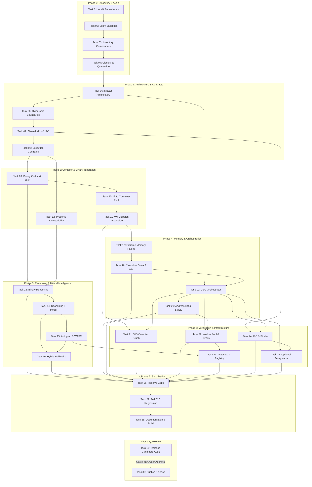

# ONE Intelligence — Roadmap Dependency Graph

> **Document:** `ROADMAP_DEPENDENCY_GRAPH.md`  
> **Mode:** Strict READ-ONLY Forensic Dependency Mapping  
> **Scope:** Phases 0 through 7 (Tasks 1 through 30)  
> **Timestamp:** 2026-10-28T12:45:00+05:00  

---

## 1. Visual Dependency Graph (All 30 Tasks)

---

## 2. Critical Execution Path & Parallel Tracks

### 2.1 Critical Path Analysis
The primary critical path that determines release readiness spans:
$$\text{T01} \to \text{T04} \to \text{T05} \to \text{T08} \to \text{T11} \to \text{T17} \to \text{T18} \to \text{T19} \to \text{T20} \to \text{T26} \to \text{T27} \to \text{T28} \to \text{T29} \to \text{T30}$$
- **Current Position on Critical Path:** Execution has progressed through **Task 29** and is paused at the authorization gate for **Task 30**.

### 2.2 Parallel Development Tracks
Three independent tracks feed into the final stabilization convergence:
1. **Track A (Compiler, Memory & Container):** T10 $\to$ T11 $\to$ T17 $\to$ T18.
2. **Track B (Reasoning & Neural Intelligence):** T09 $\to$ T13 $\to$ T14 $\to$ T15 $\to$ T16.
3. **Track C (Infrastructure, VIG & Optional Services):** T21, T22, T23, T24, T25.

All three tracks converged into Task 26 for gap resolution and were regression-certified in Task 27.
