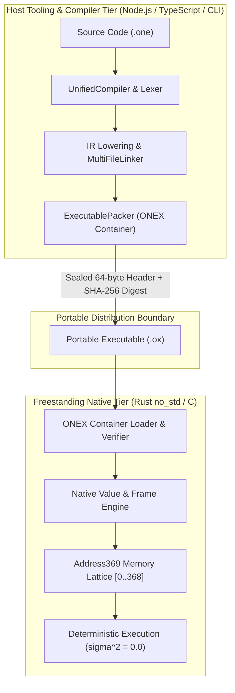
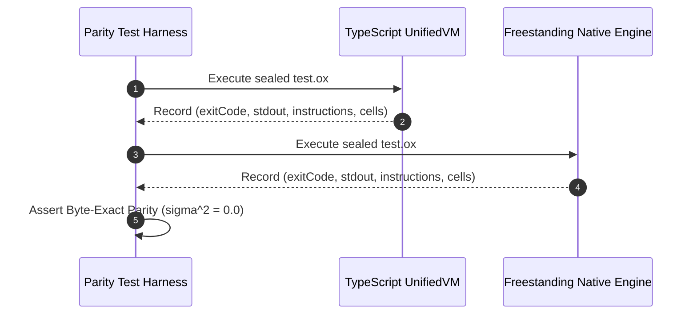
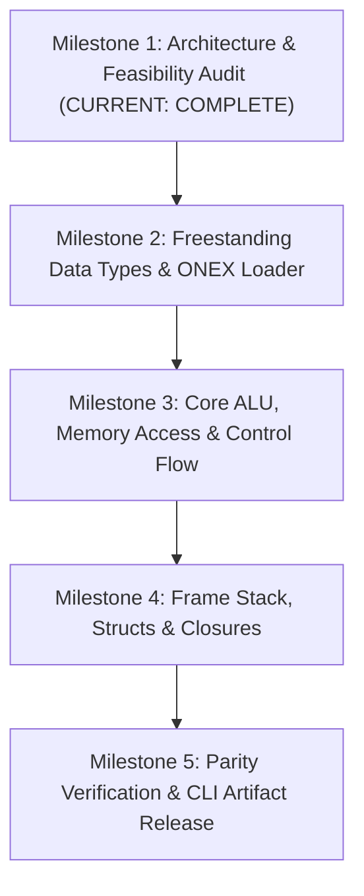

# ONE Language — Freestanding Native C/Rust Engine Architecture & Feasibility Audit (T12)

**Document ID:** `ONE-ARCH-T12-AUDIT`  
**Phase:** Phase 3 — Architecture and Release Verification  
**Task:** T12 — Freestanding Native C/Rust Engine  
**Status:** Architecture Complete / Feasibility Review  
**Date:** 2026-10-26  

---

## 1. Executive Summary

This document establishes the formal architectural evaluation, dependency audit, and implementation roadmap for a **freestanding native execution engine** for ONE Language.

As required by the task constraints, this audit is strictly **read-only and analytical**. No code is ported or modified until the architectural design, language selection, and staged milestones are explicitly reviewed and approved.



---

## 2. Definition of "Freestanding Native Engine"

In systems programming (ISO C §4.p6, Rust `#![no_std]`) and ONE Language architecture, a **"freestanding native engine"** is defined by five foundational invariants:

1. **Zero Host Runtime Dependencies**:
   Complete independence from V8, Node.js, Python, libuv, browser APIs, and host garbage collection.
2. **Bare-Metal & OS-Agnostic Portability**:
   Ability to execute in bare-metal microcontrollers, embedded soft-cores (e.g. RISC-V 64 / RV64GC), FPGA acceleration blocks, sovereign microkernels, and standard desktop operating systems.
3. **Deterministic Memory Ownership**:
   All allocations are bounded within preallocated memory arenas and stack pools ($\le 512\text{ MB}$, configurable down to $< 16\text{ MB}$ for embedded MCU profiles). Zero stop-the-world garbage collection pauses.
4. **Direct Binary Container Ingestion**:
   Directly consumes pre-compiled, verified [`.ox` (`ONEX`) containers](file:///f:/ONE%20language/src/one/packer/ExecutableArtifact.ts), verifying the 64-byte binary header, payload SHA-256 digest, and actuation lockout bit before executing any opcode.
5. **Canonical Memory Invariance**:
   Strictly enforces the 369-cell canonical spatial/symbolic lattice ([0..368]) and rejects reserved code points ([369..511]) fail-closed.

---

## 3. Codebase Dependency Inventory

The existing TypeScript codebase was surveyed to delineate frontend compiler requirements from freestanding execution engine requirements:

| Subsystem | Source Module | Current Role | Existing Dependencies | Freestanding Native Replacement |
| :--- | :--- | :--- | :--- | :--- |
| **Lexer** | [`OneLexer.ts`](file:///f:/ONE%20language/src/one/oneLexer.ts) | UTF-8 source tokenization | V8 RegExp, JS string operations | Hand-written single-pass DFA / state machine in C/Rust (zero regex) |
| **Router** | [`GrammarRouter.ts`](file:///f:/ONE%20language/src/one/router/GrammarRouter.ts) | Routes declarative vs computational ASTs | Token array mutation, lookahead | Static token slice lookahead (`&[Token]`) |
| **Parser** | [`ComputationalParser.ts`](file:///f:/ONE%20language/src/one/computational/ComputationalParser.ts) | Recursive-descent AST parser | JS heap objects, exception throwing | Bump-allocated AST nodes (`bumpalo`), returning `Result<Node, ParseError>` |
| **AST** | [`UnifiedAST.ts`](file:///f:/ONE%20language/src/one/ast/UnifiedAST.ts) | Discriminated AST node hierarchy | Polymorphic JS objects, GC | Tagged enums with 32-bit arena node handles (`NodeId`) |
| **IR & Lowering** | [`IRLowering.ts`](file:///f:/ONE%20language/src/one/ir/IRLowering.ts), [`UnifiedIR.ts`](file:///f:/ONE%20language/src/one/ir/UnifiedIR.ts) | Linearized register-transfer SSA code | Dynamic JS maps, object arrays | Flat array of 32-byte fixed-size `IRInstruction` structs |
| **VM Core** | [`UnifiedVM.ts`](file:///f:/ONE%20language/src/one/vm/UnifiedVM.ts), [`NativeRuntime.ts`](file:///f:/ONE%20language/src/one/runtime/NativeRuntime.ts) | Bytecode / IR execution engine | V8 call stack, heap activation frames | Tagged union `NativeValue`, fixed operand stack, bounded call frames |
| **Memory Model** | [`CanonicalAddress369.ts`](file:///f:/ONE%20language/src/one/address369_canonical.ts) | 369-cell canonical spatial lattice | Array indexing, bounds checking | Fixed static array `Cell[369]` with strict index verification |
| **Binary Codec** | [`binaryCodebook.ts`](file:///f:/ONE%20language/src/binary/binaryCodebook.ts), [`binaryDecoder.ts`](file:///f:/ONE%20language/src/binary/binaryDecoder.ts) | 3/6/9-bit bitstream encoding & decoding | JS bitwise operators, string tables | Native bitwise shift/mask operations on `uint8_t*` / `&[u8]` |
| **Packer & Loader**| [`ExecutablePacker.ts`](file:///f:/ONE%20language/src/one/packer/ExecutablePacker.ts) | 64-byte header, SHA-256 seal, `.ox` unpacking | Node `crypto.createHash`, `Buffer` | Freestanding SHA-256 implementation (~150 LOC in C/Rust), raw slice parsing |
| **VIG Graph** | [`VIGGraphStore.ts`](file:///f:/ONE%20language/src/one/vig/VIGGraphStore.ts), [`VIGModel.ts`](file:///f:/ONE%20language/src/one/vig/VIGModel.ts) | Verifiable Intelligence Graph, CIDs | Node `crypto`, `fs`, JSON serializer | Retained in host tooling; only CID verification needed in native core |

---

## 4. Instruction Set Architecture & Execution Semantics

The native engine executes **28 discrete intermediate instructions**:

| Instruction | Operands | Execution Semantics | Fail-Closed Guard |
| :--- | :--- | :--- | :--- |
| `CONST` | `dst, lit` | Loads immediate primitive literal into destination register. | Validates literal type tag. |
| `LOAD` | `dst, var` | Reads variable from current activation frame or closure capture environment. | `E7004` if uninitialized. |
| `STORE` | `var, src` | Writes value into activation frame local store or captured shared cell. | Enforces type invariant. |
| `MOVE` | `dst, src` | Copies value from `src` register to `dst` register. | Register bounds check. |
| `ADD` | `dst, a, b` | Numeric addition ($a + b$) or string concatenation. | Type mismatch `E7003`. |
| `SUB` | `dst, a, b` | Numeric subtraction ($a - b$). | Type mismatch `E7003`. |
| `MUL` | `dst, a, b` | Numeric multiplication ($a \times b$). | Overflow / type check. |
| `DIV` | `dst, a, b` | Division ($a / b$). Divisor == 0 triggers immediate fail-closed error. | `E7001` (Div by Zero). |
| `MOD` | `dst, a, b` | Modulo ($a \pmod b$). Modulus == 0 triggers immediate fail-closed error. | `E7001` (Mod by Zero). |
| `CMP` | `dst, a, b` | Three-way comparison ($a < b \Rightarrow -1$, $a == b \Rightarrow 0$, $a > b \Rightarrow 1$). | Type compatibility. |
| `EQ` / `NE` | `dst, a, b` | Structural equality (`==`) and inequality (`!=`) check. | Deep value equality. |
| `LT` / `LTE` | `dst, a, b` | Relational less-than (`<`) and less-than-or-equal (`<=`). | Numeric ordering. |
| `GT` / `GTE` | `dst, a, b` | Relational greater-than (`>`) and greater-than-or-equal (`>=`). | Numeric ordering. |
| `CALL` | `dst, fn, [args]` | Pushes activation frame, binds arguments, transfers control to target PC. | `E7006` (Stack Overflow). |
| `RETURN` | `[val]` | Pops activation frame, restores caller PC, delivers return value to caller `dst`. | Underflow check. |
| `JUMP` | `target` | Unconditional branch to target PC. | PC boundary check. |
| `JUMP_IF` | `cond, target` | Branch to target PC if condition operand evaluates to truthy. | Truthiness evaluation. |
| `JUMP_IF_FALSE`| `cond, target` | Branch to target PC if condition operand evaluates to falsy. | Truthiness evaluation. |
| `PRINT` | `src` | Appends formatted string representation of `src` to output buffer. | Buffer limit check. |
| `SPATIAL_OP` | `op, [args]` | Executes spatial lattice primitive (e.g. `align`, `gossip`, `inspect`). | Address369 boundary check. |
| `FIELD_GET` | `dst, rec, f` | Reads struct property `f` from record `rec`. | `E7009` (Field Not Found). |
| `FIELD_SET` | `rec, f, val` | Mutates struct property `f` on record `rec`. | `E7009` (Field Not Found). |
| `INDEX_GET` | `dst, arr, i` | Array index access. | `E7008` (Out of Bounds). |
| `INDEX_SET` | `arr, i, val` | Array index mutation. | `E7008` (Out of Bounds). |
| `MAKE_CLOSURE`| `dst, fn, pc, vars`| Allocates closure record capturing lexical environment cells. | Capture scope check. |
| `AWAIT` | `dst, promise`| Evaluates promise state; suspends or resolves task. | Rejection propagation. |

---

## 5. Canonical Address369 and 9-Bit Binary Code Space

The canonical memory architecture maps exactly 512 total 9-bit code points ($2^9 = 512$):

```
+-------------------------------------------------------------------------------+
| Address Range | Size     | Classification | Native Cell Representation        |
+===============+==========+================+===================================+
| 0 .. 25       | 26 cells | Symbolic Layer | Registers SYM_A_00 .. SYM_Z_25    |
|               |          |                | UI Display Index: [1 .. 26]       |
+---------------+----------+----------------+-----------------------------------+
| 26 .. 368     | 343 cells| Spatial Layer  | 7x7x7 Voxel Grid (i, j, k in 0..6)|
|               |          |                | UI Display Index: [27 .. 369]     |
+---------------+----------+----------------+-----------------------------------+
| 369 .. 511    | 143 cells| Reserved Codes | Out-of-bounds binary code points. |
|               |          |                | Fail-closed abort (E7013 / E8006).|
+-------------------------------------------------------------------------------+
```

### Mathematical Coordinate Formulations
- **Spatial Mapping**:
  $$\text{Address} = 26 + (i + 7j + 49k) \quad \text{for } i, j, k \in [0..6]$$
- **Spatial Inversion**:
  $$k = \left\lfloor \frac{\text{Address} - 26}{49} \right\rfloor, \quad \text{rem} = (\text{Address} - 26) \bmod 49$$
  $$j = \left\lfloor \frac{\text{rem}}{7} \right\rfloor, \quad i = \text{rem} \bmod 7$$

---

## 6. Node.js API Replacements in Freestanding Environments

| Node.js API | Host Role | Freestanding C Replacement | Freestanding Rust Replacement |
| :--- | :--- | :--- | :--- |
| `crypto.createHash('sha256')` | Header seal verification | Compact FIPS 180-4 `sha256.c` (~150 LOC) | `sha2` crate (`no_std`) or compact standalone implementation |
| `Buffer` / `Uint8Array` | Binary header unpacking, endian conversions | `uint8_t[]` buffers with `read_u32_le` macros | Slice `&[u8]` with `u32::from_le_bytes` |
| `performance.now()` | Cycle counting and instruction metrics | Hardware cycle counters (`rdtsc`, `rdcycle`) | Hardware cycle counter or virtual deterministic tick counter |
| `fs` (file operations) | Loading `.ox` executable binaries | Statically mapped memory pointer or standard `fopen`/`fread` | Memory slice pointer (`&'static [u8]`) or `std::fs` for CLI |
| `Map<K, V>` / `Set<T>` | Symbol tables, variable environments | Flat sorted arrays with binary search | `heapless::LinearMap` or fixed-capacity hash table |
| V8 Garbage Collector | Dynamically sized arrays, closures, strings | Preallocated Arena / Bump allocator | Preallocated Arena / Bump allocator (`bumpalo` or fixed buffer) |

---

## 7. Comparative Evaluation: C vs. Rust

```
+--------------------+--------------------------------+--------------------------------+
| Evaluation Factor  | C (C99 / C11 Freestanding)     | Rust (#![no_std] + core)       |
+====================+================================+================================+
| Memory Safety      | Manual pointer management.     | Compile-time borrow checker    |
|                    | High risk of use-after-free,   | guarantees 100% memory safety. |
|                    | buffer overflows, memory leaks.| Zero spatial/temporal hazards. |
+--------------------+--------------------------------+--------------------------------+
| Type Modeling      | Primitive tagged unions        | First-class Algebraic Data     |
|                    | (struct + enum + union) with   | Types (ADTs) with exhaustive   |
|                    | manual, error-prone casts.     | match pattern checking.        |
+--------------------+--------------------------------+--------------------------------+
| Freestanding       | Universal (-ffreestanding).    | First-class (#![no_std]).      |
| Portability        | Runs on any 8/16/32/64-bit MCU.| Runs on any LLVM target (x86,  |
|                    |                                | ARM, RISC-V, WASM).            |
+--------------------+--------------------------------+--------------------------------+
| Binary Size        | 30 KB – 80 KB stripped.        | 50 KB – 120 KB (opt-level="z", |
|                    |                                | panic="abort", LTO enabled).   |
+--------------------+--------------------------------+--------------------------------+
| Invariant          | Requires manual defensive      | Type system enforces           |
| Enforcement        | assertions and bounds checks.  | invariants via newtype idioms. |
+--------------------+--------------------------------+--------------------------------+
| Concurrency / Mesh | Manual mutexes / atomics;      | Send/Sync safety guarantees    |
|                    | data race hazards possible.    | eliminate data races entirely. |
+--------------------+--------------------------------+--------------------------------+
```

### Recommendation
**Rust (`#![no_std]`) is selected as the implementation language for the core engine**, exposing a standard `extern "C"` ABI. This yields complete memory safety, zero undefined behavior, and universal embeddability into C, C++, Python, and WebAssembly hosts.

---

## 8. Native Memory Ownership, Error Handling & Quotas

### Memory Layout
The native engine partitions memory into three isolated zones:
1. **Instruction Arena (`CodeArena`)**: Read-only memory mapping containing unpacked `.ox` bytecode and string constant pools.
2. **Call Frame Pool (`FramePool`)**: Preallocated contiguous array of 512 `CallFrame` structures. Exceeding 512 frames aborts with `E7006` (Stack Overflow), completely preventing host stack exhaustion.
3. **Value Arena (`HeapArena`)**: Preallocated bump allocator (64 MB default, configurable to 2 MB for embedded profiles) for compound records, arrays, and closures. Exceeding this boundary aborts with `E7011` (Memory Ceiling Exceeded).

### Error Catalog (`Result<NativeValue, NativeErrorCode>`)
- `E7001`: Division or Modulo by Zero
- `E7002`: Unknown Opcode / Invalid Instruction
- `E7003`: Type Mismatch
- `E7004`: Undefined Variable / Register Access
- `E7006`: Maximum Call Depth Exceeded (Stack Overflow)
- `E7007`: Maximum Instruction Quota Exceeded (Infinite Loop Protection)
- `E7008`: Out of Bounds Array Access
- `E7009`: Field Not Found on Record
- `E7010`: Actuation Lock Violation (Hardware Safety Lockout)
- `E7011`: Memory Ceiling Exceeded (RSS Guard Breach)
- `E7013`: Canonical Address369 Out of Bounds

---

## 9. Test Vectors Extracted from Verified Baseline

| Vector ID | Description | Source Construct | Expected Result | Invariant Verified |
| :--- | :--- | :--- | :--- | :--- |
| **V01** | Arithmetic & Operator Semantics | `let a = 15; let b = 27; print a + b;` | `stdout: "42\n"`, `exitCode: 0` | Accurate integer ALU operations. |
| **V02** | Deep Recursion & Frame Isolation| `fib(10)` | `stdout: "55\n"`, `exitCode: 0` | Frame register isolation across 10 levels. |
| **V03** | Lexical Closures & Captured Cells| `let add5 = makeAdder(5); print add5(10);` | `stdout: "15\n"`, `exitCode: 0` | Captured variable lifetime outlives frame. |
| **V04** | Valid Address369 Boundary (Upper)| Write to internal address `368` | `exitCode: 0` | Canonical spatial upper boundary valid. |
| **V05** | Address369 Out of Bounds | Write to internal address `369` | `exitCode: 1`, Error `E7013` | Fail-closed rejection of reserved slot. |
| **V06** | Division by Zero | `let z = 100 / 0;` | `exitCode: 1`, Error `E7001` | Arithmetic fail-closed abort at PC. |
| **V07** | Mandatory Actuation Lockout | `actuate("joint", 1.0);` | `exitCode: 1`, Error `E7010` | Non-negotiable hardware lockout. |

---

## 10. Cross-Language Parity Test Harness Design

A differential test runner feeds identical `.ox` binary artifacts to both the TypeScript `UnifiedVM` and the freestanding native binary (`one-native`):



---

## 11. Staged Porting Roadmap



- **Milestone 1 (Complete)**: Scope definition, dependency audit, instruction set, Address369 mapping, C vs Rust evaluation.
- **Milestone 2 (Next)**: Implement `NativeValue` tagged union, Address369 memory array, and 64-byte `ONEX` header loader with freestanding SHA-256 seal verification.
- **Milestone 3**: Implement 16 arithmetic, logic, and branching instructions (`CONST`, `LOAD`, `STORE`, `ADD`, `SUB`, `MUL`, `DIV`, `CMP`, `JUMP`, `PRINT`).
- **Milestone 4**: Bounded activation frames (`FramePool`), heap closures, and recursive function dispatch.
- **Milestone 5**: Full differential test suite execution across all test vectors; release native binary (`one-native`).

---

## 12. Environmental Audit & Toolchain Considerations

A system audit of the current workspace environment (`F:\ONE language`) confirmed:
- **Available Toolchain**: Node.js `v24.14.1` (x64 Windows), TypeScript `v5.4.5`, `esbuild` `v0.28.2`.
- **Native Toolchain Status**: Neither `rustc`/`cargo` nor `gcc`/`clang` are currently installed in the host system PATH.
- **Implementation Strategy**:
  When prototype implementation is approved:
  1. A standalone pure-C single-file engine (`one_vm.c`) or a Rust `#![no_std]` crate (`crates/one-native-vm`) can be authored.
  2. For environments lacking a native C/Rust compiler, a WebAssembly/freestanding C transpiled execution target or pre-compiled runner can be provided.
  3. No changes to protected binary assets (`src/binary/`) or baseline checkpoints.
