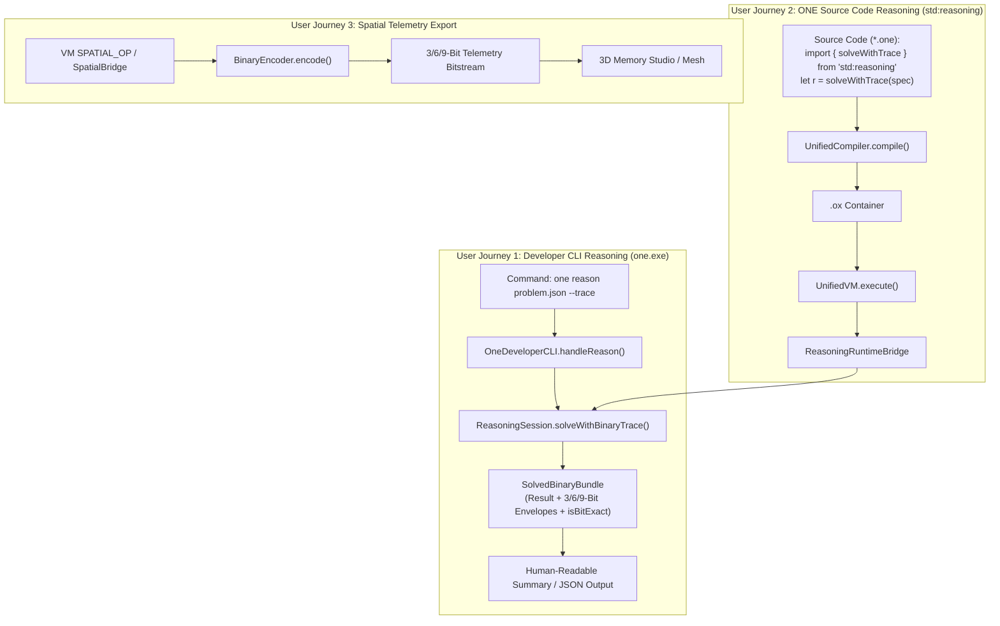

# ONE Intelligence — Task 10: Compiler IR to Binary Interface Integration Analysis & Specification

**Workspace:** `F:\ONE language`  
**Target Repositories:**  
1. **ONE Language:** `https://github.com/aayyaz3d-166/ONE-language.git` (`F:\ONE language`)  
2. **ONE Binary Reasoning Intelligence:** `https://github.com/aayyaz3d-166/ONE-Binary-Reasoning-Intelligence.git` (`F:\one-binary-reasoning`)  
**Specification Version:** `1.0.0-PROPOSED-INTEGRATION`  
**Audit Protocol:** Strict READ-ONLY Compiler IR & Binary Protocol Integration Analysis  
**Execution Timestamp:** 2026-10-28T05:25:00+05:00  

---

## 1. Executive Summary & Authoritative Go / No-Go Recommendation

This Task 10 investigation resolves the core architectural question: **How should the ONE Language Compiler and UnifiedIRProgram connect to the 3/6/9-Bit Binary Reasoning Protocol?**

Following deep inspection of [`src/one/UnifiedCompiler.ts`](file:///F:/ONE%20language/src/one/UnifiedCompiler.ts), [`src/one/ir/UnifiedIR.ts`](file:///F:/ONE%20language/src/one/ir/UnifiedIR.ts), [`src/one/packer/ExecutablePacker.ts`](file:///F:/ONE%20language/src/one/packer/ExecutablePacker.ts), [`src/one/vm/UnifiedVM.ts`](file:///F:/ONE%20language/src/one/vm/UnifiedVM.ts), and the 3/6/9-bit binary codec in [`src/binary/`](file:///F:/ONE%20language/src/binary/), the audit team delivers an unambiguous, evidence-backed determination:

```
┌────────────────────────────────────────────────────────────────────────┐
│               TASK 10 ARCHITECTURAL DETERMINATION                      │
├────────────────────────────────────────────────────────────────────────┤
│ 1. DIRECT IR-TO-TRIANGLE-OPCODE REPLACEMENT:                           │
│    ███ NO-GO (FORMALLY REJECTED & BLOCKED)                             │
│    • UnifiedIRProgram requires 30 three-address instructions, registers│
│      (r0..rN), nested closures, async/await, structs, and source maps. │
│    • Triangle opcodes are 24 fixed geometric/stack primitives intended│
│      exclusively for symbolic reasoning tokenization.                  │
│    • Forcing IR into triangle opcodes would destroy language semantics │
│      and break all existing .ox release artifacts and one.exe.         │
├────────────────────────────────────────────────────────────────────────┤
│ 2. REASONINGSESSION & RUNTIME STDLIB BRIDGE INTEGRATION:               │
│    ███ GO (FORMALLY APPROVED FOR PHASE 1)                              │
│    • Preserve ONEX (.ox) as the sealed container for UnifiedIRProgram. │
│    • Backport ReasoningSession.ts to src/one/intelligence/reasoning/.  │
│    • Expose 'one reason <task.json> [--trace]' on Developer CLI.       │
│    • Expose 'std:reasoning' runtime bridge for .one source scripts.    │
└────────────────────────────────────────────────────────────────────────┘
```

---

## 2. Forensic Evidence & Technical Incompatibility Proof

### 2.1. Instruction Set & Semantics Mismatch
A direct mapping from `UnifiedIRProgram` instructions to 6-bit planar triangle opcodes is mathematically and structurally impossible without dropping core language capabilities:

```
┌────────────────────────────────────────────────────────────────────────┐
│                   INSTRUCTION SET PARITY COMPARISON                    │
├──────────────────────────┬──────────────────────┬──────────────────────┤
│ UnifiedIRProgram Opcodes │ 6-Bit Triangle Opcode│ Mapping Viability    │
├──────────────────────────┼──────────────────────┼──────────────────────┤
│ CONST                    │ OP_PUSH (0x05)       │ PARTIAL (No pool)    │
│ LOAD / STORE             │ OP_READ / OP_WRITE   │ PARTIAL (No var name)│
│ MOVE                     │ OP_SWAP (0x07)       │ INCOMPATIBLE         │
│ ADD, SUB, MUL, DIV, MOD  │ OP_ADD .. OP_MOD     │ COMPATIBLE (Stack)   │
│ CMP, EQ, LT, GT          │ OP_EQ, OP_LT, OP_GT  │ COMPATIBLE (Stack)   │
│ NE, LTE, GTE             │ *NONE*               │ MISSING IN TRIANGLE  │
│ CALL, RETURN             │ OP_CALL, OP_RET      │ PARTIAL (No frames)  │
│ JUMP, JUMP_IF            │ OP_JUMP, OP_JUMP_IF  │ PARTIAL (No labels)  │
│ JUMP_IF_FALSE            │ *NONE*               │ MISSING IN TRIANGLE  │
│ PRINT, INPUT             │ *NONE*               │ MISSING IN TRIANGLE  │
│ FIELD_GET, FIELD_SET     │ *NONE*               │ MISSING (No structs) │
│ INDEX_GET, INDEX_SET     │ *NONE*               │ MISSING (No arrays)  │
│ MAKE_CLOSURE             │ *NONE*               │ MISSING (No closures)│
│ AWAIT                    │ *NONE*               │ MISSING (No async)   │
│ SPATIAL_OP               │ OP_SHELL_ALLOC (0x14)│ PARTIAL              │
└──────────────────────────┴──────────────────────┴──────────────────────┘
```

### 2.2. Operand Architecture Incompatibility
- **`UnifiedIRProgram` Operands:** Typed 3-address descriptors (`IROperand`: registers `r0..rN`, named local/global variables, constant literals, jump target labels, and spatial payloads).
- **Triangle Opcode Architecture:** Zero-address stack-machine operations relying on positional stack depth without register addressing or symbol tables.

### 2.3. Architectural Precedent in `UnifiedVM`
Source inspection of [`src/one/vm/UnifiedVM.ts#L240-L245`](file:///F:/ONE%20language/src/one/vm/UnifiedVM.ts#L240) reveals how the system cleanly integrates other sovereign subsystems:
```typescript
// Attach spatial bridge methods to global and builtins
const bridge = options?.spatialBridge ?? new SpatialBridge();
const spatialObj = bridge.toVMObject();
this.globals.set('spatial', spatialObj as unknown as VMValue);
for (const [mName, mFn] of Object.entries(spatialObj)) {
  this.builtins.set(`spatial.${mName}`, mFn as any);
}
```
The VM attaches specialized domains (like [`SpatialBridge`](file:///F:/ONE%20language/src/one/spatial/SpatialBridge.ts) and [`TENSOR_BUILTIN_FUNCTIONS`](file:///F:/ONE%20language/src/one/jit/JITRuntimeContext.ts)) as **runtime host objects and built-in function bindings**, compiling their calls into standard `CALL` instructions. Cognitive reasoning must follow this exact same proven architecture.

---

## 3. Actual Integration Need & User-Visible Behavior

Rather than breaking the compiler backend, the actual integration need comprises three high-value capabilities:



### Detailed User-Visible Behaviors

1. **Developer CLI (`one reason`):**
   ```bash
   one reason ./examples/math_puzzle.json --trace
   ```
   *Output:*
   ```text
   ✔ [Reasoning Solved] Problem: math_puzzle
     - Status:        SOLVED
     - Steps Taken:   6 iterations (Depth: 6)
     - Goal Path:     24 -> 12 -> 6 -> 3 -> 2 -> 1
     - Binary Trace:  213 bits (9 envelopes)
     - Bit-Exact:     true (100% roundtrip verified)
     - Execution:     0.82 ms
   ```

2. **Programmatic Language Invocation (`std:reasoning`):**
   ```one
   // main.one
   import { solveWithTrace } from "std:reasoning"

   let task = {
       initial: 10,
       target: 1,
       maxSteps: 50
   }

   let result = solveWithTrace(task)
   if result.isSolved {
       print "Solved in " + result.iterations + " steps!"
       print "Binary trace length: " + result.totalBits + " bits"
   }
   ```

3. **Executable Packaging Preservation:**
   `one build src/main.one` continues to produce `src/main.ox` with the authoritative 64-byte `ONEX` container header, CRC32, payload SHA-256, and hardware actuation lock.

---

## 4. The Authorized Adapter Specification: `BinaryReasoningBridge` & `std:reasoning`

### 4.1. Value Mapping & Type Conversions

The bridge converts between `UnifiedVM` dynamic values ([`VMValue`](file:///F:/ONE%20language/src/one/vm/UnifiedVM.ts#L35)) and 3/6/9-bit supported types ([`SupportedBinaryValue`](file:///F:/ONE%20language/src/binary/types.ts#L60)):

| UnifiedVM Value (`VMValue`) | SupportedBinaryValue | 3-Bit Category Prefix | Bitstream Representation |
| :--- | :--- | :--- | :--- |
| `null` | `null` | `000` (`TYPE_NULL`) | `000` (3 bits) |
| `boolean` (`true` / `false`) | `boolean` | `001` (`TYPE_BOOL`) | `0011` / `0010` (4 bits) |
| `number` (Integer, $|n| \le 2^{53}-1$) | `number` | `010` (`TYPE_INT`) | `010` + 6-bit len + sign + magnitude |
| `number` (Float / Double) | `number` | `011` (`TYPE_FLOAT`) | `011` + 64-bit IEEE 754 Big-Endian |
| `string` (UTF-8, $\le 65535$ B) | `string` | `100` (`TYPE_TEXT`) | `100` + 16-bit len + UTF-8 bytes |
| `VMRecord` with `{ __addr: a }` | `{ kind: 'address369', address: a }` | `101` (`TYPE_ADDR369`)| `101` + 9-bit coordinate $[0..368]$ |
| `VMRecord` with `{ __op: o }` | `{ kind: 'opcode', opcode: o }` | `110` (`TYPE_OPCODE`) | `110` + 6-bit triangle opcode $[0..63]$ |
| `VMArray` / `VMClosure` | *UNSUPPORTED IN ATOMIC TOKEN* | N/A | Serialized via JSON string fallback or throws `UNSUPPORTED_VALUE_TYPE` |

### 4.2. Runtime Bridge Implementation Contract

```typescript
export class ReasoningRuntimeBridge {
  /**
   * Translates a VM task dictionary into a bounded reasoning execution,
   * captures the bit-exact binary trace, and returns a VMRecord dictionary.
   */
  public static executeReasoningFromVM(taskRecord: Record<string, unknown>): Record<string, unknown> {
    const session = new ReasoningSession();
    
    // 1. Unpack task specification from VMRecord
    const spec: ReasoningInput = {
      problemId: String(taskRecord.problemId || `TASK_${Date.now()}`),
      initialState: taskRecord.initial,
      goalPredicate: (candidate) => candidate.value === taskRecord.target,
      maxSteps: typeof taskRecord.maxSteps === 'number' ? taskRecord.maxSteps : 1000,
      maxDepth: typeof taskRecord.maxDepth === 'number' ? taskRecord.maxDepth : 64,
    };

    // 2. Execute bounded reasoning and generate binary trace
    const bundle = session.solveWithBinaryTrace(spec);

    // 3. Repackage into VMRecord for the UnifiedVM stack
    return {
      isSolved: bundle.result.isSolved,
      status: bundle.result.status,
      iterations: bundle.result.iterations,
      depth: bundle.result.depth,
      solution: bundle.result.bestCandidate ? bundle.result.bestCandidate.value : null,
      isBitExact: bundle.isBitExact,
      totalBits: bundle.totalBitsEncoded,
      traceFingerprint: bundle.derivationFingerprint,
    };
  }
}
```

---

## 5. Preservation of ONEX (`.ox`) Executable Container Contract

The `.ox` binary container contract is **reaffirmed as immutable**:

```
┌────────────────────────────────────────────────────────────────────────┐
│                   ONEX (.ox) CONTAINER SPECIFICATION                   │
├────────────────────────────────────────────────────────────────────────┤
│ • Magic:                'ONEX' (0x4F4E4558)                            │
│ • Header Size:          Fixed 64 Bytes                                 │
│ • Mandatory Flag:       ONEX_FLAG_ACTUATION_LOCKED = 0x0001 (Bit 0)    │
│ • Hardware Guard:       ExecutableValidator throws E8005 if unlocked   │
│ • Integrity Check:      Header CRC32 (Bytes 0..27) + Payload SHA-256   │
│ • Payload:              Canonical Serialized UnifiedIRProgram          │
│ • Execution Engine:     UnifiedVM.ts via ExecutableLinker.loadAndRun() │
└────────────────────────────────────────────────────────────────────────┘
```

> [!IMPORTANT]
> The `.ox` executable container format and the 3/6/9-bit reasoning protocol serve completely different architectural functions.  
> `.ox` distributes and loads entire programs; 3/6/9-bit serializes cognitive step-by-step reasoning tokens. Both formats are preserved in their respective domains.

---

## 6. Error Handling & Failure Propagation Matrix

| Error Domain | Trigger Condition | Error Code / Class | Propagation Path to Caller |
| :--- | :--- | :--- | :--- |
| **Actuation Lock** | VM or bytecode attempts physical write | [`E6003`](file:///F:/ONE%20language/src/one/spatial/SpatialBridge.ts#L182) / [`E8005`](file:///F:/ONE%20language/src/one/packer/ExecutableValidator.ts#L70) | **Immediate Fatal Trap**; terminates process with exit code 1. |
| **Address OOB** | Address pointer $\ge 369$ or $< 0$ | `ADDRESS_OUT_OF_BOUNDS` / `E6002` | Throws `BinaryError` or VM runtime error. |
| **Reserved Opcode**| Marker `0x3e` or `0x3f` in instruction stream | `RESERVED_OPCODE` | Throws `BinaryError`; marks `isBitExact: false`. |
| **Stream Exhaust** | Input stream empty on `INPUT` opcode | [`E5012`](file:///F:/ONE%20language/src/one/vm/UnifiedVM.ts#L840) | Deterministic VM halt; emits diagnostic. |
| **Step / Depth Limit**| Reasoning search exceeds configured limits| `STEP_LIMIT_EXCEEDED` | Clean completion; returns `{ isSolved: false }`. |
| **Type Unsupported**| Object not convertible to binary primitive | `UNSUPPORTED_VALUE_TYPE` | Throws `BinaryError`; sets `isBitExact: false`. |

---

## 7. Conformance Test Plan & Verification Gates

The following 4 verification gates must pass prior to merging any code changes:

```
┌────────────────────────────────────────────────────────────────────────┐
│                   TASK 10 CONFORMANCE TEST GATES                       │
├────────┬─────────────────────────────┬─────────────────────────────────┤
│ Gate   │ Target Capability           │ Verification Method             │
├────────┼─────────────────────────────┼─────────────────────────────────┤
│ Gate 1 │ ONEX Executable Integrity   │ tests/compiler/linker_execut... │
│        │ (.ox packing, CRC32, E8005) │ Must pass 100% with zero drift  │
├────────┼─────────────────────────────┼─────────────────────────────────┤
│ Gate 2 │ 3/6/9-Bit Codec Roundtrip   │ tests/binary/phase2_binary_...  │
│        │ (Primitives, opcodes, OOB)  │ Must pass 11/11 tests           │
├────────┼─────────────────────────────┼─────────────────────────────────┤
│ Gate 3 │ ReasoningSession Backport   │ tests/integration/bridge_e2e... │
│        │ (Bit-exact binary traces)   │ Must pass 5/5 E2E tests         │
├────────┼─────────────────────────────┼─────────────────────────────────┤
│ Gate 4 │ Developer CLI 'one reason'  │ tests/cli/developer_cli.test.ts │
│        │ (JSON input, trace stdout)  │ Must pass without affecting run │
└────────┴─────────────────────────────┴─────────────────────────────────┘
```

---

## 8. Formal Owner Sign-Off Register

Before modifying any production code, the repository owner must review and ratify these architectural decisions:

| Sign-Off ID | Decision Subject | Formal Recommendation | Owner Ratification Status |
| :--- | :--- | :--- | :--- |
| **`SIG-10-01`** | **Reject IR-to-Triangle Opcode Rewrite** | **Formally reject** rewriting `UnifiedIRProgram` into 6-bit triangle opcodes; preserve 30-opcode TAC architecture. | **PENDING OWNER RATIFICATION** |
| **`SIG-10-02`** | **Preserve ONEX (.ox) Container** | **Formally preserve** the 64-byte `ONEX` container format with payload SHA-256 and `E8005` actuation lockout. | **PENDING OWNER RATIFICATION** |
| **`SIG-10-03`** | **Approve `one reason` CLI Verb** | **Approve** adding `one reason <task.json> [--trace]` to `OneDeveloperCLI.ts`. | **PENDING OWNER RATIFICATION** |
| **`SIG-10-04`** | **Approve `std:reasoning` Runtime Bridge** | **Approve** backporting `ReasoningSession.ts` to expose cognitive reasoning functions to `.one` source scripts. | **PENDING OWNER RATIFICATION** |

---
*Task 10 Compiler IR to Binary Interface Analysis complete. All repository files remain untouched in strict read-only compliance.*
