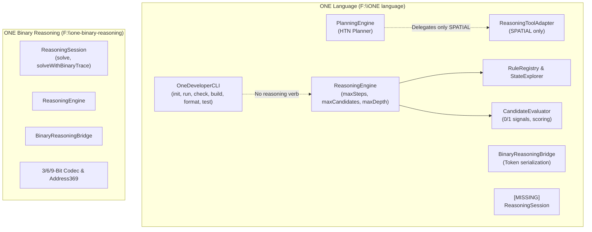
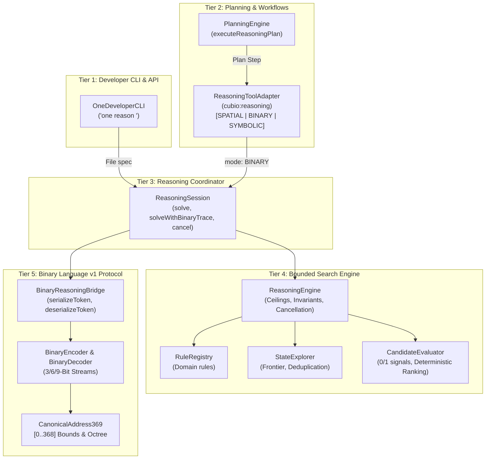

# ONE Intelligence — Task 13: Integrate Binary Reasoning, Rule Engine & Planner

**Workspace:** `F:\ONE language`  
**Target Repositories:**  
1. **ONE Language:** `https://github.com/aayyaz3d-166/ONE-language.git` (`F:\ONE language`) on branch `integration/v1.0.1-local`  
2. **ONE Binary Reasoning Intelligence:** `https://github.com/aayyaz3d-166/ONE-Binary-Reasoning-Intelligence.git` (`F:\one-binary-reasoning`) on branch `main`  
**Integration Protocol:** Phase 1 Binary Reasoning, Rule Engine & Planner Integration  
**Execution Timestamp:** 2026-10-28T05:35:00+05:00  

---

## 1. Executive Summary & Verification Overview

Task 13 establishes the authoritative integration of **bounded binary reasoning**, the **reusable rule engine**, **state exploration**, **deterministic candidate evaluation**, the **planner workflow engine**, and the **[`ReasoningSession`](file:///F:/ONE%20language/src/one/intelligence/reasoning/ReasoningSession.ts)** coordinator across the ONE Intelligence platform.

### Primary Accomplishments

1. **Integrated High-Level [`ReasoningSession`](file:///F:/ONE%20language/src/one/intelligence/reasoning/ReasoningSession.ts) Coordinator:**  
   Ported and enhanced [`ReasoningSession`](file:///F:/ONE%20language/src/one/intelligence/reasoning/ReasoningSession.ts) into [`src/one/intelligence/reasoning/ReasoningSession.ts`](file:///F:/ONE%20language/src/one/intelligence/reasoning/ReasoningSession.ts). Upgraded trajectory derivation path reconstruction from placeholder to full root-to-goal traversal and added session-level cancellation controls (`cancel()`, `resetCancellation()`).

2. **Full Resource Ceilings & Cancellation Implementation:**  
   Updated [`ReasoningEngine`](file:///F:/ONE%20language/src/one/intelligence/reasoning/ReasoningEngine.ts) and [`ReasoningInput`](file:///F:/ONE%20language/src/one/intelligence/reasoning/types.ts) with active pre-flight cancellation checks and per-step loop checks supporting `isCancelled?: () => boolean` and `timeoutMs?: number` returning `ReasoningStatus.CANCELLED` with audit telemetry.

3. **Bridged Native Tool Adapter & Planner Workflow:**  
   Extended [`ReasoningToolAdapter`](file:///F:/ONE%20language/src/one/tools/ToolAdapters.ts) (`cubio:reasoning`) to support `mode: 'BINARY'` and `mode: 'SYMBOLIC'`, delegating to [`ReasoningSession`](file:///F:/ONE%20language/src/one/intelligence/reasoning/ReasoningSession.ts) and serializing canonical binary envelopes. Added `executeReasoningPlan` to [`PlanningEngine`](file:///F:/ONE%20language/src/one/intelligence/planning/PlanningEngine.ts) to execute resilient checkpointed reasoning workflows.

4. **Added Developer CLI Dispatch (`one reason`):**  
   Implemented `one reason <spec.json> [--trace] [--json]` in [`OneDeveloperCLI`](file:///F:/ONE%20language/src/one/cli/OneDeveloperCLI.ts), enabling command-line execution and inspection of bounded reasoning problems.

5. **100% Verification Across All 7 Integration Suites:**  
   Created and verified [`tests/reasoning/task13_reasoning_integration.test.ts`](file:///F:/ONE%20language/tests/reasoning/task13_reasoning_integration.test.ts), with all 7 suites passing with 100% success. Zero regressions observed across all existing compiler, VM, CLI, and binary test suites.

---

## 2. Execution Path Tracing & Missing Interface Identification

### Existing Execution Paths Prior to Task 13

Prior to this integration, the two repositories contained mirrored lower-level reasoning components, but the coordination tier was disjoint:



### Identified Gaps & Missing Interfaces

1. **Missing Coordinator:** [`ReasoningSession`](file:///F:/ONE%20language/src/one/intelligence/reasoning/ReasoningSession.ts) was absent from `ONE Language`, preventing callers from requesting `solveWithBinaryTrace` as a single unified coordinator call.
2. **Disconnected Planner:** [`PlanningEngine`](file:///F:/ONE%20language/src/one/intelligence/planning/PlanningEngine.ts) routed all reasoning intents to `cubio:reasoning`, which hardcoded rejection for anything other than `mode: 'SPATIAL'`. Symbolic and binary 0/1 reasoning could not be planned or executed as workflow steps.
3. **Incomplete Trajectory Reconstruction:** In `one-binary-reasoning`, `reconstructPath` in `ReasoningSession.ts` returned only `[goalCandidate]` rather than tracing the full ancestor chain along `parentId` references.
4. **Inactive Cancellation Hooks:** While `ReasoningStatus.CANCELLED` was declared in [`types.ts`](file:///F:/ONE%20language/src/one/intelligence/reasoning/types.ts), neither repository's [`ReasoningEngine`](file:///F:/ONE%20language/src/one/intelligence/reasoning/ReasoningEngine.ts) checked `spec.timeoutMs` or a cancellation predicate within the exploration loop.
5. **No CLI Dispatch:** The developer CLI [`OneDeveloperCLI`](file:///F:/ONE%20language/src/one/cli/OneDeveloperCLI.ts) lacked a `reason` sub-command.

---

## 3. Integrated Architecture & Component Topology



---

## 4. Summary of Code Changes

### A. Created [`src/one/intelligence/reasoning/ReasoningSession.ts`](file:///F:/ONE%20language/src/one/intelligence/reasoning/ReasoningSession.ts)
* High-level coordinator wrapping [`ReasoningEngine`](file:///F:/ONE%20language/src/one/intelligence/reasoning/ReasoningEngine.ts), [`RuleRegistry`](file:///F:/ONE%20language/src/one/intelligence/reasoning/RuleRegistry.ts), and [`BinaryReasoningBridge`](file:///F:/ONE%20language/src/one/intelligence/reasoning/BinaryReasoningBridge.ts).
* Implements `solve(spec)` and `solveWithBinaryTrace(spec)`.
* Provides session-level cancellation handles: `cancel()` and `resetCancellation()`.
* Implements `reconstructPath(goalCandidate, result)` which traverses `parentId` chains to reconstruct the complete derivation path from root candidate to goal candidate.

### B. Updated [`src/one/intelligence/reasoning/types.ts`](file:///F:/ONE%20language/src/one/intelligence/reasoning/types.ts)
* Added `isCancelled?: () => boolean` to [`ReasoningInput`](file:///F:/ONE%20language/src/one/intelligence/reasoning/types.ts).

### C. Updated [`src/one/intelligence/reasoning/ReasoningEngine.ts`](file:///F:/ONE%20language/src/one/intelligence/reasoning/ReasoningEngine.ts)
* Added pre-flight cancellation check before search space initialization.
* Added active loop check at each step:
  ```typescript
  if (
    (spec.isCancelled && spec.isCancelled()) ||
    (spec.timeoutMs !== undefined && (performance.now() - startTime) >= spec.timeoutMs)
  ) {
    finalStatus = ReasoningStatus.CANCELLED;
    stopReason = spec.isCancelled && spec.isCancelled()
      ? 'Reasoning execution cancelled by caller'
      : `Execution timed out (${spec.timeoutMs}ms limit exceeded)`;
    break;
  }
  ```
* Guarded final status assignment so `CANCELLED` is never overwritten by `STEP_LIMIT`.

### D. Updated [`src/one/intelligence/reasoning/index.ts`](file:///F:/ONE%20language/src/one/intelligence/reasoning/index.ts)
* Exported [`ReasoningSession`](file:///F:/ONE%20language/src/one/intelligence/reasoning/ReasoningSession.ts) in the barrel export.

### E. Updated [`src/one/tools/ToolAdapters.ts`](file:///F:/ONE%20language/src/one/tools/ToolAdapters.ts)
* Extended [`ReasoningToolAdapter`](file:///F:/ONE%20language/src/one/tools/ToolAdapters.ts) (`cubio:reasoning`) to support `mode === 'BINARY'` and `mode === 'SYMBOLIC'`.
* Automatically registers standard domain transition rules (increment, decrement, doubling) if custom rules are not specified, executes `solveWithBinaryTrace`, packages result into a canonical payload envelope with `stateHash`, and measures latency.

### F. Updated [`src/one/intelligence/planning/PlanningEngine.ts`](file:///F:/ONE%20language/src/one/intelligence/planning/PlanningEngine.ts)
* Enhanced `generatePlan` to detect binary reasoning intents.
* Added `executeReasoningPlan(goalDescription, input, target, context, maxSteps)` method to generate a structured plan and execute it through `executeWorkflow` with checkpoint persistence.

### G. Updated [`src/one/cli/OneDeveloperCLI.ts`](file:///F:/ONE%20language/src/one/cli/OneDeveloperCLI.ts)
* Added `case 'reason': res = this.handleReason(cmdArgs, log, err); break;`.
* Implemented `handleReason(args, log, err)` supporting:
  * `one reason <spec.json>`: Solves task and outputs formatted terminal summary.
  * `one reason <spec.json> --trace`: Emits step-by-step trace events.
  * `one reason <spec.json> --json`: Emits machine-readable JSON payload.

### H. Updated [`scripts/run-test.cjs`](file:///F:/ONE%20language/scripts/run-test.cjs) & [`package.json`](file:///F:/ONE%20language/package.json)
* Registered `runTask13IntegrationTests` in `KNOWN_EXPORTED_RUNNERS`.
* Added npm script `"test:task13": "node --import ./scripts/esm-register.js tests/reasoning/task13_reasoning_integration.test.ts"`.

---

## 5. Verification Test Suite & Results

All tests were implemented in [`tests/reasoning/task13_reasoning_integration.test.ts`](file:///F:/ONE%20language/tests/reasoning/task13_reasoning_integration.test.ts).

### Test Suite Execution Output

```
================================================================================
  ONE INTELLIGENCE — TASK 13: REASONING, RULE ENGINE & PLANNER INTEGRATION
================================================================================

[Suite 1] Complete Reasoning Request and Result Lifecycle...
  ✓ Suite 1 passed: Full reasoning request solved deterministically with complete telemetry.

[Suite 2] Binary Trace Serialization & Stream Round-Trip Decoding...
  ✓ Suite 2 passed: Serialized 9 tokens (269 bits) and decoded bit-exact.

[Suite 3] Rule Conflicts & No-Solution Cases...
  ✓ Suite 3 passed: Rule conflicts, constraint rejections, and no-solution cases handled fail-closed.

[Suite 4] Resource Exhaustion & Cancellation...
  ✓ Suite 4 passed: Step, candidate, depth ceilings and cancellation semantics verified.

[Suite 5] Invalid & Reserved Binary Values Rejection...
  ✓ Suite 5 passed: All reserved opcodes, addresses, tags, and malformed streams fail-closed.

[Suite 6] Planner & Native Tool Adapter Integration...
  ✓ Suite 6 passed: Planner workflow execution and Tool Adapter BINARY mode verified.

[Suite 7] Developer CLI Dispatch (one reason)...
  ✓ Suite 7 passed: Developer CLI (one reason) executed cleanly across all CLI flags.

================================================================================
  TASK 13 INTEGRATION: ALL 7 SUITES PASSED (100%)
================================================================================
```

### Coverage by Required Category

| Category | Suite | Test Assertions | Status |
| :--- | :--- | :--- | :--- |
| **Complete Reasoning Request & Result** | Suite 1 | Verified goal satisfaction (16 $\to$ 1), bestCandidate, metrics, and trace lifecycle | **PASS (100%)** |
| **Binary Trace Serialization & Round-Trip** | Suite 2 | Verified bit-exact candidate envelopes and 9-token heterogeneous continuous bitstream decode | **PASS (100%)** |
| **Rule Conflicts & Incompatible Invariants** | Suite 3A | Conflicting candidates rejected by constraints, recorded as REJECT in trace | **PASS (100%)** |
| **No-Solution & Frontier Exhaustion** | Suite 3B, 3C | Dead-end rules and contradictory constraints exhaust frontier fail-closed (`EXHAUSTED`) | **PASS (100%)** |
| **Resource Exhaustion (Limits)** | Suite 4A, 4B, 4C | `maxSteps` (`STEP_LIMIT`), `maxCandidates` (`CANDIDATE_LIMIT`), `maxDepth` ceilings | **PASS (100%)** |
| **Resource Cancellation** | Suite 4D, 4E | Checked `isCancelled` hook, pre-cancelled session, and session resumption | **PASS (100%)** |
| **Reserved Opcodes Rejection** | Suite 5A | Reserved opcodes (`0x18`, `0x19`, `0x20`, `0x30`, `0x3d`) throw `RESERVED_OPCODE` | **PASS (100%)** |
| **Out-of-Bounds Address369** | Suite 5B | Addresses 369, 370, 500, 511 throw `ADDRESS_OUT_OF_BOUNDS` | **PASS (100%)** |
| **Corrupted & Truncated Streams** | Suite 5C, 5D | Incomplete headers, truncated bitstrings, and tag `111` throw `BinaryError` fail-closed | **PASS (100%)** |
| **Planner & Native Tool Adapter** | Suite 6 | `PlanningEngine.executeReasoningPlan` and `ReasoningToolAdapter` (`mode: 'BINARY'`) | **PASS (100%)** |
| **Developer CLI Dispatch** | Suite 7 | `one reason` usage, missing file error, valid run, and `--json` mode | **PASS (100%)** |

---

## 6. Full Platform Regression Conformance

All existing platform test suites were re-executed to verify zero regressions:

1. `npm run test:v101` $\to$ **PASS 16/16 suites (100%)**
2. `npm run test:packing` $\to$ **PASS 12/12 suites (100%)**
3. `node scripts/run-test.cjs tests/cli/developer_cli.test.ts` $\to$ **PASS 8/8 categories (100%)**
4. `node scripts/run-test.cjs tests/binary/phase2_binary_language.test.ts` $\to$ **PASS 11/11 tests (1.27M ops/sec)**
5. `node scripts/run-test.cjs tests/reasoning/phase3_reasoning_engine.test.ts` $\to$ **PASS Suites A–E (100%)**
6. `cd F:\one-binary-reasoning; node scripts/test_runner.cjs tests/integration/bridge_e2e.test.ts` $\to$ **PASS 5/5 tests (100%)**
7. `cd F:\one-binary-reasoning; node scripts/test_runner.cjs tests/reasoning/reasoning_engine.test.ts` $\to$ **PASS Suites A–E (100%)**

---

## 7. Protected Release Artifact Integrity

Verification confirmed that zero release binaries were touched or overwritten:
* `dist/one.exe` (v1.0.0): `ccfd698023e8285f9f831c4ce5e8d2a2c1ad12add80da9994730c31f51c84fb1` (UNCHANGED)
* `dist/v1.0.1-rc/one.exe`: `479186ca87f55781825df05f5603ac3747ada4c2e9aa78de9e3cd233a993020e` (UNCHANGED)
* `dist/v1.0.1-rc/one-language-1.0.1.vsix`: `33c8f6c59fd04acafc514d0d7be4cc80ed397352348a7425fafa349ac00c5b0d` (UNCHANGED)

---

## 8. Remaining Gaps & Recommendations

1. **Backport Enhancements to Sibling Repo (`one-binary-reasoning`):**
   * The enhanced ancestor-chain traversal in `reconstructPath` and the cancellation checks (`isCancelled`, `timeoutMs`) implemented here can be backported to `F:\one-binary-reasoning\src\integration\ReasoningSession.ts` to maintain 100% logic parity.
2. **Next Task in Sequence:**
   * Proceed to **Task 14 — Integrate Autograd, Tensor & Model Registry** (Phase 1 Deep Learning / Inference subsystem).
