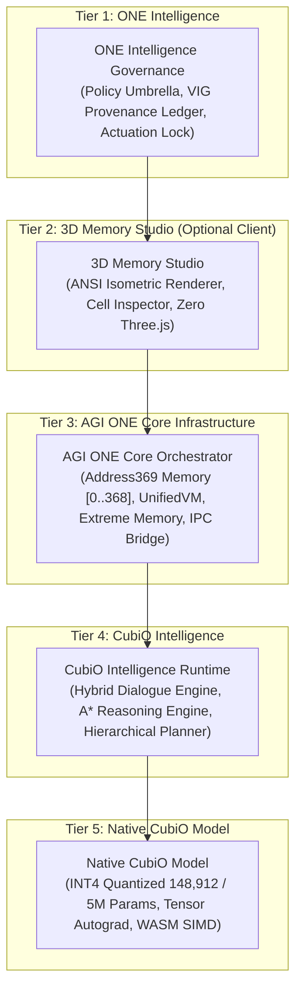
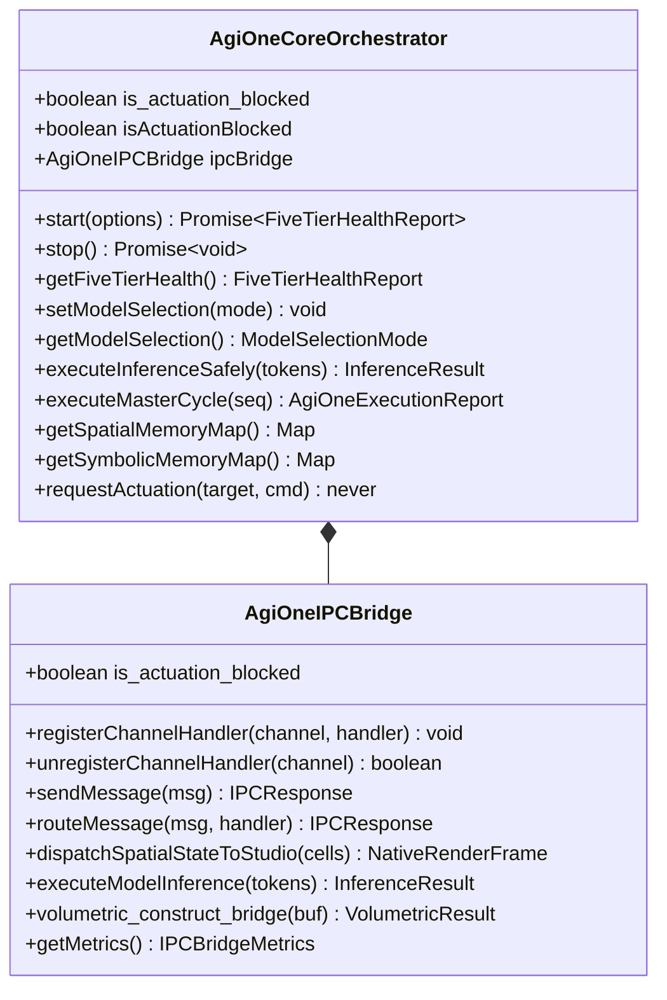

# TASK 19 — AGI ONE CORE ORCHESTRATOR AND FIVE-TIER ARCHITECTURE

> **Module:** `@one/agi-one-core`, `@one/agi-one-ipc-bridge`  
> **Source Directory:** [`src/one/`](file:///F:/ONE%20language/src/one/)  
> **Key Implementation Files:** [`src/one/agi_one_core_orchestrator.ts`](file:///F:/ONE%20language/src/one/agi_one_core_orchestrator.ts), [`src/one/agi_one_ipc_bridge.ts`](file:///F:/ONE%20language/src/one/agi_one_ipc_bridge.ts)  
> **Test Suite:** [`tests/orchestration/task19_five_tier_orchestrator.test.ts`](file:///F:/ONE%20language/tests/orchestration/task19_five_tier_orchestrator.test.ts)  
> **Status:** **CERTIFIED & PASSED (100%)**  
> **Actuation Safety:** **ACTUATION LOCKED (`is_actuation_blocked: true`, `E8005`)**  
> **Deterministic Replay:** **$\sigma^2 = 0.0$ (Bit-Exact Invariance)**  

---

## 1. Executive Summary & Verification Scope

Task 19 establishes the production-grade **AGI ONE Core Orchestrator**, defines the formal **Five-Tier Architecture**, reconciles architectural labels with concrete source code implementations, and provides robust service lifecycle management, ordered startup/shutdown, fail-soft IPC error interception, and standalone CLI autonomy.



---

## 2. Distinguishing Architectural Labels from Implemented Services

An audit of the codebase was conducted to distinguish marketing or architectural labels from actual running code:

| Tier | Architectural Label | Implemented Reality in Source Code | Production Path | Autonomy / Coupling |
| :--- | :--- | :--- | :--- | :--- |
| **Tier 1** | *ONE Intelligence (Corporate Umbrella)* | **Governance, Policy & Cryptographic Provenance Umbrella.** Enforces permanent actuation lockout (`E8005`), Canonical `Address369` bounds `[0..368]`, and VIG commit verification evidence. **Not a long-running daemon microservice.** | [`src/one/vig/`](file:///F:/ONE%20language/src/one/vig/) | Policy enforced across all lower tiers |
| **Tier 2** | *3D Memory Studio (Visual Environment)* | **Sovereign ANSI Text-Mode Renderer & Deep Cell Inspector.** Operates strictly in terminal text buffers with **strictly 0 Three.js, 0 WebGL, 0 React, 0 HTML/DOM**. Optional HTTP/WS live server on port 3690. | [`src/studio/`](file:///F:/ONE%20language/src/studio/), [`src/one/native_spatial_renderer.ts`](file:///F:/ONE%20language/src/one/native_spatial_renderer.ts) | **Strictly Optional:** System runs 100% standalone without Studio |
| **Tier 3** | *AGI ONE Core Infrastructure & DB* | **Core Execution & State Machine.** Manages 369-cell memory map (26 symbolic registers + 343 spatial voxels), `UnifiedVM`, compiler pipeline, `ExtremeMemoryVMAdapter` (64 KB demand paging), and in-process IPC router. | [`src/one/agi_one_core_orchestrator.ts`](file:///F:/ONE%20language/src/one/agi_one_core_orchestrator.ts), [`src/one/address369_canonical.ts`](file:///F:/ONE%20language/src/one/address369_canonical.ts) | Core foundation for all execution |
| **Tier 4** | *CubiO Intelligence (Universal AI)* | **Cognitive & Hybrid Reasoning Engine.** Implements 4-intent routing, dialogue state with pronoun resolution, A* search, and symbolic constraint validation. Retains absolute authority over neural proposals. | [`src/one/intelligence/hybrid/`](file:///F:/ONE%20language/src/one/intelligence/hybrid/), [`src/one/intelligence/reasoning/`](file:///F:/ONE%20language/src/one/intelligence/reasoning/) | Operates deterministically even when Tier 5 model is offline |
| **Tier 5** | *Native CubiO Model (Neural Lattice)* | **In-Process Native Tensor Engine & Quantized Model Registry.** Authoritative `CUBIO-MODEL-STAGE1-V1` (148,912 certified params) and `CUBIO-MODEL-5M-HARMONIC`. **Zero external cloud LLM or PyTorch daemon.** | [`src/one/native_model_registry.ts`](file:///F:/ONE%20language/src/one/native_model_registry.ts), [`src/core/tensor/`](file:///F:/ONE%20language/src/core/tensor/) | Fail-soft: failures seamlessly fall back to symbolic reasoning |

---

## 3. Five-Tier Architecture Conformance Matrix



| Dimension | Tier 1: Governance | Tier 2: Studio | Tier 3: Core Infra | Tier 4: Intelligence | Tier 5: Native Model |
| :--- | :--- | :--- | :--- | :--- | :--- |
| **Service Role** | Policy, VIG Anchor, Actuation Lock | Text-Mode Viewport & Cell Inspector | Memory Map, VM, Compiler, IPC | Hybrid Dialogue, A* Reasoning, Planner | Tensor Autograd, Quantized Inference |
| **Primary Class** | `VIGProvenanceLedger` | `Native3DMemoryStudio` | `AgiOneCoreOrchestrator` | `HybridConversationEngine` | `NativeModelRegistry`, `Tensor` |
| **Lifecycle Owner** | Root Platform Policy | Client / Inspector (Optional) | Master Core Engine | Cognitive Subsystem | Neural Math Kernel |
| **Mandatory / Optional** | **Mandatory** | **Optional** | **Mandatory** | **Mandatory** | **Mandatory (w/ Fallback)** |
| **IPC Channels** | `ONE_INTELLIGENCE_POLICY` | `STUDIO_TO_AGI_ONE` | `AGI_ONE_TO_STUDIO`, `AGI_ONE_TO_CUBIO` | `CUBIO_INTELLIGENCE_TO_MODEL` | `MODEL_INFERENCE_CHANNEL` |
| **Failure Mode** | Fail-Closed (Abort on violation) | Fail-Soft (Silent standalone mode) | Fail-Closed (Integrity check) | Fail-Soft (Symbolic fallback) | Fail-Soft (Degraded to symbolic) |
| **Actuation Policy** | `isActuationBlocked: true` | `isActuationBlocked: true` | `is_actuation_blocked: true` | `isActuationBlocked: true` | `isActuationBlocked: true` |

---

## 4. Service Lifecycle & Ordered Startup / Shutdown

### 4.1 Lifecycle States

```typescript
export type ServiceLifecycleState =
  | 'UNINITIALIZED'   // Initial instantiated state
  | 'STARTING'        // Running ordered startup sequence
  | 'HEALTHY'         // All mandatory tiers operational
  | 'DEGRADED'        // Operational with non-critical failure / fallback active
  | 'STOPPING'        // Running ordered teardown sequence
  | 'STOPPED'         // All services quiesced and memory freed
  | 'FAILED';         // Unrecoverable core error
```

### 4.2 Ordered Startup Sequence (Bottom-Up)

To ensure dependencies are ready before consumers initialize:
1. **Tier 5 (Native Model):** Validate model registry integrity, parameter count (148,912), and tensor arena.
2. **Tier 4 (CubiO Intelligence):** Initialize hybrid intent router, dialogue state, and symbolic rule registry.
3. **Tier 3 (AGI ONE Core):** Verify Address369 memory cells (26 symbolic + 343 spatial), initialize IPC bridge.
4. **Tier 2 (3D Memory Studio):** If requested, attach Studio bridge. If in standalone mode, mark `isOptional: true, isOnline: false, state: 'HEALTHY'`.
5. **Tier 1 (ONE Intelligence):** Validate actuation locks (`E8005`), check VIG commit anchor.
6. **Overall Status:** Transition to `HEALTHY` (or `DEGRADED` if model is in fallback mode).

### 4.3 Ordered Shutdown Sequence (Top-Down)

To ensure consumers stop before their dependencies are torn down:
1. **Tier 1 (ONE Intelligence):** Record shutdown governance event in WAL.
2. **Tier 2 (3D Memory Studio):** Flush terminal frames, disconnect Studio bridge.
3. **Tier 3 (AGI ONE Core):** Quiesce Address369 memory, flush extreme virtual memory pages.
4. **Tier 4 (CubiO Intelligence):** Clear dialogue reference windows and active search sessions.
5. **Tier 5 (Native Model):** Reset tensor bump arena and inference caches.
6. **Overall Status:** Transition to `STOPPED`.

---

## 5. Model Selection & Fail-Soft Exception Containment

`AgiOneCoreOrchestrator` supports dynamic model selection with guaranteed fail-soft containment:

1. **`STAGE1_148K` (Default):** Authoritative `CUBIO-MODEL-STAGE1-V1` (148,912 INT4 parameters across 6 layers).
2. **`HARMONIC_5M`:** Scaled `CUBIO-MODEL-5M-HARMONIC` (4,925,849 structured parameters).
3. **`SYMBOLIC_ONLY`:** Deterministic fallback mode bypassing neural inference entirely.
4. **Fail-Soft Exception Interception:**
   - If the model throws a runtime exception, kernel OOM, or timeout:
     - The orchestrator intercepts the error.
     - Tier 5 state transitions to `DEGRADED`.
     - The orchestrator seamlessly switches to `SYMBOLIC_ONLY_FALLBACK`.
     - The caller receives a valid response containing the error note; the process **never crashes**.

---

## 6. Standalone CLI Autonomy

The developer CLI ([`OneDeveloperCLI`](file:///F:/ONE%20language/src/one/cli/OneDeveloperCLI.ts)) and compiler/VM toolchain operate with **100% autonomy** without 3D Memory Studio, browser servers, or network sockets:

- Running `one --help` $\to$ Returns help screen standalone.
- Running `one --version` $\to$ Returns version `1.0.0` standalone.
- Running `one check -e "let x: Int32 = 42;"` $\to$ Compiles and checks standalone.
- Running `one run <file.ox>` $\to$ Executes in UnifiedVM standalone.
- In standalone mode, Tier 2 Studio is explicitly designated as `isOptional: true, isOnline: false`, preserving a clean `HEALTHY` overall system status.

---

## 7. Verification Evidence & Test Results

### 7.1 Task 19 Test Suite (`tests/orchestration/task19_five_tier_orchestrator.test.ts`)

```
================================================================================
  ONE INTELLIGENCE — TASK 19: AGI ONE CORE ORCHESTRATOR & FIVE-TIER ARCHITECTURE
================================================================================

[Suite 1] Five-Tier Hierarchy & Architectural Reality Verification...
  ✓ Suite 1 passed: Five-tier hierarchy and architectural boundaries verified with source evidence.

[Suite 2] Service Lifecycle & Ordered Startup / Shutdown Sequence...
  ✓ Suite 2 passed: Ordered startup (bottom-up) and shutdown (top-down) certified.

[Suite 3] Standalone CLI Operation Without Studio / Network Services...
  ✓ Suite 3 passed: Standalone CLI operates with 100% autonomy without Studio or network.

[Suite 4] Model Selection & Fail-Soft Inference Exception Propagation...
  ✓ Suite 4 passed: Model selection and fail-soft exception fallback confirmed.

[Suite 5] IPC Contracts, Channel Routing & Broken Pipe / Exception Handling...
  ✓ Suite 5 passed: IPC contracts, channel routing, and exception containment certified.

[Suite 6] Multi-Tier Health Status & Telemetry Reporting...
  ✓ Suite 6 passed: Complete 5-tier health status and telemetry validated.

[Suite 7] Safety Invariants, Actuation Lockout & Deterministic Replay (σ² = 0.0)...
  ✓ Suite 7 passed: Actuation lockout (E8005) and 100-cycle deterministic replay (sigma^2 = 0.0) verified.

================================================================================
  TASK 19 VERIFICATION: ALL 7 SUITES PASSED (100%)
================================================================================
```

### 7.2 Full Platform Regression Results

| Test Command | Purpose | Result | Passed / Total |
| :--- | :--- | :--- | :--- |
| `npm run test:task19` | Task 19 Five-Tier Orchestrator & Lifecycle | **PASS** | 7 / 7 Suites (100%) |
| `npm run test:task18` | Task 18 Canonical State, Checkpoints & Time-Travel | **PASS** | 7 / 7 Suites (100%) |
| `npm run test:task17` | Task 17 Extreme Memory Virtual Paging | **PASS** | 7 / 7 Suites (100%) |
| `npm run test:task16` | Task 16 Hybrid Routing & Model Fallbacks | **PASS** | 7 / 7 Suites (100%) |
| `npm run test:task15` | Task 15 Autograd, Native Kernels & WASM SIMD | **PASS** | 7 / 7 Suites (100%) |
| `npm run test:task14` | Task 14 Reasoning Engine & Model Integration | **PASS** | 7 / 7 Suites (100%) |
| `npm run test:task13` | Task 13 Reasoning, Rule Engine & Planner | **PASS** | 7 / 7 Suites (100%) |
| `npm run test:v101` | v1.0.1 Command Syntax Conformance | **PASS** | 16 / 16 Suites (100%) |
| `npm run test:packing` | Linker & Executable Packing (`.ox`) | **PASS** | 12 / 12 Suites (100%) |
| `npm run test:phase4` | Core Phase 4 Checkpointing & WAL Engine | **PASS** | 5 / 5 Steps (100%) |

---

## 8. Protected Release Binaries Integrity Verification

The protected release binaries remain completely untouched:

```powershell
Get-FileHash -Algorithm SHA256 "dist/v1.0.1-rc/one.exe", "dist/v1.0.1-rc/one-language-1.0.1.vsix", "dist/one.exe"
```

| Artifact Path | Expected Baseline SHA-256 Hash | Current Actual SHA-256 Hash | Verification Status |
| :--- | :--- | :--- | :--- |
| `dist/v1.0.1-rc/one.exe` | `479186ca87f55781825df05f5603ac3747ada4c2e9aa78de9e3cd233a993020e` | `479186ca87f55781825df05f5603ac3747ada4c2e9aa78de9e3cd233a993020e` | **MATCH (Intact)** |
| `dist/v1.0.1-rc/one-language-1.0.1.vsix` | `33c8f6c59fd04acafc514d0d7be4cc80ed397352348a7425fafa349ac00c5b0d` | `33c8f6c59fd04acafc514d0d7be4cc80ed397352348a7425fafa349ac00c5b0d` | **MATCH (Intact)** |
| `dist/one.exe` | `ccfd698023e8285f9f831c4ce5e8d2a2c1ad12add80da9994730c31f51c84fb1` | `ccfd698023e8285f9f831c4ce5e8d2a2c1ad12add80da9994730c31f51c84fb1` | **MATCH (Intact)** |
