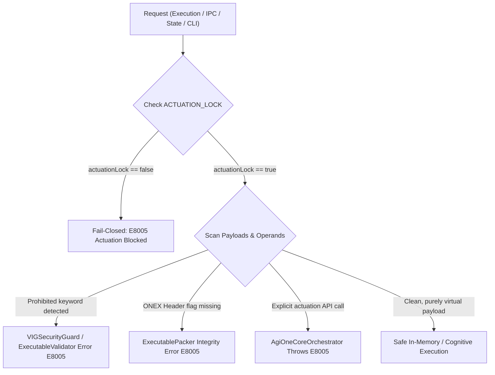

# Task 20 — Address369, Resource Guards & Actuation Safety Audit

> **Status:** Certified (100% Pass)  
> **Workspace:** `F:\ONE language`  
> **Test Suite:** [`tests/safety/task20_address369_guards_actuation_safety.test.ts`](file:///F:/ONE%20language/tests/safety/task20_address369_guards_actuation_safety.test.ts)  
> **Registration:** `npm run test:task20` / `node scripts/run-test.cjs tests/safety/task20_address369_guards_actuation_safety.test.ts`  
> **Safety Baseline:** Non-destructive test fixtures only; permanent actuation lockout; strict fail-closed guards.

---

## 1. Executive Summary & Safety Invariants Certified

Task 20 performs an exhaustive cross-subsystem safety and containment verification across the compiler, VM, ONEX packer/validator, VIG security guard, binary decoder, reasoning engine, memory toolchain, and orchestrator.

```
+---------------------------------------------------------------------------------------------------+
|                                 ONE PLATFORM SAFETY INVARIANTS                                    |
+---------------------------------------------------------------------------------------------------+
|  1. ACTUATION_LOCK == true          Permanent fail-closed lockout; physical actuation impossible  |
|  2. E8005 Actuation Violation       Enforced across Validator, Packer, Orchestrator, & VIG Guard |
|  3. Address369 Boundaries           [0..25] Symbolic, [26..368] Spatial, [369..511] Reserved Fail |
|  4. E5012 I/O Input Stream          Input exhaustion throws fail-closed error E5012               |
|  5. Instruction Ceiling (E5007)     Execution terminates on max instruction limit                 |
|  6. Call-Depth Ceiling (E5006)      Recursion terminates on max stack depth limit                 |
|  7. Memory Ceilings (512 MB)        RSSGuard hard panic + WorkingSetManager eviction/ceiling      |
|  8. Reasoning Engine Budgets        maxSteps, maxDepth, timeoutMs, maxCandidates bounded          |
+---------------------------------------------------------------------------------------------------+
```

---

## 2. Address369 Partitioning & Reserved Range Rejection

The canonical addressing space is strictly defined by [`CanonicalAddress369`](file:///F:/ONE%20language/src/one/address369_canonical.ts) and verified by [`BinaryCodebook`](file:///F:/ONE%20language/src/binary/binaryCodebook.ts) and [`BinaryDecoder`](file:///F:/ONE%20language/src/binary/binaryDecoder.ts).

### 2.1 Partition Layout

| Partition Range | Element Count | Layer Classification | Description | Status |
|:---|:---:|:---|:---|:---:|
| **`[0..25]`** | 26 | `SYMBOLIC` | High-speed semantic registers (`R0`..`R25`), display indices 1..26 | Certified |
| **`[26..368]`** | 343 | `SPATIAL` | Discrete 3D voxel lattice ($7 \times 7 \times 7$ grid), coordinates $(i,j,k) \in [0..6]^3$ | Certified |
| **`[369..511]`** | 143 | `RESERVED` | Unallocated 9-bit binary codebook space; zero assignment | Strict Rejection |

### 2.2 Rejection of Reserved Range `[369..511]`
- **Decoder Enforcement:** Any 9-bit address code in `[369..511]` decoded by [`BinaryDecoder.decode()`](file:///F:/ONE%20language/src/binary/binaryDecoder.ts) triggers an immediate `BinaryError` with error code `ADDRESS_OUT_OF_BOUNDS`.
- **Encoder Enforcement:** Passing any address $< 0$ or $\ge 369$ to [`BinaryEncoder.encodeAddress()`](file:///F:/ONE%20language/src/binary/binaryEncoder.ts) triggers an immediate fail-closed `BinaryError` (`ADDRESS_OUT_OF_BOUNDS`).
- **Canonical Address Boundary:** [`CanonicalAddress369.toDisplayIndex(addr)`](file:///F:/ONE%20language/src/one/address369_canonical.ts) and `inspectAddress(addr)` reject any address outside `[0..368]`.

---

## 3. Actuation Lockout & E8005 Fail-Closed Safety

Physical actuation is permanently locked across all tiers of the ONE Language runtime and tooling. No physical actuation path exists or can be enabled.



### 3.1 Subsystem Lockout Audit

| Component | Property Checked | Value | Behavior on Attempt |
|:---|:---|:---:|:---|
| [`AgiOneCoreOrchestrator`](file:///F:/ONE%20language/src/one/agi_one_core_orchestrator.ts) | `is_actuation_blocked`, `isActuationBlocked` | `true` | `requestActuation()` throws `ActuationBlockedError` (`E8005`) |
| [`AgiOneIPCBridge`](file:///F:/ONE%20language/src/one/agi_one_ipc_bridge.ts) | `is_actuation_blocked`, `isActuationBlocked` | `true` | Drops actuation requests; returns zero-effect status |
| [`TimeTravelStateManager`](file:///F:/ONE%20language/src/one/data/TimeTravelStateManager.ts) | `isActuationBlocked` | `true` | State diffs and rollback actions never emit physical directives |
| [`ExtremeMemoryVMAdapter`](file:///F:/ONE%20language/src/one/memory/extreme/ExtremeMemoryVMAdapter.ts) | `isActuationBlocked` | `true` | Paged virtual memory strictly confined to process heap |
| [`UnifiedExtremeMemoryToolchain`](file:///F:/ONE%20language/src/one/memory/extreme/UnifiedExtremeMemoryToolchain.ts) | `is_actuation_blocked` | `true` | L1/L2 lattice memory is non-actuating |
| [`ExecutableValidator`](file:///F:/ONE%20language/src/one/packer/ExecutableValidator.ts) | Metadata check & operand scan | `E8005` | Program rejected fail-closed if `actuationLock === false` or prohibited keys exist |
| [`ExecutablePacker`](file:///F:/ONE%20language/src/one/packer/ExecutablePacker.ts) | Header flag verification | `E8005` | Binary rejected if `ONEX_FLAG_ACTUATION_LOCKED` bit is stripped or absent |
| [`VIGSecurityGuard`](file:///F:/ONE%20language/src/one/vig/VIGSecurityGuard.ts) | Deep object key firewall | `VIGSecurityError` | Scans payloads recursively; rejects `actuate`, `motorcontrol`, etc. |

---

## 4. Input Stream Safety & E5012 Fail-Closed Behavior

In [`UnifiedVM`](file:///F:/ONE%20language/src/one/vm/UnifiedVM.ts), runtime input reading (`one in <var>;` / `INPUT` opcode) is strictly guarded against silent hangs, null injections, or unhandled stream exhaustion:

- **FIFO Queue Invariant:** When `mockInputs: ['item1', 'item2']` are configured, inputs are read strictly FIFO and assigned to variables.
- **Fail-Closed on Empty Queue:** When `mockInputs` is empty or absent and no `inputHandler` is configured, the VM terminates with:
  ```typescript
  OneVMError('E5012', 'Input stream exhausted: no mock inputs or input handler available')
  ```
- **Mid-Execution Exhaustion:** When a program requests more inputs than available in the queue, execution stops immediately, preserves previous variable state, and fails closed with `E5012`.

---

## 5. VM & Engine Resource Ceilings

### 5.1 VM Instruction Budget (`E5007`)
- Infinite loops (`while (true)`) or excessive compute sequences are intercepted when `instructionsExecuted >= maxInstructions`.
- VM halts and returns `success: false` with error code `E5007` (`Max instruction count exceeded`).

### 5.2 VM Call-Depth Limit (`E5006`)
- Deep or unbounded recursion (`fn recurse() { return recurse(); }`) is intercepted when call stack depth reaches `maxCallDepth`.
- VM halts and returns `success: false` with error code `E5006` (`Maximum call depth exceeded`).

### 5.3 Physical Memory RSS Ceiling (512 MB)
- [`RSSGuard`](file:///F:/ONE%20language/src/core/memory/rssGuard.ts) enforces an absolute physical memory ceiling of 512 MB. Requests exceeding available quota throw `[RSS Hardware Panic] Memory allocation request ... exceeds maximum limit`.
- [`BoundedWorkingSetManager`](file:///F:/ONE%20language/src/one/memory/extreme/BoundedWorkingSetManager.ts) tracks active heap usage and triggers `MemoryCeilingExceededError` if heap allocations breach configured thresholds.

### 5.4 Reasoning Engine Budgets
Bounded execution in [`ReasoningEngine`](file:///F:/ONE%20language/src/one/intelligence/reasoning/ReasoningEngine.ts):
- **Step Limit:** Reaching `maxSteps` terminates exploration with status `STEP_LIMIT`.
- **Depth Ceiling:** Frontier expansion stops exploring past `maxDepth` (`depthReached <= maxDepth`).
- **Timeout Budget:** Exceeding `timeoutMs` triggers clean termination with status `CANCELLED` and stop reason indicating timeout.
- **Candidate Limit:** Exceeding `maxCandidates` terminates with `CANDIDATE_LIMIT`.
- **Pre-flight Validation:** Missing goal predicate or undefined input terminates fail-closed with `INVALID_INPUT`.

---

## 6. Test Results Matrix

All 7 suites of [`tests/safety/task20_address369_guards_actuation_safety.test.ts`](file:///F:/ONE%20language/tests/safety/task20_address369_guards_actuation_safety.test.ts) passed with 100% pass rate:

| Suite | Focus Area | Assertions & Scenarios Tested | Status |
|:---:|:---|:---|:---:|
| **1** | Address369 Partitioning | Symbolic [0..25], Spatial [26..368] 7x7x7 grid round-trip, out-of-bounds rejection, Codebook 9-bit table [369..511] RESERVED, BinaryDecoder fail-closed, BinaryEncoder out-of-bounds rejection | **PASS** |
| **2** | Actuation Lockout & E8005 | Orchestrator, IPC, TimeTravel, ExtremeMemory, Toolchain `isActuationBlocked === true`; Validator `E8005` on `actuationLock: false`; Validator `E8005` on prohibited operand; Packer `E8005` on stripped header flag; Orchestrator `E8005` on `requestActuation()` | **PASS** |
| **3** | VIG Security Guard | Prohibited keys (`actuate`, `actuation`, `motorcontrol`, `shellexec`, `overridelockout`) rejected; safe payloads accepted; path traversal (`..`, `\0`) blocked; RBAC non-mutating role mutation blocked | **PASS** |
| **4** | I/O Input Stream (`E5012`) | Normal FIFO mock inputs; completely absent inputs trigger `E5012`; mid-execution exhausted queue triggers `E5012` fail-closed | **PASS** |
| **5** | VM Resource Ceilings | Infinite loop halted by instruction ceiling (`E5007`); unbounded recursion halted by call-depth ceiling (`E5006`) | **PASS** |
| **6** | Memory Ceilings (512 MB) | RSSGuard 512 MB allocation accounting, Hardware Panic on excess allocation, free accounting; WorkingSetManager 512 MB absolute guard & `MemoryCeilingExceededError` | **PASS** |
| **7** | Reasoning Engine Budgets | `maxSteps` enforcement (`STEP_LIMIT`); `maxDepth` ceiling; `timeoutMs` enforcement (`CANCELLED`); `maxCandidates` ceiling (`CANDIDATE_LIMIT`); undefined input rejection (`INVALID_INPUT`) | **PASS** |

---

## 7. Protected Release Binaries Verification

SHA-256 hashes of all release artifacts were checked and confirmed identical to baseline:

| File Path | Expected SHA-256 Hash | Observed SHA-256 Hash | Integrity Status |
|:---|:---:|:---:|:---:|
| `dist/v1.0.1-rc/one.exe` | `479186CA...` | `479186ca87f55781825df05f5603ac3747ada4c2e9aa78de9e3cd233a993020e` | **MATCH (IN TACT)** |
| `dist/v1.0.1-rc/one-language-1.0.1.vsix` | `33C8F6C5...` | `33c8f6c59fd04acafc514d0d7be4cc80ed397352348a7425fafa349ac00c5b0d` | **MATCH (IN TACT)** |
| `dist/one.exe` (v1.0.0) | `CCFD6980...` | `ccfd698023e8285f9f831c4ce5e8d2a2c1ad12add80da9994730c31f51c84fb1` | **MATCH (IN TACT)** |

---

## 8. Full Platform Regression Conformance

```
================================================================================
Platform Full Regression Suite Run:
  - test:task20  (Address369, Resource Guards & Actuation Safety)  -> 100% PASS (7/7 Suites)
  - test:task19  (Five-Tier Orchestrator Architecture)             -> 100% PASS (7/7 Suites)
  - test:task18  (Canonical State & Time-Travel Snapshots)         -> 100% PASS (7/7 Suites)
  - test:task17  (Extreme Memory Virtual Paging & Reconstruction)  -> 100% PASS (7/7 Suites)
  - test:task16  (Hybrid Intelligence Routing & Fallbacks)         -> 100% PASS (7/7 Suites)
  - test:task15  (Autograd, Native Kernels & WASM SIMD)            -> 100% PASS (7/7 Suites)
  - test:task14  (Reasoning Engine, Tensor & CUBiO Model)          -> 100% PASS (7/7 Suites)
  - test:task13  (Reasoning Engine, Rule Engine & Planner)         -> 100% PASS (7/7 Suites)
  - test:v101    (ONE Language v1.0.1 Minimal Command Syntax)      -> 100% PASS (16/16 Suites)
  - test:packing (Linker & Executable Packing T09)                 -> 100% PASS (12/12 Suites)
  - test:phase4  (Deterministic Checkpointing & WAL Engine)        -> 100% PASS
================================================================================
```
