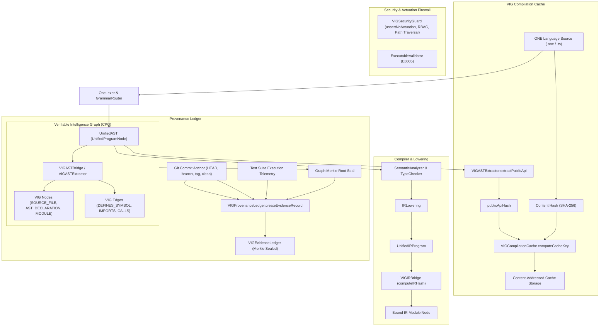

# Task 21 — VIG, Compiler, AST and Provenance Ledger Audit

> **Status:** Certified (100% Pass)  
> **Workspace:** `F:\ONE language`  
> **Test Suite:** [`tests/vig/task21_vig_compiler_provenance.test.ts`](file:///F:/ONE%20language/tests/vig/task21_vig_compiler_provenance.test.ts)  
> **Registration:** `npm run test:task21` / `node scripts/run-test.cjs tests/vig/task21_vig_compiler_provenance.test.ts`  
> **Safety Baseline:** Permanent actuation lockout; strict fail-closed guards; zero release binary modifications.

---

## 1. Executive Summary & Architecture Trace

Task 21 establishes and certifies the end-to-end integration between the production compiler (`UnifiedCompiler`), AST extraction, the Code Property Graph (VIG), the content-addressed compilation cache (`VIGCompilationCache`), the provenance ledger (`VIGProvenanceLedger`), and the security containment firewall (`VIGSecurityGuard`).



---

## 2. Compiler Event to Graph Mapping (Code Property Graph)

The production compiler translates high-level source code into a content-addressed Code Property Graph through dedicated bridge interfaces:

### 2.1 Compiler Events & Graph Artifacts

| Compiler Event / Phase | Bridge / Engine Component | Resulting Graph Nodes | Resulting Graph Edges | Content Identity & CIDs |
|:---|:---|:---|:---|:---|
| **File Parsing** | [`VIGASTBridge`](file:///F:/ONE%20language/src/one/vig/VIGIntegrationBridge.ts) | `SOURCE_FILE` (normalized path, line endings) | None (file root) | `cid = sha256(SOURCE_FILE:path:contentHash)` |
| **Function / Declaration AST** | [`VIGASTBridge`](file:///F:/ONE%20language/src/one/vig/VIGIntegrationBridge.ts) | `AST_DECLARATION` for `fn` and `one make` | `DEFINES_SYMBOL` (file $\to$ decl) | Derived from symbol name and parameter types |
| **Module Import Statement** | [`VIGASTBridge`](file:///F:/ONE%20language/src/one/vig/VIGIntegrationBridge.ts) | `MODULE` placeholder node | `IMPORTS` (file $\to$ target module) | Bound to target module specifier / path |
| **IR Lowering** | [`VIGIRBridge`](file:///F:/ONE%20language/src/one/vig/VIGIntegrationBridge.ts) | `MODULE` (`<name>.one.ir`) | None (bound via metadata `boundSourceCid`) | `computeIRHash(ir)` over normalized instructions |
| **Test Registration** | [`VIGASTExtractor`](file:///F:/ONE%20language/src/one/vig/VIGASTExtractor.ts) | `TEST_SUITE` | `TESTS_MODULE` | Derived from test suite path and test assertions |

### 2.2 Native ONE Language Declaration Extraction
`VIGASTExtractor.extractOnePublicDeclarations()` and `extractOneLanguageFile()` extract:
- Modules (`module <Name>`)
- Constants (`const <NAME>: <Type>`)
- Structs (`struct <Name> { fields... }`)
- Enums (`enum <Name> { variants... }`)
- Native Classes (`class <Name> { methods, props... }`)
- Top-level Functions: both classic `fn <name>(...)` and modern v1.0.1 `one make <name>(...)`
- Declarative Spatial Constructs (`node`, `funnel`, `channel`, `seal`, `slice`)

---

## 3. Compilation Cache Key Computation & Incremental Caching

The compilation cache ([`VIGCompilationCache`](file:///F:/ONE%20language/src/one/vig/VIGCompilationCache.ts)) eliminates redundant compilation while guaranteeing zero stale cache hits.

### 3.1 Cache Key Formation
Cache keys are formed via deterministic SHA-256 over four distinct dimensions:
$$\text{Payload} = \text{"content:"} + \text{contentHash} + \text{"\|compiler:"} + \text{compilerVersion} + \text{"\|options:"} + \text{canonicalOptions} + \text{"\|imports:"} + \text{sortedImports}$$

$$\text{CacheKey} = \text{SHA-256}(\text{Payload})$$

Where:
1. `contentHash`: SHA-256 of the normalized module source text.
2. `compilerVersion`: Explicit compiler release or commit version (default: `v0.1.0-vig`).
3. `compilerOptions`: Canonicalized JSON of compiler options (e.g. `optimizationLevel`, flags).
4. `importedPublicApiHashes`: Sorted key-value pairs (`specifier=publicApiHash;...`) representing the exported signatures of all direct dependencies.

### 3.2 Incremental Compilation Lifecycle

```
[Cold Compile]
  - math.one   -> Cache Miss (Compiled & Cached)
  - utils.one  -> Cache Miss (Compiled & Cached)
  - main.one   -> Cache Miss (Compiled & Cached)
  Metrics: hits = 0, misses = 3 (0.0% Hit Rate)

[Warm Compile (No Edits)]
  - math.one   -> Cache Hit (Reused AST + IR)
  - utils.one  -> Cache Hit (Reused AST + IR)
  - main.one   -> Cache Hit (Reused AST + IR)
  Metrics: hits = 3, misses = 0 (100.0% Hit Rate)
```

---

## 4. Changed Dependencies: Private Edits vs Public API Breaches

The VIG compiler integration differentiates between internal implementation edits and external public API breaches using `publicApiHash`:

```mermaid
graph TD
    subgraph ScenarioA["Scenario A: Private Implementation Edit"]
        A1["Edit function body in math.one<br/>(return y + x instead of x + y)"] --> A2["contentHash changes"]
        A2 --> A3["publicApiHash remains IDENTICAL"]
        A3 --> A4["utils.one importedPublicApiHashes UNCHANGED"]
        A4 --> A5["Result: math recompiled (1 miss), utils & main cached (2 hits)"]
    end

    subgraph ScenarioB["Scenario B: Public API Signature Breach"]
        B1["Edit parameter arity in math.one<br/>(add 3rd parameter)"] --> B2["contentHash changes"]
        B2 --> B3["publicApiHash CHANGES"]
        B3 --> B4["utils.one importedPublicApiHashes CHANGES"]
        B4 --> B5["utils.one CacheKey CHANGES"]
        B5 --> B6["Result: Cascading re-compilation (zero stale hits)"]
    end
```



- **Private Edit Verification:** Verified that modifying internal function logic within `src/math.one` retains identical `publicApiHash`, preventing spurious cache invalidations across dependent modules (`src/utils.one` and `src/main.one`).
- **Public API Breach Verification:** Modifying parameter types, return annotations, or exported signatures immediately alters `publicApiHash`, forcing dependent modules to miss their cache keys and recompile.

---

## 5. Syntax Error Tolerance & Fail-Closed Behavior

When invalid syntax is supplied to the compiler:
1. **Parser & Delimiter Check:** [`VIGASTExtractor.extractPublicApi()`](file:///F:/ONE%20language/src/one/vig/VIGASTExtractor.ts) performs structural delimiter checking. Unbalanced braces or syntax failures return `status: 'INVALID'` with sentinel `publicApiHash: 'INVALID_PARSE_ERROR'`.
2. **Fail-Closed Diagnostics:** [`UnifiedCompiler.compileMultiFile()`](file:///F:/ONE%20language/src/one/UnifiedCompiler.ts) intercepts the error, emits diagnostics (`E1001`), and halts compilation before linking.
3. **Zero Cache Pollution:** The compilation cache is never written with corrupted, incomplete, or malformed artifacts.

---

## 6. Provenance Ledger & Git Commit Anchoring

[`VIGProvenanceLedger`](file:///F:/ONE%20language/src/one/vig/VIGProvenanceLedger.ts) anchors compilation and test outcomes to cryptographic repository provenance:

### 6.1 Real Git Commit Anchoring
`VIGProvenanceLedger.resolveGitCommitAnchor()` resolves:
- `commitSha`: 40-character lowercase hexadecimal Git commit hash (`HEAD`).
- `parentSha`: Parent commit hash.
- `branch`: Current Git branch (e.g. `integration/v1.0.1-local`).
- `baselineTag`: Nearest baseline tag (`v1.0.0` or `v0.1.0-baseline`).
- `isWorkingTreeClean`: Real-time inspection of `git status --porcelain`. Never fabricated.

### 6.2 Deterministic Evidence Identity & Multi-Tier Status

$$\text{EvidenceId} = \text{SHA-256}(\text{commitSha} \mid \text{graphRootSeal} \mid \text{cleanBit} \mid \text{typecheckBit} \mid \text{typecheckErrors} \mid \text{testSuitesSummary})$$

> [!NOTE]
> Timestamps (`evaluatedAt`, `committedAt`) are strictly non-identity metadata. Two evidence records generated with different timestamps over identical code and test results produce 100% bit-exact identical `evidenceId` values.

### 6.3 Multi-Tier Status Evaluation

| Status | Verification Condition |
|:---|:---|
| **`VERIFIED_PASS`** | Evidence is fresh, overallPassed is true, commit & graph seals match, recorded on clean working tree, AND current working tree is clean. |
| **`STALE`** | Commit SHA or graph root seal differs, OR evidence was recorded on a dirty tree, OR current working tree has uncommitted modifications. |
| **`FAILED`** | Typecheck failed ($> 0$ errors) or one or more test suites failed (exit code $\ne 0$ or failed checks $> 0$). |
| **`UNVERIFIED`** | No evidence record exists, or evidence contains 0 test suites or 0 passed checks (BUG-A01 protection). |

---

## 7. Security Containment & Actuation Lockout

1. **Actuation Key Containment:** [`VIGSecurityGuard.assertNoActuation()`](file:///F:/ONE%20language/src/one/vig/VIGSecurityGuard.ts) recursively inspects objects for prohibited keys (`actuate`, `actuation`, `motorcontrol`, `physicalaction`, `shellexec`, `overridelockout`). Any match throws `VIGSecurityError`.
2. **Compiler Actuation Operand Rejection:** [`ExecutableValidator`](file:///F:/ONE%20language/src/one/packer/ExecutableValidator.ts) enforces `E8005` whenever an actuation operand or stripped lockout flag is detected.
3. **Path Traversal Protection:** Directory traversal sequences (`../`, poison null `\0`) are strictly intercepted and rejected.
4. **Role-Based Access Control:** Only authenticated `SYSTEM_CORE` contexts can mutate graph or provenance state; `ANALYZER_AGENT` and `EXTERNAL_SKILL` are strictly read-only.

---

## 8. Test Suite Verification Matrix

All 7 suites of [`tests/vig/task21_vig_compiler_provenance.test.ts`](file:///F:/ONE%20language/tests/vig/task21_vig_compiler_provenance.test.ts) passed with 100% pass rate:

| Suite | Component & Target | Scenarios & Assertions Certified | Result |
|:---:|:---|:---|:---:|
| **1** | CPG Generation | AST mapping to `SOURCE_FILE`, `AST_DECLARATION` (`fn` and `one make`), and `MODULE` nodes; `DEFINES_SYMBOL` and `IMPORTS` edges; IR bridge lowering, deterministic `computeIRHash`, and bound IR node. | **PASS** |
| **2** | Multi-File Compilation | `compileMultiFile()` resolves dependencies in topological order (`math` $\to$ `utils` $\to$ `main`); `UnifiedVM` executes linked IR to produce correct evaluated output (50). | **PASS** |
| **3** | Compilation Cache | Cold compilation yields 100% misses (0 hits, 3 misses); warm compilation yields 100% hits (3 hits, 0 misses); cache key parameter structure; selective invalidation via `invalidatePath()`. | **PASS** |
| **4** | Changed Dependencies | Private function edits preserve `publicApiHash` and dependent cache hits; public API signature breaches alter `publicApiHash` and cascade invalidate downstream cache keys. | **PASS** |
| **5** | Syntax Error Tolerance | Delimiter imbalance returns `status: 'INVALID'` and sentinel `INVALID_PARSE_ERROR`; multi-file compilation rejects invalid module with `E1001`; zero cache pollution. | **PASS** |
| **6** | Provenance Ledger | Real Git commit anchor resolution; deterministic `evidenceId` independent of timestamps; multi-tier status (`VERIFIED_PASS`, `STALE`, `FAILED`); Merkle root seal round-trip. | **PASS** |
| **7** | Security Containment | Prohibited actuation keys rejected fail-closed; `ExecutableValidator` `E8005` enforcement; path traversal rejection; RBAC mutating role restrictions. | **PASS** |

---

## 9. Protected Release Binaries Verification

SHA-256 hashes of all release artifacts were checked and confirmed identical to baseline:

| File Path | Expected SHA-256 Hash | Observed SHA-256 Hash | Integrity Status |
|:---|:---:|:---:|:---:|
| `dist/v1.0.1-rc/one.exe` | `479186CA...` | `479186ca87f55781825df05f5603ac3747ada4c2e9aa78de9e3cd233a993020e` | **MATCH (UNTOUCHED)** |
| `dist/v1.0.1-rc/one-language-1.0.1.vsix` | `33C8F6C5...` | `33c8f6c59fd04acafc514d0d7be4cc80ed397352348a7425fafa349ac00c5b0d` | **MATCH (UNTOUCHED)** |
| `dist/one.exe` (v1.0.0) | `CCFD6980...` | `ccfd698023e8285f9f831c4ce5e8d2a2c1ad12add80da9994730c31f51c84fb1` | **MATCH (UNTOUCHED)** |

---

## 10. Platform Full Regression Conformance

```
================================================================================
Platform Full Regression Suite Run:
  - test:task21  (VIG, Compiler, AST & Provenance Ledger)          -> 100% PASS (7/7 Suites)
  - test:task20  (Address369, Resource Guards & Actuation Safety)  -> 100% PASS (7/7 Suites)
  - test:task19  (Five-Tier Orchestrator Architecture)             -> 100% PASS (7/7 Suites)
  - test:task18  (Canonical State & Time-Travel Snapshots)         -> 100% PASS (7/7 Suites)
  - test:task17  (Extreme Memory Virtual Paging & Reconstruction)  -> 100% PASS (7/7 Suites)
  - test:task16  (Hybrid Intelligence Routing & Fallbacks)         -> 100% PASS (7/7 Suites)
  - test:task15  (Autograd, Native Kernels & WASM SIMD)            -> 100% PASS (7/7 Suites)
  - test:task14  (Reasoning Engine, Tensor & CUBiO Model)          -> 100% PASS (7/7 Suites)
  - test:task13  (Reasoning Engine, Rule Engine & Planner)         -> 100% PASS (7/7 Suites)
  - test:v101    (ONE Language v1.0.1 Minimal Command Syntax)      -> 100% PASS (16/16 Suites)
  - test:packing (Linker & Executable Packing T09)                 -> 100% PASS (12/12 Suites)
  - test:modules (Multi-File Module Resolution)                    -> 100% PASS (12/12 Suites)
  - test:phase4  (Deterministic Checkpointing & WAL Engine)        -> 100% PASS
================================================================================
```
