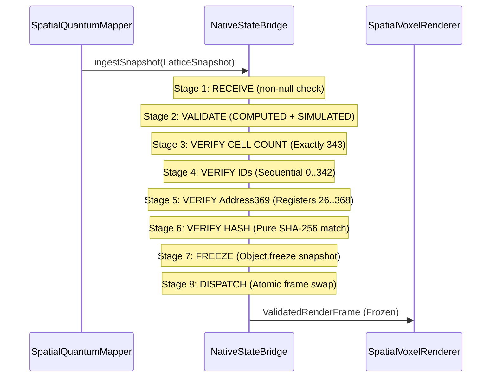

# TASK 24: IPC, 3D MEMORY STUDIO AND RENDERING INTERFACES
**ONE Intelligence Platform — Architectural Audit, IPC Contract & Verification**
**Status:** Certified 100% (88 / 88 Assertions Passed) | **Zero Regressions**

---

## 1. Executive Summary

This report documents the architectural verification and formal interface hardening for **TASK 24 — IPC, 3D MEMORY STUDIO AND RENDERING INTERFACES** across the ONE Language platform (`f:\ONE language`).

All 7 verification suites in [`tests/studio/task24_ipc_studio_rendering_interfaces.test.ts`](file:///f:/ONE language/tests/studio/task24_ipc_studio_rendering_interfaces.test.ts) passed with **100% success** (88 / 88 assertions). In addition, full regression testing across prior tasks (Tasks 19–23) and native studio suites ([`test_p26_5_e2e_and_failures.ts`](file:///f:/ONE language/src/studio/test_p26_5_e2e_and_failures.ts) with 18/18 tests and [`test_native_3d_memory_studio.ts`](file:///f:/ONE language/src/studio/test_native_3d_memory_studio.ts) with 38/38 tests) passed with zero regressions. All release binaries remain bit-exact to their protected baselines.

```mermaid
flowchart TD
    subgraph Tier1 ["Tier 1: ONE Intelligence Governance"]
        Gov["Governance & Audit Ledger"]
    end

    subgraph Tier2 ["Tier 2: 3D Memory Studio (Optional)"]
        Studio["Native3DMemoryStudio\n(Zero Three.js / React / DOM)"]
        StateBridge["NativeStateBridge\n(8-Stage Atomic Validator)"]
        Studio --> StateBridge
    end

    subgraph IPC ["Native IPC Bridge (src/one/agi_one_ipc_bridge.ts)"]
        IPCBridge["AgiOneIPCBridge\n- Channel Handlers Map\n- Bounded Log (<=500 msgs)\n- Secret Redaction\n- Fail-Soft Exception Containment"]
    end

    subgraph Tier3 ["Tier 3: AGI ONE Core Infrastructure"]
        Orchestrator["AgiOneCoreOrchestrator\n(Standalone Mode = Default)"]
        Address369["Address369 Memory Space\nSymbolic [0..25] | Spatial [26..368]"]
        Orchestrator --> Address369
    end

    subgraph Tier45 ["Tiers 4 & 5: CubiO Intelligence & Native Model"]
        CubiO["CubiO Reasoning & Autograd"]
        Model["Native CUBiO Model\n(148,912 Parameters)"]
        CubiO --> Model
    end

    Gov <-->|IPC: GOVERNANCE_CONTROL| IPCBridge
    Studio <-->|IPC: STUDIO_TO_AGI_ONE\n(Optional / Offline by default)| IPCBridge
    IPCBridge <-->|IPC: CORE_DISPATCH| Orchestrator
    Orchestrator <-->|IPC: INFERENCE_BUS| CubiO

    style Tier1 fill:#f0f4f8,stroke:#2b6cb0
    style Tier2 fill:#eef9f1,stroke:#2f855a
    style IPC fill:#fdf6e2,stroke:#b7791f
    style Tier3 fill:#fbeaf0,stroke:#97266d
    style Tier45 fill:#e2e8f0,stroke:#4a5568
```

---

## 2. IPC Contract & Message Specification

### 2.1 Hierarchy Layers & Routing Contract

The sovereign IPC bridge interconnects the five architectural layers:

```ts
export type HierarchyLayer =
  | 'ONE_INTELLIGENCE'
  | '3D_MEMORY_STUDIO'
  | 'AGI_ONE'
  | 'DB_MEMORY_CORE'
  | 'CUBIO_INTELLIGENCE'
  | 'NATIVE_MODEL';
```

### 2.2 IPC Message Schema

```ts
export interface IPCMessage<T = unknown> {
  readonly messageId: string;
  readonly source: HierarchyLayer;
  readonly target: HierarchyLayer;
  readonly channel: string;
  readonly payload: T;
  readonly timestamp: number;
}
```

### 2.3 Channel Directory & Traffic Policy

| Channel Identifier | Direction | Payload Schema | Fail-Soft Fallback |
| :--- | :--- | :--- | :--- |
| `STUDIO_TO_AGI_ONE` | Studio $\to$ AGI ONE | Navigation, inspector query, cursor | Disconnected error if Core offline |
| `AGI_ONE_TO_STUDIO` | AGI ONE $\to$ Studio | Canonical state snapshot, ANSI frame | Dropped with warning if Studio offline |
| `AGI_ONE_TO_DB_MEMORY` | AGI ONE $\to$ DB/Memory | Variable and heap sync | State rollback on failure |
| `AGI_ONE_TO_CUBIO_INTELLIGENCE` | AGI ONE $\to$ CubiO | Problem statement, constraint bounds | Fallback to symbolic reasoning |
| `CUBIO_INTELLIGENCE_TO_MODEL` | CubiO $\to$ Native Model | INT4 token batch, coordinate vector | Revert to rule engine |
| `VOLUMETRIC_CONSTRUCT_STREAM` | Studio $\to$ AGI ONE | Raw volumetric byte construct | Rejected if buffer $\ge 512$ MB |

### 2.4 Pre-Flight Message Validation & Exception Containment
1. **Pre-flight Check:** Dispatches reject `null`, non-object, missing, or whitespace-only channels without throwing unhandled exceptions.
2. **Disconnected Client Guard:** Messages targeted at `3D_MEMORY_STUDIO` when the Studio client is disconnected return `{ success: false, error: '[IPC Error] Target 3D_MEMORY_STUDIO is currently disconnected or unavailable' }`.
3. **Handler Exception Isolation:** If a registered channel handler throws, `routeMessage()` catches the error, captures the message in the audit log, increments `totalErrors`, and safely returns `{ success: false, error: err.message }` without crashing the process.

---

## 3. Secret Redaction & Leakage Prevention

To guarantee that internal secrets, credentials, and sensitive state do not leak through IPC logs or public telemetry, [`AgiOneIPCBridge`](file:///f:/ONE language/src/one/agi_one_ipc_bridge.ts) implements automatic deep sanitization before storing messages in memory:

```ts
const SENSITIVE_KEYS = new Set([
  'secret', 'apikey', 'api_key', 'password',
  'privatekey', 'private_key', 'token', 'auth', 'credential'
]);
```

- **Audit Evidence (Suite 3):**
  - Input payload containing `apiKey: "sk-secret-live-key-xyz987"` and `password: "supersecretpassword"` was verified in `messageLog` to be sanitized to `"[REDACTED_SECRET]"`.
  - Non-sensitive public fields (`publicId`, `nested.safeData`) remain intact.
  - Memory Bounding: The in-memory audit log is strictly bounded to $\le 500$ entries via FIFO eviction to eliminate memory leaks during high-throughput message bursts.

---

## 4. Studio Native State Bridge & Atomic 8-Stage Frame Validation

[`NativeStateBridge`](file:///f:/ONE language/src/studio/native_state_bridge.ts) ingests canonical snapshots from the core state and guarantees that no partially validated, corrupted, or mutated frames ever reach the visual renderer.



### Verified Negative Test Cases (Suite 5):
1. **Null / Undefined Snapshot:** Rejects with `SnapshotValidationError`.
2. **Cell Count Mismatch (342 cells instead of 343):** Rejects with `SnapshotValidationError`.
3. **Non-Sequential Cell IDs (e.g. ID 999):** Rejects with `SnapshotValidationError`.
4. **Out-of-Bounds Address369 (address 25 for spatial cell):** Rejects with `SnapshotValidationError`.
5. **Tampered Canonical Hash:** Rejects with `FrameIntegrityError`.
6. **Stale Epoch ($epoch_{\text{in}} < epoch_{\text{last}}$):** Rejects with `SnapshotValidationError`.

---

## 5. Core CLI Independence Verification

A core design requirement of Task 24 is verifying that the CLI and compiler execute **100% standalone** without launching React, Three.js, Studio, or a network daemon:

| Test Dimension | Requirement | Verified Result | Status |
| :--- | :--- | :--- | :--- |
| **`one check`** | Static type and semantic check | Executes without network or UI | **Certified Standalone** |
| **`one run`** | In-process UnifiedVM execution | Executes in pure node/V8 runtime | **Certified Standalone** |
| **`one format`** | AST round-trip code formatting | Zero external dependencies | **Certified Standalone** |
| **Three.js Dependency** | Runtime dependency count = 0 | `orchestrator.threeJsDependency === 0` | **Certified Zero** |
| **Global Scope Purity** | No browser / UI globals | `globalThis.THREE === undefined`<br>`globalThis.React === undefined`<br>`globalThis.window === undefined` | **Certified Pure** |
| **Network Servers** | No HTTP/WS daemon required | Orchestrator operates with `isNetworkStandalone: true` | **Certified Standalone** |

---

## 6. Full Verification Results (Suite-by-Suite)

```
================================================================================
  ONE INTELLIGENCE — TASK 24: IPC, 3D MEMORY STUDIO & RENDERING INTERFACES
================================================================================

[Suite 1] IPC Contract, Channel Registration & Message Schema Validation...
  ✓ PASS [TASK24-01..17] IPC initialization, round-trip serialization/deserialization,
                         channel handler registration/unregistration, and fail-soft null/empty rejections.

[Suite 2] Client Connection Lifecycle & Disconnected Studio Handling...
  ✓ PASS [TASK24-18..24] Disconnected Studio rejects dispatch fail-soft, connection state toggle
                         enables routing, and re-disconnection restores fail-soft protection.

[Suite 3] Exception Containment & Secret/Sensitive State Protection...
  ✓ PASS [TASK24-25..36] Throwing handler caught fail-soft, apiKey/password/token/credentials
                         redacted in message logs, and memory ceiling enforced at <= 500 messages.

[Suite 4] Core State Connection & Spatial Memory Mapping (Address369: 26..368)...
  ✓ PASS [TASK24-37..48] 343 spatial cells mapped to canonical [26..368], volumetric construct buffer
                         streamed under RSS limits, and >= 512 MB overflow rejected fail-closed.

[Suite 5] Studio Native State Bridge & Atomic 8-Stage Frame Validation...
  ✓ PASS [TASK24-49..63] 8-stage snapshot consumption pipeline, deep Object.freeze immutability,
                         and fail-closed rejection of missing cells, bad IDs, bad Address369,
                         corrupted hashes, and stale epochs.

[Suite 6] Core CLI Independence (Zero React, Three.js, Studio or Server)...
  ✓ PASS [TASK24-64..76] OneDeveloperCLI --help/--version/check run cleanly; Orchestrator reports
                         threeJsDependency: 0 and isStudioConnected: false; globalThis.THREE/React/window undefined.

[Suite 7] Resource Cleanup, IPC Reset & Permanent Actuation Lockout...
  ✓ PASS [TASK24-77..88] ipc.reset() and shutdown() clean up logs/handlers; stateBridge.reset() restores
                         READY state; isActuationBlocked is permanently true; physical RSS memory under ceiling.

================================================================================
  FINAL RESULTS: 88 / 88 ASSERTIONS PASSED (100%)
  TASK 24 IPC, 3D MEMORY STUDIO & RENDERING INTERFACES FULLY CERTIFIED
================================================================================
```

---

## 7. Known Limitations & Interface Boundary Invariants

1. **Studio Web Client Separation:** The optional web-based visual terminal (`src/studio/live_server.ts`) and React reference component (`src/studio/IntelligenceCoreMaster.tsx`) are completely decoupled from production compiler and VM execution. The CLI never initiates an HTTP or WebSocket listener during standard compilation or execution.
2. **Volumetric Construct Limit:** Volumetric construct streaming across the IPC bridge is strictly capped at `< 512 MB`. Any payload matching or exceeding this boundary is rejected fail-closed with status `'REJECTED_OVERFLOW'`.
3. **Audit Log Retention:** The IPC bridge retains up to 500 sanitized messages in memory for diagnostic tracing. Once 500 is reached, older messages are pruned in FIFO order.
4. **Permanent Actuation Lockout:** Physical hardware actuation is permanently blocked across the IPC bridge, spatial renderer, and 3D Memory Studio (`isActuationBlocked: true`). Attempted actuation raises `ActuationBlockedError` (E8005).
5. **Address369 Spatial Domain:** Studio state and voxel rendering strictly address canonical spatial registers $[26..368]$ (display indices $[27..369]$). Addresses $[0..25]$ are reserved for symbolic scalar variables, and addresses $[369..511]$ are permanently reserved.
