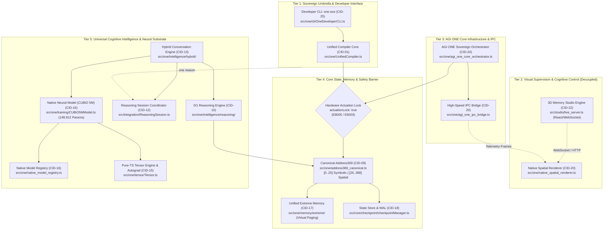
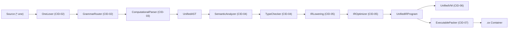
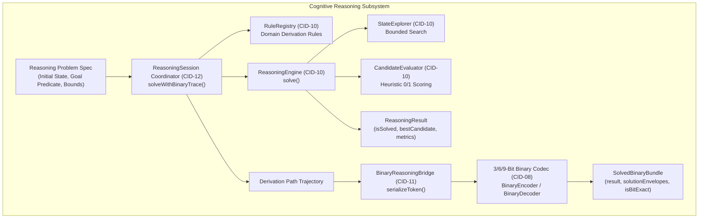
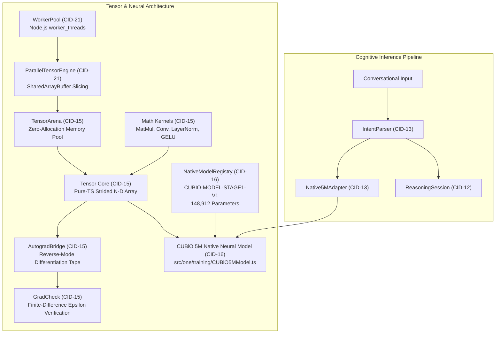
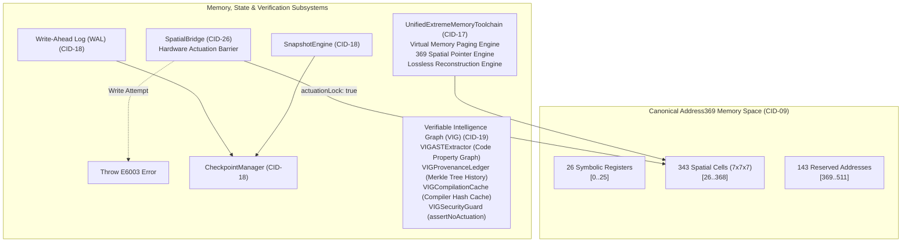

# ONE Intelligence — Task 5: Master Architecture Specification & Decision Register

**Workspace:** `F:\ONE language`  
**Target Repositories:**  
1. **ONE Language:** `https://github.com/aayyaz3d-166/ONE-language.git` (`F:\ONE language`)  
2. **ONE Binary Reasoning Intelligence:** `https://github.com/aayyaz3d-166/ONE-Binary-Reasoning-Intelligence.git` (`F:\one-binary-reasoning`)  
**Specification Version:** `1.0.0-PROPOSED-TARGET`  
**Baseline Status:** Certified against Tasks 1–4 read-only audit evidence  
**Execution Timestamp:** 2026-10-28T05:00:00+05:00  

---

## 1. Executive Architecture Overview

### Architectural Mission & Vision

**ONE Intelligence** is a sovereign, dual-stack computational and cognitive runtime that fuses deterministic, high-performance programming language compilation with bounded, verifiable symbolic reasoning and native compact neural execution.

Based on the forensic findings of Tasks 1 through 4, the architecture resolves historic lineage ambiguities, cleanly separates concerns across independent processes, enforces hardware-grade safety invariants, and establishes a scalable foundation for Phase 1 local integration.

```
┌────────────────────────────────────────────────────────────────────────┐
│                    ONE INTELLIGENCE SYSTEM BOUNDS                      │
├────────────────────────────────────────────────────────────────────────┤
│  CLI / CORE COMPILER & RUNTIME       │  DECOUPLED OPTIONAL SERVICES   │
│  • OneDeveloperCLI (one.exe)          │  • 3D Memory Studio (Web/WS)   │
│  • UnifiedCompiler & UnifiedVM        │  • Sovereign Mesh Cluster      │
│  • ONEX Packer / Linker (.ox)         │  • Decentralized DNS / Storage │
│  • 3/6/9-Bit Reasoning Engine         │  • OMail & PQC Mailbox         │
│  • Canonical Address369 ([0..368])    │                                │
│  • Actuation Lock Barrier (E8005/6003)│                                │
└───────────────────────────────────────┴────────────────────────────────┘
```

### Core Architecture Pillars

1. **Deterministic Single-Binary CLI Execution:**  
   The core developer toolchain ([`OneDeveloperCLI.ts`](file:///F:/ONE%20language/src/one/cli/OneDeveloperCLI.ts)) compiles to a self-contained, native Windows x64 executable ([`one.exe`](file:///F:/ONE%20language/dist/v1.0.1-rc/one.exe)) via Node.js Single Executable Application (SEA). It has zero runtime dependencies on web frameworks, Three.js, or external daemon processes.

2. **Decoupled Multi-Process Boundary:**  
   Heavy visual supervisors ([`3D Memory Studio`](file:///F:/ONE%20language/src/studio/live_server.ts)) and peer-to-peer network nodes ([`Mesh Cluster`](file:///F:/ONE%20language/src/mesh/spatialMeshCluster.ts)) are strictly decoupled from the core language runtime. They operate as optional services communicating over standardized IPC and WebSocket protocols.

3. **Strict Lineage Disambiguation:**  
   The modern high-level programming language compiler and stack VM ([`src/one/`](file:///F:/ONE%20language/src/one/)) is established as the sole production language path. The historical Lineage A cellular automaton prototype ([`src/compiler/`](file:///F:/ONE%20language/src/compiler/) and [`src/vm/cubioVM.ts`](file:///F:/ONE%20language/src/vm/cubioVM.ts)) is isolated into a legacy research partition.

4. **Container vs Protocol Disambiguation:**  
   The **`.ox` (ONEX)** format is strictly an executable binary container packing compiled `UnifiedIRProgram` bytecode with CRC32, SHA-256 digests, and hardware actuation assertions. The **3/6/9-bit protocol** is strictly a streaming serialization format for symbolic reasoning derivations and coordinate addressing.

5. **Fail-Closed Actuation Invariant:**  
   Physical actuation and external state mutation remain permanently locked across all compilation, execution, and reasoning pathways (`actuationLock: true`, [`E8005`](file:///F:/ONE%20language/src/one/packer/ExecutableValidator.ts#L70), [`E6003`](file:///F:/ONE%20language/src/one/spatial/SpatialBridge.ts#L182)).

---

## 2. The Five-Tier Sovereign Architecture (Evidence-Backed)

The authoritative orchestrator ([`AgiOneCoreOrchestrator.ts`](file:///F:/ONE%20language/src/one/agi_one_core_orchestrator.ts)) establishes a 5-tier sovereign hierarchy codified in Gate CNL-P26.2:



---

## 3. Subsystem Architecture Specifications

### 3.1. ONE Language Compiler, IR, Runtime & ONEX Packaging

#### Compiler Pipeline Architecture
The compilation subsystem is a synchronous multi-pass pipeline producing deterministically verifiable intermediate code:



1. **Lexical Analysis ([`OneLexer.ts`](file:///F:/ONE%20language/src/one/oneLexer.ts)):**  
   Deterministic regex and string matching yielding typed `Token` streams with zero external parser dependencies.
2. **Grammar Routing ([`GrammarRouter.ts`](file:///F:/ONE%20language/src/one/router/GrammarRouter.ts)):**  
   Dispatches tokens between computational statement sequences and spatial lattice commands.
3. **AST Construction ([`ComputationalParser.ts`](file:///F:/ONE%20language/src/one/computational/ComputationalParser.ts)):**  
   Recursive-descent parser constructing [`UnifiedProgramNode`](file:///F:/ONE%20language/src/one/ast/UnifiedAST.ts) representing functions, nested closures, structs, enums, deep recursion, async/await, and spatial operations.
4. **Semantics & Type Checking ([`SemanticAnalyzer.ts`](file:///F:/ONE%20language/src/one/semantics/SemanticAnalyzer.ts), [`TypeChecker.ts`](file:///F:/ONE%20language/src/one/types/TypeChecker.ts)):**  
   Scoped symbol tables, type inference, struct/enum definition validation, and numeric safety bounds.
5. **IR Lowering ([`IRLowering.ts`](file:///F:/ONE%20language/src/one/ir/IRLowering.ts)):**  
   Lowers typed AST into linear three-address [`UnifiedIRProgram`](file:///F:/ONE%20language/src/one/ir/UnifiedIR.ts) instructions (`CONST`, `LOAD`, `STORE`, `ADD`, `CALL`, `RET`, `SPATIAL_READ`, `SPATIAL_WRITE`, etc.).

#### Unified Virtual Machine ([`UnifiedVM.ts`](file:///F:/ONE%20language/src/one/vm/UnifiedVM.ts))
- **Architecture:** Stack-based virtual machine executing `IRInstruction` streams with explicit `CallFrame` management.
- **Sandboxing Invariants:** Zero dynamic string evaluation (`no eval`, `no new Function`), zero host process escapes, zero unmonitored filesystem access.
- **Execution Limits:** Stack depth ceiling ($512$ frames), max instruction count ($10^6$ ops), RSS limit ($512$ MB).

#### ONEX (`.ox`) Executable Container Specification
- **Fixed 64-Byte PE/ELF Binary Header ([`ExecutableArtifact.ts`](file:///F:/ONE%20language/src/one/packer/ExecutableArtifact.ts)):**
  - Bytes `[0..3]`: Magic `'ONEX'` (`0x4F4E4558`)
  - Bytes `[4..9]`: Format version `1.0.0`
  - Bytes `[10..11]`: Target architecture `0x0001` (`ONE_VM`)
  - Bytes `[12..13]`: Flags bitfield (Mandatory: `ONEX_FLAG_ACTUATION_LOCKED = 0x0001`)
  - Bytes `[14..17]`: Max RSS allocation limit in MB (`512`)
  - Bytes `[18..21]`: Entry point instruction index (PC)
  - Bytes `[22..25]`: Instruction count
  - Bytes `[26..29]`: Payload byte length
  - Bytes `[30..31]`: CRC32 header integrity checksum
  - Bytes `[32..63]`: 32-byte payload SHA-256 digest in hex (64 chars)
- **Packer / Linker ([`ExecutablePacker.ts`](file:///F:/ONE%20language/src/one/packer/ExecutablePacker.ts), [`ExecutableLinker.ts`](file:///F:/ONE%20language/src/one/packer/ExecutableLinker.ts)):**  
  Serializes `UnifiedIRProgram` into deterministic, bit-exact `.ox` containers; validates header CRC32, payload SHA-256, and throws [`E8005`](file:///F:/ONE%20language/src/one/packer/ExecutableValidator.ts#L70) if actuation lock is missing.

---

### 3.2. Binary Reasoning Protocol, Engines & Planner



#### 3/6/9-Bit Protocol Specification
- **Bit 0..2 (Category Header):** 3 bits defining payload classification:
  - `0b000` = `TYPE_NULL`
  - `0b001` = `TYPE_BOOL`
  - `0b010` = `TYPE_INT`
  - `0b011` = `TYPE_FLOAT`
  - `0b100` = `TYPE_TEXT`
  - `0b101` = `TYPE_ADDR369`
  - `0b110` = `TYPE_OPCODE`
  - `0b111` = `TYPE_CONTROL`
- **Bit 3..8 (Planar Triangle Opcode):** 6 bits geometrically mapped across 4 planar quartiles:
  - Quartile 0 (Core): `OP_NOP` (`0x00`) to `OP_GT` (`0x0f`)
  - Quartile 1 (Control & Spatial): `OP_JUMP` (`0x10`) to `OP_BARRIER` (`0x17`)
  - Quartile 3 (Markers): `MARKER_ESCAPE` (`0x3e`), `MARKER_EOS` (`0x3f`)
- **Bit 9..17 (Address369 Pointer):** 9 bits encoding canonical coordinate references in range `[0..368]`.

#### Reasoning Session Coordinator ([`ReasoningSession.ts`](file:///F:/one-binary-reasoning/src/integration/ReasoningSession.ts))
Currently residing in `one-binary-reasoning`, this high-level coordinator must be backported to `ONE language`. It provides:
- `solve(spec: ReasoningInput<T>): ReasoningResult<T>`: Forward-chaining state exploration.
- `solveWithBinaryTrace(spec: ReasoningInput<T>): SolvedBinaryBundle<T>`: Derives goal trajectories, encodes candidate steps into 3/6/9-bit binary envelopes, and validates bit-exact round-trip identity.

---

### 3.3. Tensor Engine, Autograd, Native Model & Inference/Training Paths



#### Authoritative Neural Model Identity
- **Model ID:** `CUBIO-MODEL-STAGE1-V1` ([`NativeModelRegistry.ts`](file:///F:/ONE%20language/src/one/native_model_registry.ts#L33))
- **Authoritative Parameter Count:** **$148,912$** parameters (Legacy claim of $38,400$ is permanently discarded).
- **Precision:** INT4 quantized weights with 3-6-9 harmonic attention bands:
  - Symbolic/Spatial Embedding: $23,616$ params
  - Harmonic Attention 3MHz (Resting): $28,160$ params
  - Harmonic Attention 6MHz (Active): $28,160$ params
  - Harmonic Attention 9MHz (High Cognitive): $28,160$ params
  - Voxel FeedForward MLP: $38,208$ params
  - Total: $23,616 + (3 \times 28,160) + 38,208 = 148,912$.
- **Actuation Lock:** `isActuationBlocked: true` embedded directly in model identity.

---

### 3.4. Memory Substrates, State Persistence & Verifiable Intelligence Graph



1. **Canonical Address369 ([`address369_canonical.ts`](file:///F:/ONE%20language/src/one/address369_canonical.ts)):**  
   Strict bijection mapping coordinates $(x,y,z) \in [0..6]^3$ to address $\text{addr} = 26 + x + 7y + 49z \in [26..368]$. Symbolic registers occupy $[0..25]$. Addresses $[369..511]$ are reserved and throw exceptions upon access.
2. **Spatial Bridge & Hardware Barrier ([`SpatialBridge.ts`](file:///F:/ONE%20language/src/one/spatial/SpatialBridge.ts)):**  
   Provides VM access to the 343-voxel lattice. Reads are permitted; writes throw [`E6003`](file:///F:/ONE%20language/src/one/spatial/SpatialBridge.ts#L182) when `actuationLock: true`.
3. **State Store & Checkpoint System ([`checkpointManager.ts`](file:///F:/ONE%20language/src/core/checkpoint/checkpointManager.ts)):**  
   Atomic Write-Ahead Logging (WAL) and memory snapshot persistence with cryptographic rollback protection.
4. **Unified Extreme Memory Toolchain ([`UnifiedExtremeMemoryToolchain.ts`](file:///F:/ONE%20language/src/one/memory/extreme/UnifiedExtremeMemoryToolchain.ts)):**  
   Virtual memory paging architecture designed to swap memory pages to disk using Address369 pointers, keeping active RSS well under the $512$ MB limit.
5. **Verifiable Intelligence Graph (VIG) ([`src/one/vig/`](file:///F:/ONE%20language/src/one/vig/)):**  
   In-memory Code Property Graph connecting AST nodes, symbols, and dependencies with Merkle change tracking. Includes `VIGCompilationCache` (used by `UnifiedCompiler`) and `VIGCanonicalizer` (used by `ExecutablePacker`).

---

### 3.5. Concurrency, IPC, Visual Supervision & Optional Networking

```mermaid
flowchart LR
    subgraph CLI_PROCESS["Process 1: Core CLI Runtime (one.exe)"]
        CORE_CLI["OneDeveloperCLI"]
        CORE_VM["UnifiedVM"]
        CORE_ORCH["AgiOneCoreOrchestrator"]
        CORE_IPC["AgiOneIPCBridge"]
        CORE_WORKERS["WorkerPool (Threads)"]

        CORE_CLI --> CORE_VM
        CORE_CLI --> CORE_ORCH
        CORE_ORCH --> CORE_IPC
        CORE_ORCH --> CORE_WORKERS
    end

    subgraph STUDIO_PROCESS["Process 2: 3D Memory Studio (Optional)"]
        STUDIO_SERVER["live_server.ts"]
        STUDIO_UI["React / Canvas UI"]
        STUDIO_VOXEL["spatial_voxel_renderer.ts"]

        STUDIO_SERVER --> STUDIO_UI
        STUDIO_SERVER --> STUDIO_VOXEL
    end

    subgraph MESH_PROCESS["Process 3: Sovereign Mesh Node (Optional)"]
        MESH_CLUSTER["spatialMeshCluster.ts"]
        MESH_ROUTER["euclideanRouter.ts"]
        MESH_DNS["cubio_dns_engine.ts"]
        OMAIL["omail_mailbox_manager.ts"]

        MESH_CLUSTER --> MESH_ROUTER
        MESH_CLUSTER --> MESH_DNS
        MESH_CLUSTER --> OMAIL
    end

    CORE_IPC -.->|WebSocket / Unix Socket| STUDIO_SERVER
    CORE_IPC -.->|Network Socket (PQC)| MESH_CLUSTER
```

- **Process Isolation:** The Developer CLI executes entirely within Process 1. If Studio or Mesh are started, they run as independent child processes or daemons.
- **Worker Concurrency:** Intensive tensor operations utilize Node.js `worker_threads` communicating via `SharedArrayBuffer` with atomic spinlocks ([`WorkerPool.ts`](file:///F:/ONE%20language/src/one/workers/WorkerPool.ts)).
- **Zero Three.js Runtime Dependency:** Studio rendering relies on native canvas voxel projection or WebGL shaders; core runtime enforces `threeJsDependency: 0`.

---

## 4. System Boundaries, Data Flows & Trust Boundaries

### Trust Boundary Model

```
┌────────────────────────────────────────────────────────────────────────┐
│                        TRUST BOUNDARY TAXONOMY                         │
├───────────────────┬──────────────┬─────────────────────────────────────┤
│ Boundary Zone     │ Trust Level  │ Safety Enforcement Mechanism        │
├───────────────────┼──────────────┼─────────────────────────────────────┤
│ 1. User Source    │ Untrusted    │ Lexer / Parser strict grammar check │
│ 2. Compiled IR    │ Verified     │ TypeChecker & Semantic Analyzer     │
│ 3. Sealed .ox     │ Cryptographic│ CRC32, Payload SHA-256, E8005 check │
│ 4. VM Runtime     │ Sandboxed    │ Zero eval, call stack & step limits │
│ 5. Spatial Memory │ Guarded      │ Address369 bounds, E6003 lock check │
│ 6. Physical World │ BLOCKED      │ Permanent Actuation Lockout         │
└───────────────────┴──────────────┴─────────────────────────────────────┘
```

### End-to-End Data Flow Lifecycles

#### A. Compilation & Execution Lifecycle
```
[User Source (.one)] 
   ──> OneDeveloperCLI.handleRun()
   ──> UnifiedCompiler.compile()
   ──> UnifiedIRProgram
   ──> UnifiedVM.execute()
   ──> [Standard Output / Terminal]
```

#### B. Sealed Binary Container Lifecycle
```
[User Source (.one)] 
   ──> OneDeveloperCLI.handleBuild()
   ──> UnifiedCompiler.compile()
   ──> ExecutablePacker.pack() 
   ──> Sealed Executable Container (.ox) with ONEX Header + SHA-256
   ──> [Disk Storage]
   ──> OneDeveloperCLI.handleRun(<file.ox>)
   ──> ExecutableLinker.loadAndRun()
   ──> ExecutableValidator.validate() (Asserts CRC32, SHA-256, E8005)
   ──> UnifiedVM.execute()
```

#### C. Symbolic Reasoning & Trace Lifecycle (Proposed Phase 1 Path)
```
[Reasoning Task Spec (JSON)]
   ──> OneDeveloperCLI.handleReason() (Proposed)
   ──> ReasoningSession.solveWithBinaryTrace()
   ──> StateExplorer.explore() + CandidateEvaluator.score()
   ──> Goal Candidate Trajectory
   ──> BinaryReasoningBridge.serializeToken()
   ──> BinaryEncoder.encode()
   ──> SolvedBinaryBundle (Result + 3/6/9-bit Bitstream + isBitExact Verification)
   ──> [Terminal Output / Output File]
```

---

## 5. Failure Paths, Safety Invariants & Error Code Matrix

The ONE Intelligence architecture enforces deterministic fail-closed behavior across all execution paths.

| Error Code | Error Symbol | Architectural Subsystem | Triggering Condition | Fail-Closed Safety Response |
| :--- | :--- | :--- | :--- | :--- |
| **`E8005`** | `ERR_ACTUATION_LOCKED` | [`ExecutableValidator.ts`](file:///F:/ONE%20language/src/one/packer/ExecutableValidator.ts#L70) | `.ox` container missing `ONEX_FLAG_ACTUATION_LOCKED (0x0001)` | **Immediate Execution Abort**; VM refuses to load instructions. |
| **`E6003`** | `ERR_SPATIAL_WRITE_LOCKED` | [`SpatialBridge.ts`](file:///F:/ONE%20language/src/one/spatial/SpatialBridge.ts#L182) | Bytecode attempts `SPATIAL_WRITE` while `actuationLock: true` | **Immediate Runtime Fault**; spatial memory remains unmutated. |
| **`E6001`** | `ERR_SPATIAL_COORD_OOB` | [`SpatialBridge.ts`](file:///F:/ONE%20language/src/one/spatial/SpatialBridge.ts#L120) | Spatial coordinate outside $[0..6, 0..6, 0..6]$ | **Fault**; prevents buffer overflow on 343-cell lattice. |
| **`E6002`** | `ERR_SPATIAL_ADDR_OOB` | [`SpatialBridge.ts`](file:///F:/ONE%20language/src/one/spatial/SpatialBridge.ts#L150) | Canonical address outside spatial range $[26..368]$ | **Fault**; prevents illegal access into reserved memory. |
| **`E5012`** | `ERR_STREAM_EXHAUSTED` | [`UnifiedVM.ts`](file:///F:/ONE%20language/src/one/vm/UnifiedVM.ts#L840) | `INPUT` opcode executed when input stream is empty | **Deterministic Termination**; prevents hanging or undef reads. |
| **`E5001`** | `ERR_DIV_BY_ZERO` | [`UnifiedVM.ts`](file:///F:/ONE%20language/src/one/vm/UnifiedVM.ts#L550) | Integer or float division/modulo by zero | **VM Trap**; emits structured diagnostic with source map. |
| **`E5002`** | `ERR_UNKNOWN_OPCODE` | [`UnifiedVM.ts`](file:///F:/ONE%20language/src/one/vm/UnifiedVM.ts#L990) | Program counter hits invalid instruction opcode | **VM Trap**; halts execution immediately. |
| **`E5003`** | `ERR_STACK_UNDERFLOW` | [`UnifiedVM.ts`](file:///F:/ONE%20language/src/one/vm/UnifiedVM.ts#L420) | Pop instruction executed on empty operand stack | **VM Trap**; prevents stack corruption. |
| **`E5006`** | `ERR_MAX_CALL_DEPTH` | [`UnifiedVM.ts`](file:///F:/ONE%20language/src/one/vm/UnifiedVM.ts#L710) | Call frame stack exceeds 512 nested invocations | **VM Trap**; prevents host process call stack overflow. |
| **`E5007`** | `ERR_MAX_INSTRUCTIONS` | [`UnifiedVM.ts`](file:///F:/ONE%20language/src/one/vm/UnifiedVM.ts#L480) | Program execution steps exceed $1,000,000$ ops | **VM Trap**; terminates runaway infinite loops. |
| **`E4001`** | `ERR_RESERVED_OPCODE` | [`binaryDecoder.ts`](file:///F:/ONE%20language/src/binary/binaryDecoder.ts) | 3/6/9-bit decoder receives marker opcode `0x3e` or `0x3f` | **Decoding Rejection**; throws `BinaryError`. |

---

## 6. Implementation Horizon: Status Matrix

To guide Phase 1 execution without ambiguity, all components are mapped to one of four implementation horizons:

```
┌────────────────────────────────────────────────────────────────────────┐
│                   HORIZON 1: EXISTING VERIFIED PATHS                   │
├────────────────────────────────────────────────────────────────────────┤
│ • Modern Compiler Pipeline (oneLexer, GrammarRouter, Parser, Semantics)│
│ • Unified Virtual Machine (UnifiedVM with full stack execution)        │
│ • ONEX Packaging & Linker (.ox with CRC32, SHA-256, and E8005)         │
│ • Developer CLI (OneDeveloperCLI with init, run, check, build, format) │
│ • Standalone Windows Executable (dist/v1.0.1-rc/one.exe via Node SEA)  │
│ • Canonical Address369 Invariant ([0..368] with 100% byte parity)      │
│ • SpatialBridge & Actuation Lock Barrier (E6003 enforcement)           │
│ • 3/6/9-Bit Binary Codec (BinaryEncoder, BinaryDecoder, 11/11 tests)   │
│ • 0/1 Reasoning Engine (ReasoningEngine, RuleRegistry, StateExplorer)  │
│ • Native Model Registry (148,912 authoritative parameter identity)     │
└────────────────────────────────────────────────────────────────────────┘

┌────────────────────────────────────────────────────────────────────────┐
│                   HORIZON 2: PROPOSED INTERFACES (PHASE 1)             │
├────────────────────────────────────────────────────────────────────────┤
│ • ReasoningSession Backport: Copy ReasoningSession.ts from OBR to ONE │
│ • Developer CLI Verb: Add 'one reason <task.json>' to OneDeveloperCLI  │
│ • GridMemory Refactoring: Relocate GridMemory directly under src/one/  │
│ • Legacy Lineage A Isolation: Move src/compiler/ and cubioVM to legacy/│
│ • Cross-Repository Dependency Linkage: Formalize npm / submodule link  │
└────────────────────────────────────────────────────────────────────────┘

┌────────────────────────────────────────────────────────────────────────┐
│                   HORIZON 3: MISSING COMPONENTS (PHASE 1)              │
├────────────────────────────────────────────────────────────────────────┤
│ • Unified Test Runner Whitelist: Update scripts/run-test.cjs to allow  │
│   direct execution of tests/v101/ and tests/cli/ test files            │
│ • Clean Reason Task Runner: Standard JSON schema for bounded reasoning │
│ • Unified Diagnostic Pretty-Printer for Reasoning Verification Failures│
└────────────────────────────────────────────────────────────────────────┘

┌────────────────────────────────────────────────────────────────────────┐
│                   HORIZON 4: FUTURE WORK (PHASE 2 & BEYOND)            │
├────────────────────────────────────────────────────────────────────────┤
│ • Extreme Memory Virtual Paging: Route VM heap allocation through      │
│   UnifiedExtremeMemoryToolchain for paging beyond Node.js RSS limits   │
│ • First-Class Tensor IR: Add tensor types and autograd opcodes         │
│   (GRAD, BACKWARD) to ComputationalParser and IRLowering               │
│ • High-Speed IPC Streaming: Connect live VM heap frames to Studio      │
└────────────────────────────────────────────────────────────────────────┘
```

---

## 7. Architectural Decision Register (ADR)

The following Architectural Decision Records (ADRs) capture the permanent design decisions governing the ONE Intelligence target architecture:

### ADR-001: Preservation of v1.0.0/v1.0.1 Binary Stability and Single Executable Packaging
- **Status:** **APPROVED**
- **Context:** The project has released `v1.0.0` and staged `v1.0.1-rc`. Users rely on a standalone `one.exe` Windows executable.
- **Decision:** The core language toolchain shall always package into a single, freestanding binary via Node.js SEA. New intelligence or reasoning capabilities must be integrated as internal libraries within the bundle, without introducing external native shared libraries (`.dll`) or requiring separate runtime processes for basic execution.
- **Consequences:** All core dependencies must remain pure TypeScript/JavaScript compatible with esbuild bundling.

### ADR-002: Strict Separation of ONEX (`.ox`) Executable Container from 3/6/9-Bit Protocol
- **Status:** **APPROVED**
- **Context:** Previous audit reports occasionally conflated `.ox` files with 3/6/9-bit reasoning bitstreams.
- **Decision:** Establish an explicit boundary: `.ox` is a 64-byte PE/ELF-style container header packing compiled `UnifiedIRProgram` bytecode with CRC32 and SHA-256 integrity verification. The 3/6/9-bit format is strictly an in-memory streaming protocol for serializing symbolic reasoning steps and Address369 references.
- **Consequences:** `.ox` files are executed by `UnifiedVM`. 3/6/9-bit bitstreams are decoded by `BinaryDecoder` and processed by `ReasoningEngine`.

### ADR-003: Formal Isolation of Lineage A Spatial Prototypes
- **Status:** **APPROVED**
- **Context:** The repository contains two compilers: the modern computational language compiler (`src/one/UnifiedCompiler.ts`) and the historical cellular automaton prototype (`src/compiler/oneCompiler.ts` and `src/vm/cubioVM.ts`).
- **Decision:** Formally classify Lineage A as legacy research code. Relocate `src/compiler/` and `src/vm/cubioVM.ts` to `legacy/lineage_a_spatial_prototype/`. Extract `GridMemory` into `src/one/spatial/GridMemory.ts` to sever all dependencies from `src/one/` to `src/vm/`.
- **Consequences:** Eliminates architectural confusion; clarifies that `src/one/UnifiedCompiler.ts` is the sole production compiler.

### ADR-004: Decoupled Multi-Process Architecture for Studio and Mesh Services
- **Status:** **APPROVED**
- **Context:** 3D Memory Studio includes heavy React/Canvas web servers and Mesh networking includes peer-to-peer socket handlers.
- **Decision:** Studio and Mesh shall never be bundled into `one.exe`. They remain optional standalone services communicating with the core runtime over standardized IPC/WebSocket interfaces.
- **Consequences:** Keeps `one.exe` lean ($< 95$ MB RSS), fast to start, and completely independent of web/networking daemons.

### ADR-005: Canonical Address369 Boundary and Permanent Actuation Lock Barrier
- **Status:** **APPROVED**
- **Context:** Hardware safety requires that neither language execution nor symbolic reasoning can trigger unmonitored physical actuators.
- **Decision:** Maintain `actuationLock: true` as an immutable fail-closed default across all runtime bridges. Canonical Address369 is strictly bounded to internal indices $[0..368]$ ($26$ symbolic $+ 343$ spatial). Any write attempt throws [`E6003`](file:///F:/ONE%20language/src/one/spatial/SpatialBridge.ts#L182); any `.ox` artifact lacking the actuation flag throws [`E8005`](file:///F:/ONE%20language/src/one/packer/ExecutableValidator.ts#L70).
- **Consequences:** Guarantees zero unmonitored external side-effects across all execution paths.

### ADR-006: Integration of `ReasoningSession` and CLI Command Verb `one reason`
- **Status:** **APPROVED**
- **Context:** `one-binary-reasoning` contains a working `ReasoningSession.ts` that coordinates bounded problem solving and bit-exact binary verification, but `ONE language` lacks this coordinator and has no CLI interface for it.
- **Decision:** Backport `ReasoningSession.ts` from `one-binary-reasoning` to `F:\ONE language\src\one\intelligence\reasoning\ReasoningSession.ts`. Extend `OneDeveloperCLI.ts` with a `reason` command verb (`one reason <task.json> [--trace]`).
- **Consequences:** Bridges the cognitive reasoning engine directly to the developer CLI workflow.

### ADR-007: Phased Integration for Extreme Memory and Native Tensor Syntax
- **Status:** **APPROVED**
- **Context:** Both `UnifiedExtremeMemoryToolchain` (virtual paging) and `Tensor.ts` (reverse autograd) exist in the codebase and pass tests, but are disconnected from `UnifiedVM` bytecode execution.
- **Decision:** Defer wiring Extreme Memory virtual paging and native tensor syntax lowering to Phase 2. Phase 1 shall focus on local unification, CLI integration of reasoning, Lineage A isolation, and dependency linkage.
- **Consequences:** Minimizes regression risk for the immediate v1.0.1 release while establishing a clear roadmap for Phase 2.

---
*Task 5 Master Architecture Specification & Decision Register complete. All repositories and source files remain untouched. Execution halted.*
