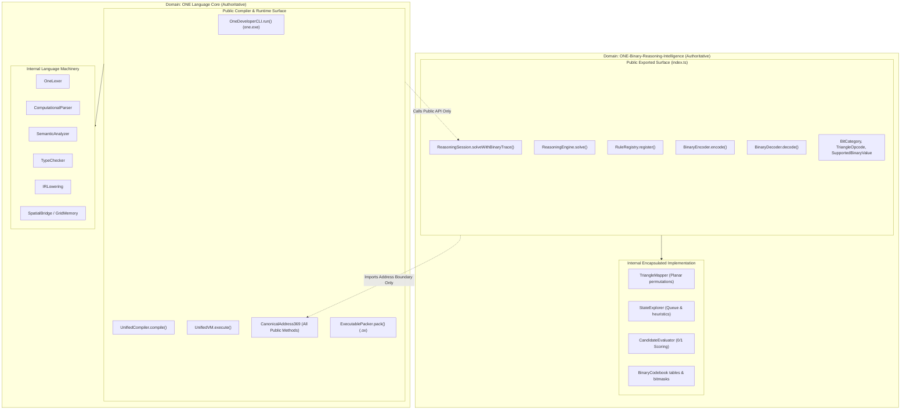
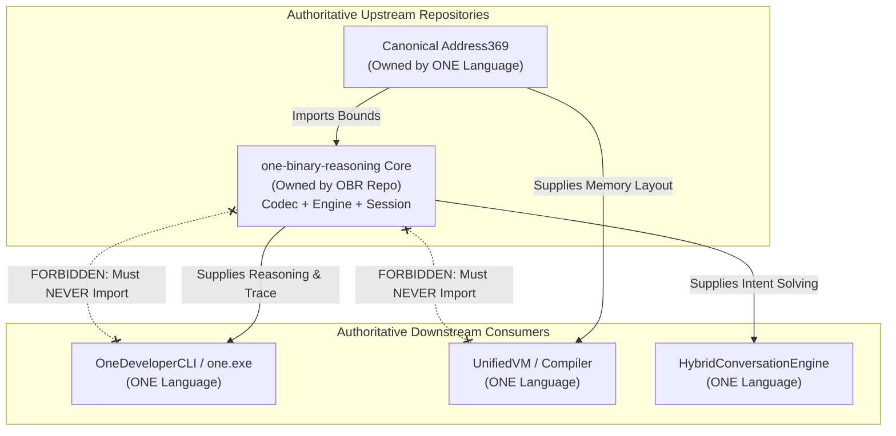

# ONE Intelligence — Task 6: Component Ownership & Integration Boundaries Specification

**Workspace:** `F:\ONE language`  
**Target Repositories:**  
1. **ONE Language:** `https://github.com/aayyaz3d-166/ONE-language.git` (`F:\ONE language`)  
2. **ONE Binary Reasoning Intelligence:** `https://github.com/aayyaz3d-166/ONE-Binary-Reasoning-Intelligence.git` (`F:\one-binary-reasoning`)  
**Specification Version:** `1.0.0-PROPOSED-GOVERNANCE`  
**Audit Protocol:** Strict READ-ONLY Cross-Repository Integration & Architectural Governance Audit  
**Execution Timestamp:** 2026-10-28T05:05:00+05:00  

---

## 1. Executive Governance Charter & Ownership Principles

To resolve cross-repository duplication, prevent architectural drift, and maintain the integrity of release artifacts ([`one.exe`](file:///F:/ONE%20language/dist/v1.0.1-rc/one.exe), [`cli-bundle.cjs`](file:///F:/ONE%20language/dist/v1.0.1-rc/cli-bundle.cjs)), this document establishes the authoritative ownership, integration strategy, API contracts, error code governance, and dependency direction across all shared and mirrored subsystems.

### Core Governance Principles

1. **Single Source of Truth (SSOT):** Every schema, error code, invariant, and algorithm has exactly one designated authoritative repository.
2. **Deterministic Parity Invariant:** Where code remains temporarily duplicated for build isolation, bit-for-bit or AST-level semantic parity must be enforced by automated verification.
3. **Freestanding Core Execution:** The production language runtime (`one.exe`) must never depend on remote network registries, unbundled dynamic dependencies, or active daemon processes during core execution.
4. **Permanent Safety Freeze:** Hardware actuation lockout (`actuationLock: true`, [`E8005`](file:///F:/ONE%20language/src/one/packer/ExecutableValidator.ts#L70), [`E6003`](file:///F:/ONE%20language/src/one/spatial/SpatialBridge.ts#L182)) and Address369 coordinate boundaries ($[0..368]$) are permanent invariants that cannot be altered by either repository.

---

## 2. Component Ownership & Integration Strategy Matrix

| Component Name | Relative Path in ONE | Relative Path in OBR | Authoritative Owner | Integration Strategy (Phase 1 vs Phase 2) | Ownership Rationale & Architectural Role |
| :--- | :--- | :--- | :--- | :--- | :--- |
| **Canonical Address369** | `src/one/address369_canonical.ts` | `src/shared/address369.ts` | **`ONE Language`** | **Phase 1:** Duplicated (100% byte-exact parity).<br>**Phase 2:** Extract to `@one/address369` zero-dep package. | Bedrock coordinate system of the ONE Language spatial lattice ($7 \times 7 \times 7 = 343$ cells) and symbolic registers ($[0..25]$). OBR consumes this purely as a coordinate boundary. |
| **Binary Codebook** | `src/binary/binaryCodebook.ts` | `src/binary/binaryCodebook.ts` | **`one-binary-reasoning`** | **Phase 1:** Duplicated with CI parity test.<br>**Phase 2:** Consume via OBR package export. | Authoritative mapping for 3-bit category headers, 6-bit planar triangle opcodes, and 9-bit address codewords. |
| **Deterministic Binary Encoder** | `src/binary/binaryEncoder.ts` | `src/binary/binaryEncoder.ts` | **`one-binary-reasoning`** | **Phase 1:** Duplicated with CI parity test.<br>**Phase 2:** Consume via OBR package export. | Upstream bitstream serialization engine. Enforces bit-level packing rules for scalars, coordinates, and opcodes. |
| **Deterministic Binary Decoder** | `src/binary/binaryDecoder.ts` | `src/binary/binaryDecoder.ts` | **`one-binary-reasoning`** | **Phase 1:** Duplicated with CI parity test.<br>**Phase 2:** Consume via OBR package export. | Upstream bitstream deserialization engine. Enforces fail-closed rejection of reserved patterns and stream exhaustion. |
| **Planar Triangle Mapper** | `src/binary/triangleMapper.ts` | `src/binary/triangleMapper.ts` | **`one-binary-reasoning`** | **Phase 1:** Duplicated with CI parity test.<br>**Phase 2:** Consume via OBR package export. | Geometric permutation math mapping 6-bit codes to triangle vertices $(c_1, e_1, c_2, e_2, c_3, e_3)$. |
| **Binary Language Types & Errors** | `src/binary/types.ts` | `src/binary/types.ts` | **`one-binary-reasoning`** | **Phase 1:** Duplicated (100% byte-exact parity).<br>**Phase 2:** Consume via OBR package export. | Defines `BitCategory`, `TriangleOpcode`, `SupportedBinaryValue`, and `BinaryError`. |
| **Bounded 0/1 Reasoning Engine** | `src/one/intelligence/reasoning/` | `src/reasoning/` | **`one-binary-reasoning`** | **Phase 1:** Duplicated with CI parity test.<br>**Phase 2:** Consume via OBR package export. | Core cognitive search engine: `ReasoningEngine`, `RuleRegistry`, `StateExplorer`, `CandidateEvaluator`. OBR is the primary research and benchmarking repo. |
| **Binary Reasoning Bridge** | `src/one/intelligence/reasoning/BinaryReasoningBridge.ts` | `src/integration/BinaryReasoningBridge.ts` | **`one-binary-reasoning`** | **Phase 1:** Duplicated with CI parity test.<br>**Phase 2:** Consume via OBR package export. | Bidirectional bridge serializing reasoning candidate tokens into 3/6/9-bit binary envelopes. |
| **Reasoning Session Coordinator** | *NOT PRESENT* | `src/integration/ReasoningSession.ts` | **`one-binary-reasoning`** | **Phase 1:** Backport to `ONE language`.<br>**Phase 2:** Consume via OBR package export. | High-level coordinator executing bounded reasoning and capturing bit-exact binary verification traces. OBR is the creator; ONE is the consumer. |
| **Unified Compiler & VM** | `src/one/UnifiedCompiler.ts`<br>`src/one/vm/UnifiedVM.ts` | *NOT PRESENT* | **`ONE Language`** | **Exclusive to ONE.** Never mirrored to OBR. | Production language frontend, AST, IR lowering, and stack virtual machine. |
| **ONEX Executable Packager (.ox)** | `src/one/packer/` | *NOT PRESENT* | **`ONE Language`** | **Exclusive to ONE.** Never mirrored to OBR. | 64-byte sealed executable container format, CRC32, payload SHA-256, and actuation lockout assertion (`E8005`). |
| **Native Neural Model Registry** | `src/one/native_model_registry.ts` | *NOT PRESENT* | **`ONE Language`** | **Exclusive to ONE.** Never mirrored to OBR. | Authoritative identity for `CUBIO-MODEL-STAGE1-V1` (148,912 parameters). |

---

## 3. Integration Strategy Evaluation & Trade-off Analysis

To resolve duplication without destabilizing the production compiler, four architectural integration strategies were evaluated:

### Option A: Controlled Duplication with Automated Parity Verification (RECOMMENDED FOR PHASE 1)
- **Mechanism:** Files remain physically present in both repositories. A dedicated CI parity script checks that files in `F:\ONE language\src\binary\` and `F:\ONE language\src\one\intelligence\reasoning\` match `F:\one-binary-reasoning` AST-for-AST (accounting only for ESM `.js` import specifiers).
- **Pros:**
  - **Zero Regression Risk:** `esbuild` bundling for `cli-bundle.cjs` and `one.exe` remains 100% stable and self-contained.
  - **No Network / Registry Overhead:** Builds require zero external npm package resolution or token authentication.
  - **Immediate Release Readiness:** Enables immediate backport of `ReasoningSession.ts` and implementation of `one reason` CLI verb.
- **Cons:** Requires running a parity verification script in CI; manual backporting when OBR updates.

### Option B: Versioned Private / Public Package (`@one/binary-reasoning`)
- **Mechanism:** `one-binary-reasoning` publishes to npm or GitHub Packages. `ONE language` adds `"@one/binary-reasoning": "^1.0.0"` to `package.json`.
- **Pros:** Clean architectural separation; standard SemVer governance; single physical source of truth.
- **Cons:** Introduces publishing pipeline overhead, credentials management, version bumping latency, and potential esbuild bundling challenges if ESM/CJS interop differs.

### Option C: Git Submodule or Direct Git Dependency
- **Mechanism:** `ONE language` includes `one-binary-reasoning` via `git submodule add` or `"dependencies": { "one-binary-reasoning": "github:aayyaz3d-166/ONE-Binary-Reasoning-Intelligence" }`.
- **Pros:** Tracks exact commit SHA without npm registry infrastructure.
- **Cons:** High developer friction (`submodule update` desyncs), fragile CI checkouts on Windows, and slower npm install times.

### Option D: Unified Monorepo Workspace (RECOMMENDED FOR PHASE 2 CONVERGENCE)
- **Mechanism:** Merge `one-binary-reasoning` into `ONE language` under `packages/one-binary-reasoning` using npm/pnpm workspaces.
- **Pros:** Atomic commits spanning compiler and reasoning; zero duplication; instant local linking; unified CI.
- **Cons:** Out of scope for Phase 1 stabilization; requires restructuring repository Git history.

> [!IMPORTANT]
> **Strategic Recommendation:**  
> - **Phase 1 (Immediate / Stabilization):** Adopt **Option A**. Backport `ReasoningSession.ts` directly into `src/one/intelligence/reasoning/`, enforce automated parity verification, and add `one reason` to the CLI.  
> - **Phase 2 (Convergence):** Transition to **Option D (Monorepo Workspace)** or **Option B (Versioned Package)** once v1.0.1 is published.

---

## 4. API Boundary & Encapsulation Contracts (Public vs Internal)



### Encapsulation Rules

1. **Downstream Consumption Rule:** `ONE language` must consume `one-binary-reasoning` **only** through its documented public entry points (`ReasoningSession`, `ReasoningEngine`, `BinaryEncoder`, `BinaryDecoder`). Direct coupling to internal classes (`StateExplorer`, `TriangleMapper`) is prohibited.
2. **Upstream Substrate Rule:** `one-binary-reasoning` must consume `CanonicalAddress369` **only** through its public boundary query methods (`spatialCoordToCanonicalAddress`, `toDisplayIndex`, `inspectAddress`, constants). OBR must never access `SpatialBridge` or `GridMemory`.

---

## 5. Schema, Invariant & Error Code Ownership

### Error Code Governance

A strict partitioned namespace ensures zero collision between compiler, runtime, binary codec, and safety errors:

```
┌────────────────────────────────────────────────────────────────────────┐
│                      ERROR CODE NAMESPACE REGISTRY                     │
├─────────────────┬──────────────────────┬───────────────────────────────┤
│ Code Range      │ Authoritative Owner  │ Subsystem Scope               │
├─────────────────┼──────────────────────┼───────────────────────────────┤
│ E1000 – E1999   │ ONE Language         │ Lexer & Grammar Router        │
│ E2000 – E2999   │ ONE Language         │ Computational Parser & AST    │
│ E3000 – E3999   │ ONE Language         │ Semantic Analyzer & Types     │
│ E4000 – E4999   │ ONE Language         │ IR Lowering & Optimization    │
│ E5000 – E5999   │ ONE Language         │ UnifiedVM Runtime & Stream    │
│ E6000 – E6999   │ ONE Language         │ Spatial Lattice & Hardware    │
│ E8000 – E8999   │ ONE Language         │ Executable Container Security │
│ BinaryError.*   │ one-binary-reasoning │ 3/6/9-Bit Codec & Protocol    │
└─────────────────┴──────────────────────┴───────────────────────────────┘
```

#### Detailed Namespace Allocation:
- **`ONE Language` Error Codes:**
  - [`E8005`](file:///F:/ONE%20language/src/one/packer/ExecutableValidator.ts#L70): `ERR_ACTUATION_LOCKED` — Hardware actuation lock violation in `.ox` container.
  - [`E6003`](file:///F:/ONE%20language/src/one/spatial/SpatialBridge.ts#L182): `ERR_SPATIAL_WRITE_LOCKED` — Illegal write to spatial lattice during actuation lock.
  - [`E6001`](file:///F:/ONE%20language/src/one/spatial/SpatialBridge.ts#L120): `ERR_SPATIAL_COORD_OOB` — Coordinate outside $[0..6, 0..6, 0..6]$.
  - [`E6002`](file:///F:/ONE%20language/src/one/spatial/SpatialBridge.ts#L150): `ERR_SPATIAL_ADDR_OOB` — Canonical address outside $[26..368]$.
  - [`E5012`](file:///F:/ONE%20language/src/one/vm/UnifiedVM.ts#L840): `ERR_STREAM_EXHAUSTED` — Input stream exhaustion on `INPUT` opcode.
  - `E5001`–`E5007`: Division-by-zero, unknown opcode, stack underflow, undefined identifier, max call depth ($512$), max instructions ($10^6$).
- **`one-binary-reasoning` Error Codes (`BinaryError`):**
  - `INVALID_3BIT_PATTERN`: Unrecognized 3-bit category prefix.
  - `INVALID_6BIT_CODE`: Opcode integer outside $[0..63]$.
  - `INVALID_9BIT_CODE`: Address code outside $[0..511]$.
  - `ADDRESS_OUT_OF_BOUNDS`: Pointer in reserved range $[369..511]$.
  - `RESERVED_OPCODE_REJECTED`: Reserved marker opcode `0x3e` or `0x3f` encountered.
  - `INCOMPLETE_STREAM`: Bitstream ended prematurely.
  - `INTEGER_OVERFLOW`, `STRING_OVERFLOW`, `UNSUPPORTED_VALUE_TYPE`.

### Schema Ownership

- **`ONE Language` Owns:**
  - `.ox` (ONEX) 64-byte binary container header schema ([`ExecutableArtifact.ts`](file:///F:/ONE%20language/src/one/packer/ExecutableArtifact.ts)).
  - `UnifiedIRProgram` 3-address instruction schema ([`UnifiedIR.ts`](file:///F:/ONE%20language/src/one/ir/UnifiedIR.ts)).
  - Canonical Address369 allocation schema ($[0..25]$ symbolic, $[26..368]$ spatial, $[369..511]$ reserved).
- **`one-binary-reasoning` Owns:**
  - 3/6/9-bit binary framing specification.
  - `ReasoningInput<T>` problem specification schema.
  - `SolvedBinaryBundle<T>` and `BinaryReasoningEnvelope` verification schema.

---

## 6. Compatibility & Versioning Policy

1. **Semantic Versioning (SemVer 2.0.0):**
   - **MAJOR:** Breaking changes to public interfaces, opcode numbering, or serialized envelope formats.
   - **MINOR:** Backward-compatible additions (e.g. new unassigned triangle opcodes in range `0x18..0x3d`, new `ReasoningSession` configuration options).
   - **PATCH:** Bugfixes, performance optimizations, and documentation updates.
2. **Permanent Invariant Freeze (No Breaking Changes Allowed):**
   - Canonical Address369 bounds $[0..368]$ are permanently frozen.
   - Actuation lockout default (`actuationLock: true`, `E8005`, `E6003`) is permanently frozen.
   - Reserved triangle opcodes `0x3e` (`MARKER_ESCAPE`) and `0x3f` (`MARKER_EOS`) are permanently frozen.
3. **Cross-Repository Synchronization Rule:**
   - Any commit modifying `src/binary/*` in `one-binary-reasoning` must include a version bump and an automated PR/commit to synchronize `src/binary/*` in `ONE language`.

---

## 7. Dependency Direction & Forbidden Circular Dependencies



### Explicit Forbidden Circular Dependencies

1. **`one-binary-reasoning` $\rightarrow$ `UnifiedVM` / Compiler / CLI is STRICTLY FORBIDDEN:**  
   `one-binary-reasoning` must remain 100% freestanding pure TypeScript with zero imports from `src/one/`. It must never reference `UnifiedVM`, `OneLexer`, `ComputationalParser`, or `OneDeveloperCLI`.
2. **`CanonicalAddress369` $\rightarrow$ `src/binary/` is STRICTLY FORBIDDEN:**  
   `address369_canonical.ts` must have zero external dependencies. It must never import `BinaryCodebook`, `BinaryEncoder`, or `types.ts`.
3. **`SpatialBridge` $\rightarrow$ Reasoning Engine is STRICTLY FORBIDDEN:**  
   `SpatialBridge.ts` operates as a low-level memory barrier in `UnifiedVM`. It must never import or invoke `ReasoningEngine` or `ReasoningSession`.

---

## 8. Optional-Service Boundaries

```
┌────────────────────────────────────────────────────────────────────────┐
│                   OPTIONAL-SERVICE ISOLATION CONTRACT                  │
├───────────────────┬──────────────┬─────────────────────────────────────┤
│ Service Subsystem │ Architecture │ Isolation Guarantee                 │
├───────────────────┼──────────────┼─────────────────────────────────────┤
│ 3D Memory Studio  │ Multi-Process│ Standalone WebSocket/HTTP server.   │
│ (src/studio/)     │ Optional     │ ZERO runtime imports in one.exe.    │
├───────────────────┼──────────────┼─────────────────────────────────────┤
│ Mesh Networking   │ Multi-Process│ Standalone P2P socket cluster.      │
│ (src/mesh/, net/) │ Optional     │ ZERO runtime imports in one.exe.    │
├───────────────────┼──────────────┼─────────────────────────────────────┤
│ OMail & PQC Seal  │ Standalone   │ Post-quantum mail daemon.           │
│ (src/mail/)       │ Optional     │ ZERO runtime imports in one.exe.    │
├───────────────────┼──────────────┼─────────────────────────────────────┤
│ Monorepo Packages │ Modular Libs │ Standalone helpers in packages/.    │
│ (packages/*)      │ Optional     │ ZERO runtime imports in one.exe.    │
└───────────────────┴──────────────┴─────────────────────────────────────┘
```

- **Core Runtime Isolation:** Neither `OneDeveloperCLI.ts` nor `UnifiedVM.ts` nor `ReasoningSession.ts` shall import from `src/studio/`, `src/mesh/`, `src/net/`, or `src/mail/`.
- **Optional Execution:** Running `one run`, `one build`, or `one reason` must succeed without starting any background daemon or network socket.

---

## 9. Migration Path, Parity Testing & Rollback Requirements

### Phase 1 Execution Plan (Zero-Breaking-Change Migration)

1. **Step 1: Parity Verification Script:**  
   Implement a read-only script (`scripts/verify-repo-parity.js`) that compares AST structures and hashes between `src/binary/` in both repositories, alerting on any drift.
2. **Step 2: Backport `ReasoningSession.ts` to `ONE language`:**  
   Copy `F:\one-binary-reasoning\src\integration\ReasoningSession.ts` to `F:\ONE language\src\one\intelligence\reasoning\ReasoningSession.ts`. Adjust import paths to local ONE structure.
3. **Step 3: Implement `one reason` CLI Command Verb:**  
   Extend `OneDeveloperCLI.ts` with `handleReason()` to invoke `ReasoningSession.solveWithBinaryTrace()`.
4. **Step 4: Isolate Lineage A Prototype:**  
   Relocate `src/compiler/` and `src/vm/cubioVM.ts` to `legacy/lineage_a_spatial_prototype/`. Extract `GridMemory` to `src/one/spatial/GridMemory.ts`.

### Rollback Protocol

If any regression occurs during Phase 1:
- Revert `OneDeveloperCLI.ts` to its verified `v1.0.1-rc` baseline.
- `ReasoningSession.ts` can be deleted or disabled with zero effect on existing commands (`init`, `run`, `check`, `build`, `format`, `test`), as existing commands do not import it.
- Existing release binaries (`one.exe` SHA-256 `479186ca...`) remain 100% functional and protected in `dist/v1.0.1-rc/`.

---

## 10. Decisions Requiring Owner Approval (Sign-Off Register)

The following formal decisions require repository owner review and sign-off before executing code modifications in Phase 1:

| Decision ID | Decision Subject | Proposed Action | Impact on Codebase | Owner Approval Status |
| :--- | :--- | :--- | :--- | :--- |
| **`DEC-01`** | **Backport `ReasoningSession.ts`** | Copy `ReasoningSession.ts` from OBR to `F:\ONE language\src\one\intelligence\reasoning\ReasoningSession.ts`. | Adds missing cognitive coordinator to ONE; enables bit-exact binary verification traces. | **PENDING APPROVAL** |
| **`DEC-02`** | **Implement `one reason` CLI Verb** | Add `reason` command verb to `OneDeveloperCLI.ts` (`one reason <task.json> [--trace]`). | Exposes cognitive reasoning on the production CLI; bundles into `one.exe`. | **PENDING APPROVAL** |
| **`DEC-03`** | **Lineage A Prototype Isolation** | Relocate `src/compiler/` and `src/vm/cubioVM.ts` to `legacy/lineage_a_spatial_prototype/`. Relocate `gridMemory.ts` to `src/one/spatial/`. | Eliminates dual-compiler ambiguity; cleans production import paths. | **PENDING APPROVAL** |
| **`DEC-04`** | **Adoption of Strategy A for Phase 1** | Maintain controlled duplication of `src/binary/` with automated CI parity tests rather than immediate npm publishing. | Zero risk of package registry dependency breakage; maintains freestanding SEA build. | **PENDING APPROVAL** |
| **`DEC-05`** | **Authoritative Ownership Assignments** | Officially ratify `ONE Language` as owner of `Address369` / `.ox` / `UnifiedVM`, and `one-binary-reasoning` as owner of `Binary Codec` / `ReasoningEngine` / `ReasoningSession`. | Formalizes architectural authority; binds future PRs to SSOT rules. | **PENDING APPROVAL** |

---
*Task 6 Component Ownership & Integration Boundaries Specification complete. All repository files remain untouched in strict read-only compliance.*
