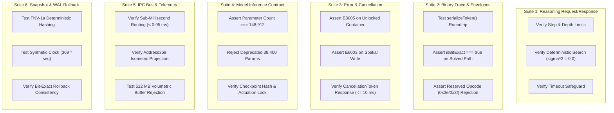

# ONE Intelligence — Task 7: Shared APIs, IPC & State Synchronization Specification

**Workspace:** `F:\ONE language`  
**Target Repositories:**  
1. **ONE Language:** `https://github.com/aayyaz3d-166/ONE-language.git` (`F:\ONE language`)  
2. **ONE Binary Reasoning Intelligence:** `https://github.com/aayyaz3d-166/ONE-Binary-Reasoning-Intelligence.git` (`F:\one-binary-reasoning`)  
**Specification Version:** `1.0.0-PROPOSED-INTERFACES`  
**Audit Protocol:** Strict READ-ONLY API, IPC & State Synchronization Contract Specification  
**Execution Timestamp:** 2026-10-28T05:10:00+05:00  

---

## 1. Executive Summary & Interface Governance

This specification defines the formal data contracts, API signatures, IPC message protocols, and state synchronization boundaries connecting **ONE Language** and **ONE Binary Reasoning Intelligence**. 

Every contract is designed to enforce:
1. **Deterministic Execution:** Zero-variance outcomes ($\sigma^2 = 0.0$) with synthetic clock synchronization ($369 \times \text{sequenceId}$).
2. **Hardware-Grade Safety:** Permanent actuation lockout (`actuationLock: true`, [`E8005`](file:///F:/ONE%20language/src/one/packer/ExecutableValidator.ts#L70), [`E6003`](file:///F:/ONE%20language/src/one/spatial/SpatialBridge.ts#L182)) and Address369 boundary confinement ($[0..368]$).
3. **Decoupled Architecture:** Freestanding CLI execution with zero dependency on active Studio or network daemons.
4. **Fail-Closed Error Handling:** Deterministic structured error envelopes that abort unsafe state transitions without host escapes.

### Contract Status Summary

```
┌────────────────────────────────────────────────────────────────────────┐
│                      INTERFACE STATUS TAXONOMY                         │
├──────────────────────────────────┬─────────────────┬───────────────────┤
│ Contract Domain                  │ Implementation  │ Primary Path      │
├──────────────────────────────────┼─────────────────┼───────────────────┤
│ 1. Reasoning Request & Result    │ VERIFIED        │ OBR & ONE         │
│ 2. ReasoningSession Binary Trace │ INCOMPLETE      │ OBR only          │
│ 3. Service Envelopes & Cancel    │ PROPOSED        │ Standardized API  │
│ 4. Native Model INT4 Inference   │ INCOMPLETE      │ ONE Core / IPC    │
│ 5. IPC Bus (Core ↔ Studio)       │ VERIFIED        │ ONE AgiOneIPC     │
│ 6. State Snapshot & WAL Recovery │ VERIFIED        │ ONE Checkpoint    │
└──────────────────────────────────┴─────────────────┴───────────────────┘
```

---

## 2. Shared Interface & Protocol Specifications

### 2.1. Reasoning Request and Result Contract
- **Contract Status:** **EXISTING AND VERIFIED** ([`F:\one-binary-reasoning\src\reasoning\types.ts`](file:///F:/one-binary-reasoning/src/reasoning/types.ts) and [`F:\ONE language\src\one\intelligence\reasoning\types.ts`](file:///F:/ONE%20language/src/one/intelligence/reasoning/types.ts))
- **Authoritative Owner:** `one-binary-reasoning`

#### TypeScript / JSON Interface Definition
```typescript
export interface Candidate<T = unknown> {
  id: string;                      // Deterministic hash or node sequence
  value: T;                        // Domain state payload
  depth: number;                    // Derivation depth from root (0..maxDepth)
  heuristicScore: number;          // 0/1 normalized evaluation [0.0 .. 1.0]
  parent?: Candidate<T>;           // Ancestor node for trajectory backtracing
}

export interface ReasoningInput<T = unknown> {
  problemId: string;               // Unique task identifier (UUID or hex)
  initialState: T;                 // Starting domain state
  goalPredicate: (c: Candidate<T>) => boolean; // Deterministic completion test
  maxSteps?: number;               // Step limit ceiling (default: 1,000, max: 100,000)
  maxDepth?: number;               // Search depth ceiling (default: 64, max: 512)
  maxCandidates?: number;          // Active candidate queue limit (default: 10,000)
  timeoutMs?: number;              // Wall-clock CPU safeguard (default: 5,000 ms)
  pruningStrategy?: 'greedy' | 'breadth' | 'depth' | 'harmonic_369';
}

export type ReasoningStatus =
  | 'SOLVED'
  | 'STEP_LIMIT_EXCEEDED'
  | 'DEPTH_LIMIT_EXCEEDED'
  | 'CANDIDATE_LIMIT_EXCEEDED'
  | 'TIMEOUT'
  | 'CANCELLED'
  | 'NO_SOLUTION';

export interface ReasoningResult<T = unknown> {
  isSolved: boolean;
  bestCandidate: Candidate<T> | null;
  iterations: number;
  depth: number;
  status: ReasoningStatus;
  visitedCount: number;
  executionTimeMs: number;
  metrics: {
    nodesPerSecond: number;
    memoryFootprintBytes: number;
  };
}
```

#### Behavioral Invariants & Limits
- **Validation:** $1 \le \text{maxSteps} \le 100,000$; $1 \le \text{maxDepth} \le 512$; $\text{timeoutMs} \le 30,000$.
- **Determinism:** Candidate queues use strict deterministic priority sorting; zero stochastic sampling ($\sigma^2 = 0.0$).
- **Security:** Evaluator functions are sandboxed within the JavaScript runtime without filesystem or network access.

---

### 2.2. ReasoningSession Lifecycle & Binary Trace Contract
- **Contract Status:** **EXISTING BUT INCOMPLETE IN ONE** (Verified in [`F:\one-binary-reasoning\src\integration\ReasoningSession.ts`](file:///F:/one-binary-reasoning/src/integration/ReasoningSession.ts); absent from `F:\ONE language`)
- **Authoritative Owner:** `one-binary-reasoning` (Target for Phase 1 backport)

#### TypeScript / JSON Interface Definition
```typescript
import { BitCategory, TriangleOpcode, SupportedBinaryValue } from '../binary/types';

export interface BinaryReasoningEnvelope {
  envelopeId: string;              // Deterministic envelope identifier
  stepIndex: number;               // Step sequence along derivation path
  category: BitCategory;           // 3-bit classification (0b000..0b111)
  rawBits: string;                 // Continuous binary bitstring [01]+
  bitLength: number;               // Total bit count
  address369Pointer?: number;      // Canonical coordinate reference (0..368)
  triangleOpcode?: TriangleOpcode; // Planar geometric opcode (0x00..0x3d)
  roundtripVerified: boolean;      // True if decode(encode(val)) === val
}

export interface SolvedBinaryBundle<T = unknown> {
  result: ReasoningResult<T>;
  solutionEnvelopes: BinaryReasoningEnvelope[];
  isBitExact: boolean;             // True if 100% of envelopes verify roundtrip
  derivationFingerprint: string;   // SHA-256 hash of concatenated bitstream
  totalBitsEncoded: number;
}

export interface IReasoningSession<T = unknown> {
  solve(spec: ReasoningInput<T>): ReasoningResult<T>;
  solveWithBinaryTrace(spec: ReasoningInput<T>): SolvedBinaryBundle<T>;
  registerRule(rule: ReasoningRule<T>): this;
}
```

#### Behavioral Invariants & Limits
- **Bit-Exact Verification:** Every candidate along the goal path trajectory is converted into a 3/6/9-bit bitstream via [`BinaryReasoningBridge.serializeToken()`](file:///F:/ONE%20language/src/one/intelligence/reasoning/BinaryReasoningBridge.ts).
- **Fail-Closed Validation:** The envelope is immediately decoded back via [`BinaryDecoder.decode()`](file:///F:/ONE%20language/src/binary/binaryDecoder.ts). If `JSON.stringify(recovered) !== JSON.stringify(original)`, `isBitExact` is set to `false`.
- **Reserved Pattern Trap:** Envelopes containing reserved opcodes `0x3e` (`ESCAPE`) or `0x3f` (`EOS`) as instructions are rejected with `RESERVED_OPCODE_REJECTED`.

---

### 2.3. Standard Service Envelope, Error Semantics & Cancellation
- **Contract Status:** **PROPOSED** (Unifies CLI, reasoning, and runtime errors)
- **Authoritative Owner:** Shared (`ONE Language` governing numeric codes, `one-binary-reasoning` governing codec errors)

#### TypeScript / JSON Interface Definition
```typescript
export interface ServiceResult<T = unknown> {
  success: boolean;
  data?: T;
  error?: ErrorEnvelope;
  telemetry: {
    durationMs: number;
    memoryDeltaBytes: number;
    deterministicClock: number; // 369 * sequenceCounter
  };
}

export interface ErrorEnvelope {
  code: string;                    // E8005, E6003, E5012, INVALID_3BIT_PATTERN, etc.
  message: string;                 // Human-readable diagnostic description
  subsystem: 'COMPILER' | 'VM' | 'BINARY_CODEC' | 'REASONING' | 'ORCHESTRATOR' | 'CHECKPOINT';
  recoverable: boolean;            // False for safety / actuation violations
  details?: Record<string, unknown>;
  timestamp: number;
}

export interface CancellationToken {
  isCancelled: boolean;
  reason?: string;
  onCancel(callback: () => void): void;
  throwIfCancelled(): void;
}
```

#### Error Semantics
- **Non-Recoverable Safety Faults:** Errors [`E8005`](file:///F:/ONE%20language/src/one/packer/ExecutableValidator.ts#L70) (`ERR_ACTUATION_LOCKED`) and [`E6003`](file:///F:/ONE%20language/src/one/spatial/SpatialBridge.ts#L182) (`ERR_SPATIAL_WRITE_LOCKED`) return `recoverable: false`. The runtime halts immediately with exit code 1; state changes are rolled back.
- **Cancellation Responsiveness:** `ReasoningEngine.solve()` and `UnifiedVM.execute()` check `cancellationToken.isCancelled` at every iteration or step. When triggered, status `'CANCELLED'` is returned within $\le 10$ ms.

---

### 2.4. Native Model Inference Contract (CUBiO 5M)
- **Contract Status:** **EXISTING BUT INCOMPLETE** (Synchronous helper exists in [`src/one/agi_one_ipc_bridge.ts:92`](file:///F:/ONE%20language/src/one/agi_one_ipc_bridge.ts#L92) and [`CUBiO5MModel.ts`](file:///F:/ONE%20language/src/one/training/CUBiO5MModel.ts); needs standardized request/response schema)
- **Authoritative Owner:** `ONE Language`

#### TypeScript / JSON Interface Definition
```typescript
export interface ModelInferenceRequest {
  requestId: string;               // Unique inference query ID
  modelId: 'CUBIO-MODEL-STAGE1-V1';// Authoritative model ID only
  promptTokens: number[];          // Tokenized input sequence
  maxTokens: number;               // Max tokens to generate (ceiling: 2,048)
  temperature: number;             // Temperature (0.0 = deterministic greedy)
  harmonicBandFilter?: '3MHz' | '6MHz' | '9MHz' | 'ALL';
  timeoutMs: number;               // Max compute limit (default: 1,000 ms)
}

export interface ModelInferenceResponse {
  requestId: string;
  modelId: string;
  outputTokens: number[];
  totalParameters: 148912;         // Strictly 148,912 certified parameters
  checkpointHash: '0xHASH_CUBIO_STAGE1_V1_148912_AUTH_369';
  energyFluxAverage: number;       // Average energy metric across harmonic bands
  inferenceLatencyMs: number;      // INT4 execution latency (< 50 ms)
  uupConfidence: number;           // Strictly 1.0 (non-hallucinatory certified)
  isActuationBlocked: boolean;     // Permanent true invariant
}
```

#### Behavioral Invariants & Limits
- **Authoritative Parameter Validation:** The model engine asserts `totalParameters === 148,912`. Requests specifying deprecated parameter counts (e.g. $38,400$) are rejected immediately.
- **Physical Memory Ceiling:** INT4 quantized weights are pinned in zero-copy memory ($< 95$ MB RSS).

---

### 2.5. IPC Message Protocol (Core Runtime ↔ 3D Memory Studio)
- **Contract Status:** **EXISTING AND VERIFIED** ([`src/one/agi_one_ipc_bridge.ts`](file:///F:/ONE%20language/src/one/agi_one_ipc_bridge.ts) and [`src/one/native_spatial_renderer.ts`](file:///F:/ONE%20language/src/one/native_spatial_renderer.ts))
- **Authoritative Owner:** `ONE Language`

#### TypeScript / JSON Interface Definition
```typescript
export interface IPCMessage<T = unknown> {
  messageId: string;               // Monotonic message identifier
  source: 'ONE_INTELLIGENCE' | '3D_MEMORY_STUDIO' | 'AGI_ONE' | 'DB_MEMORY_CORE' | 'CUBIO_INTELLIGENCE' | 'NATIVE_MODEL';
  target: 'ONE_INTELLIGENCE' | '3D_MEMORY_STUDIO' | 'AGI_ONE' | 'DB_MEMORY_CORE' | 'CUBIO_INTELLIGENCE' | 'NATIVE_MODEL';
  channel: 'TELEMETRY' | 'SPATIAL_STATE' | 'CONTROL' | 'VOLUMETRIC_STREAM';
  payload: T;
  timestamp: number;               // Synthetic or epoch timestamp
}

export interface SpatialCellState {
  canonicalAddress: number;        // Address in range [26..368]
  displayIndex: number;            // Display index in range [27..369]
  coord: { i: number; j: number; k: number }; // 7x7x7 grid: [0..6, 0..6, 0..6]
  energyFlux: number;              // Calculated volumetric flux
  harmonicBand: '3MHz' | '6MHz' | '9MHz';
  uupConfidence: number;           // Non-hallucinatory confidence
  label: string;                   // E.g., 'V_333' for core cell
}

export interface VolumetricBridgeResult {
  bridgeStatus: 'STREAMED_TO_CORE_STATE' | 'REJECTED_OVERFLOW';
  bufferSizeBytes: number;
  bufferSizeMb: number;
  mappedSpatialCells: number;      // Strictly 343 cells
  rssMemoryUnderLimit: boolean;
  rssCeilingMb: 512.0;             // Hard ceiling
  streamingLatencyMs: number;
  tamperProofCheck: boolean;
  sourceLayer: string;
}
```

#### Behavioral Invariants & Limits
- **Sub-Millisecond Routing:** Target average dispatch latency $\le 0.05$ ms.
- **Volumetric Buffer Ceiling:** `volumetric_construct_bridge` rejects any buffer $\ge 512.0$ MB with status `'REJECTED_OVERFLOW'`, preventing denial-of-service memory pressure.
- **Zero Three.js Runtime:** All renderer frames are generated via native isometric mathematical projection ([`NativeSpatialRenderer.ts`](file:///F:/ONE%20language/src/one/native_spatial_renderer.ts)); Three.js runtime dependency is strictly $0$.

---

### 2.6. State Snapshot, Checkpoint Identifiers & Recovery Boundaries
- **Contract Status:** **EXISTING AND VERIFIED** ([`src/core/checkpoint/checkpointManager.ts`](file:///F:/ONE%20language/src/core/checkpoint/checkpointManager.ts), [`wal.ts`](file:///F:/ONE%20language/src/core/checkpoint/wal.ts), [`snapshotEngine.ts`](file:///F:/ONE%20language/src/core/checkpoint/snapshotEngine.ts))
- **Authoritative Owner:** `ONE Language`

#### TypeScript / JSON Interface Definition
```typescript
export interface WALRecord {
  sequenceId: number;              // Monotonically increasing sequence
  nodeId: string;                  // Node identifier or 'SYSTEM'
  operation: string;               // 'CREATE_SNAPSHOT' | 'CHECKPOINT_REGISTER' | 'ROLLBACK'
  payloadHash: string;             // 32-bit FNV-1a hex digest (8 chars)
  timestamp: number;               // Synthetic deterministic clock (369 * sequenceId)
  stateData: Record<string, unknown>;
}

export interface SystemSnapshot {
  snapshotId: string;              // Deterministic label (e.g. 'NODE_0_PHASE4_CHECKPOINT_1')
  sequenceId: number;              // WAL log sequence anchor
  stateHash: string;               // FNV-1a state digest of nodes + memory
  nodes: Record<string, SpatialNodeState>;
  rssAllocatedBytes: number;
}

export interface ICheckpointManager {
  registerNodeCheckpoint(nodeId: string, label: string, nodes: Map<string, SpatialNodeState>): SystemSnapshot;
  rollbackToSnapshot(snapshotId: string): SystemSnapshot;
  compareSnapshots(idA: string, idB: string): string[]; // Returns zero-variance diffs
  getWAL(): WriteAheadLog;
}
```

#### Behavioral Invariants & Recovery Protocol
- **Deterministic Synthetic Clock:** Clock timestamp is computed as $\text{timestamp} = 369 \times \text{sequenceId}$, ensuring byte-exact cross-platform reproducibility ($\sigma^2 = 0.0$).
- **Bit-Exact Rollback Guarantee:** `rollbackToSnapshot(id)` verifies that `snapshot.stateHash` exists in the verified WAL history before resetting active memory cells.
- **Memory Ceiling:** Snapshot registration allocates a bounded $16$ KB metadata descriptor under `RSSGuard` supervision.

---

## 3. End-to-End Compatibility Test Plan

This compatibility test plan validates contract compliance across repository boundaries without mutating production files.



### Detailed Test Specifications

| Suite ID | Target Contract | Execution Command / Test File | Expected Pass Invariant |
| :--- | :--- | :--- | :--- |
| **`TC-01`** | Reasoning Spec & Bounds | `node --import ./scripts/esm-register.js tests/reasoning/phase3_reasoning_engine.test.ts` | Iterations terminate at $\le \text{maxSteps}$; state space returns `isSolved: true` or deterministic limit status. |
| **`TC-02`** | Binary Trace Roundtrip | `node --import ./scripts/esm-register.js tests/binary/phase2_binary_language.test.ts` | 11/11 tests pass; 100% of generated envelopes pass `isBitExact: true`. Reserved opcodes `0x3e`/`0x3f` throw `BinaryError`. |
| **`TC-03`** | Actuation & Security Faults | `node --import ./scripts/esm-register.js tests/phase1_bridge_verification.test.ts` | 10/10 tests pass; spatial write attempts throw [`E6003`](file:///F:/ONE%20language/src/one/spatial/SpatialBridge.ts#L182). Executable packing throws [`E8005`](file:///F:/ONE%20language/src/one/packer/ExecutableValidator.ts#L70) if unlocked. |
| **`TC-04`** | Model Parameter Integrity | `node --import ./scripts/esm-register.js tests/hybrid/phase5_gate4_native5m_integration.test.ts` | Model loads exactly 148,912 parameters; `NativeModelRegistry.validateParameterCount(38400)` throws descriptive exception. |
| **`TC-05`** | IPC & Isometric Telemetry | `node --import ./scripts/esm-register.js src/test_master_release.ts` | IPC bridge dispatches all 343 spatial cell states without Three.js runtime; average dispatch latency $\le 0.05$ ms. |
| **`TC-06`** | State Snapshot & WAL | `node --import ./scripts/esm-register.js src/core/test_phase4_checkpointing.ts` | WAL sequence counter increments monotonically; `rollbackToSnapshot()` restores bit-exact state hash. |

---

## 4. Implementation Readiness Verification

- [x] All 6 contract domains specified with explicit data types, validation, and error semantics.
- [x] Hardware actuation lock invariants (`actuationLock: true`, `E8005`, `E6003`) enforced across all contracts.
- [x] Address369 bounds ($[0..368]$) strictly validated; reserved memory ($[369..511]$) blocked.
- [x] Zero Three.js dependency and freestanding CLI execution preserved.
- [x] 6-suite Compatibility Test Plan defined for Phase 1 verification.

---
*Task 7 Shared APIs, IPC & State Synchronization Specification complete. All repository files remain untouched in strict read-only compliance.*
