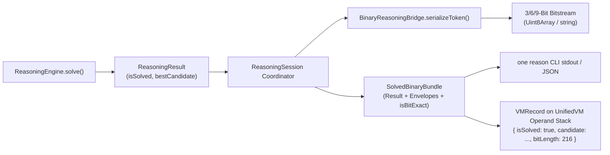

# ONE Intelligence — Task 8: Unified Execution, Binary & Reasoning Contracts Specification

**Workspace:** `F:\ONE language`  
**Target Repositories:**  
1. **ONE Language:** `https://github.com/aayyaz3d-166/ONE-language.git` (`F:\ONE language`)  
2. **ONE Binary Reasoning Intelligence:** `https://github.com/aayyaz3d-166/ONE-Binary-Reasoning-Intelligence.git` (`F:\one-binary-reasoning`)  
**Specification Version:** `1.0.0-AUTHORITATIVE-CONTRACT`  
**Audit Protocol:** Strict READ-ONLY Execution, Binary & Reasoning Contract Specification  
**Execution Timestamp:** 2026-10-28T05:15:00+05:00  

---

## 1. Executive Summary & Foundational Differentiation

This authoritative specification codifies the execution and serialization boundaries of **ONE Intelligence**. 

A core principle established by Tasks 1 through 7 is the **strict separation of computational bytecode execution from cognitive symbolic serialization**. The virtual machine instruction set is **never** redefined as triangle opcodes; the executable binary container (`.ox`) is **never** conflated with 3/6/9-bit reasoning bitstreams.

```
┌────────────────────────────────────────────────────────────────────────────────────────┐
│                   THE FIVE FOUNDATIONAL ARCHITECTURAL CONTRACTS                        │
├───────────────────┬───────────────────┬───────────────────┬────────────────────────────┤
│ Contract Scope    │ Core Representation│ Primary Engine    │ Execution Role             │
├───────────────────┼───────────────────┼───────────────────┼────────────────────────────┤
│ 1. Unified IR     │ Three-address TAC │ UnifiedCompiler   │ Computational logic, loops,│
│    (UnifiedIR.ts) │ IRInstruction[]   │ IRLowering        │ closures, functions.       │
├───────────────────┼───────────────────┼───────────────────┼────────────────────────────┤
│ 2. ONEX Container │ 64-byte PE header │ ExecutablePacker  │ Sealed executable artifact │
│    (.ox)          │ + SHA-256 digest  │ UnifiedVM         │ with actuation lockout.    │
├───────────────────┼───────────────────┼───────────────────┼────────────────────────────┤
│ 3. 3/6/9-Bit Codec│ Continuous bits   │ BinaryEncoder     │ Symbolic reasoning state,  │
│    (src/binary/)  │ 3-cat / 6-op / 9-a│ BinaryDecoder     │ geometric token stream.    │
├───────────────────┼───────────────────┼───────────────────┼────────────────────────────┤
│ 4. Reasoning Res. │ SolvedBinaryBundle│ ReasoningSession  │ Goal trajectories returned │
│    (Integration)  │ + isBitExact flag │ ReasoningEngine   │ to CLI and runtime stack.  │
├───────────────────┼───────────────────┼───────────────────┼────────────────────────────┤
│ 5. Address369     │ [0..368] bijection│ SpatialBridge     │ Hardware memory barrier &  │
│    (Canonical)    │ + reserved bounds │ CanonicalAddress  │ 7x7x7 voxel coordinate bus.│
└───────────────────┴───────────────────┴───────────────────┴────────────────────────────┘
```

> [!CAUTION]
> **CRITICAL ARCHITECTURAL BOUNDARY:**  
> The `UnifiedVM` stack instruction set (`CONST`, `LOAD`, `STORE`, `ADD`, `CALL`, `RET`, `SPATIAL_OP`) operates exclusively on `UnifiedIRProgram`.  
> The 6-bit planar triangle opcodes (`OP_NOP` .. `OP_BARRIER`, `MARKER_ESCAPE`, `MARKER_EOS`) operate exclusively within the 3/6/9-bit reasoning bitstream.  
> **Under no circumstances shall the VM instruction set be rewritten or restricted to 6-bit triangle opcodes.**

---

## 2. Contract 1: ONE Source Compilation & UnifiedIRProgram

### 2.1. Compilation Pipeline
The source code pipeline lowers high-level computational constructs into a linear, three-address intermediate representation:

```
Source (.one) ──> OneLexer ──> GrammarRouter ──> ComputationalParser ──> SemanticAnalyzer ──> TypeChecker ──> IRLowering ──> UnifiedIRProgram
```

### 2.2. UnifiedIRProgram Specification
Defined in [`src/one/ir/UnifiedIR.ts`](file:///F:/ONE%20language/src/one/ir/UnifiedIR.ts):

```typescript
export type IROpcode =
  // Computational Core
  | 'CONST' | 'LOAD' | 'STORE' | 'MOVE'
  | 'ADD' | 'SUB' | 'MUL' | 'DIV' | 'MOD'
  // Comparisons
  | 'CMP' | 'EQ' | 'NE' | 'LT' | 'LTE' | 'GT' | 'GTE'
  // Control Flow & Subroutines
  | 'CALL' | 'RETURN' | 'JUMP' | 'JUMP_IF' | 'JUMP_IF_FALSE'
  // I/O & Diagnostics
  | 'PRINT' | 'INPUT'
  // Memory & Objects
  | 'SPATIAL_OP' | 'FIELD_GET' | 'FIELD_SET' | 'INDEX_GET' | 'INDEX_SET'
  // Advanced Closures & Concurrency
  | 'MAKE_CLOSURE' | 'AWAIT';

export type IROperandKind = 'register' | 'variable' | 'constant' | 'label' | 'spatial_payload';

export interface IROperand {
  kind: IROperandKind;
  value: string | number | boolean | null | Record<string, unknown>;
  type?: string;
}

export interface IRInstruction {
  index: number;
  opcode: IROpcode;
  destination?: IROperand;
  sources: IROperand[];
  metadata?: Record<string, unknown>;
}

export interface UnifiedIRProgram {
  version: string;
  instructions: IRInstruction[];
  declarativeMetadata?: {
    rssMaxLimitMB: number;
    assertRssLimitMB?: number;
    actuationLock?: boolean;
  };
}
```

### 2.3. Validation & Malformed Input Handling
- **Validator:** [`ExecutableValidator.validate(program)`](file:///F:/ONE%20language/src/one/packer/ExecutableValidator.ts#L48).
- **Malformed Handling:**
  - If `program` is null or `instructions` is not an array: throws `E8003`.
  - If any instruction contains an unrecognized opcode not in `KNOWN_OPCODES`: throws `E8007`.
  - If any operand attempts physical actuation keywords: throws [`E8005`](file:///F:/ONE%20language/src/one/packer/ExecutableValidator.ts#L70).
  - If an Address369 pointer is outside $[0..368]$: throws `E8006`.

---

## 3. Contract 2: ONEX (`.ox`) Binary Executable Container & VM Execution

### 3.1. Binary Header Layout (64 Bytes)
The `.ox` container packages a `UnifiedIRProgram` into a sealed Windows PE/ELF-style binary artifact:

```
 0                   1                   2                   3
 0 1 2 3 4 5 6 7 8 9 0 1 2 3 4 5 6 7 8 9 0 1 2 3 4 5 6 7 8 9 0 1
+-+-+-+-+-+-+-+-+-+-+-+-+-+-+-+-+-+-+-+-+-+-+-+-+-+-+-+-+-+-+-+-+
|       Magic: 'O' 'N' 'E' 'X' (0x4F, 0x4E, 0x45, 0x58)         | [0..3]
+-+-+-+-+-+-+-+-+-+-+-+-+-+-+-+-+-+-+-+-+-+-+-+-+-+-+-+-+-+-+-+-+
|  Major Version (UInt16LE: 1)  |  Minor Version (UInt16LE: 0)  | [4..7]
+-+-+-+-+-+-+-+-+-+-+-+-+-+-+-+-+-+-+-+-+-+-+-+-+-+-+-+-+-+-+-+-+
|  Target Arch (0x0001: ONE_VM) | Flags (Bit 0: ACTUATION_LOCK) | [8..11]
+-+-+-+-+-+-+-+-+-+-+-+-+-+-+-+-+-+-+-+-+-+-+-+-+-+-+-+-+-+-+-+-+
|                  RSS Max Limit MB (UInt32LE: 512)             | [12..15]
+-+-+-+-+-+-+-+-+-+-+-+-+-+-+-+-+-+-+-+-+-+-+-+-+-+-+-+-+-+-+-+-+
|                  Entry Point PC (UInt32LE: 0)                 | [16..19]
+-+-+-+-+-+-+-+-+-+-+-+-+-+-+-+-+-+-+-+-+-+-+-+-+-+-+-+-+-+-+-+-+
|                Instruction Count (UInt32LE: N)                | [20..23]
+-+-+-+-+-+-+-+-+-+-+-+-+-+-+-+-+-+-+-+-+-+-+-+-+-+-+-+-+-+-+-+-+
|                Payload Size Bytes (UInt32LE: L)               | [24..27]
+-+-+-+-+-+-+-+-+-+-+-+-+-+-+-+-+-+-+-+-+-+-+-+-+-+-+-+-+-+-+-+-+
|                Header CRC32 Checksum (UInt32LE)               | [28..31]
+-+-+-+-+-+-+-+-+-+-+-+-+-+-+-+-+-+-+-+-+-+-+-+-+-+-+-+-+-+-+-+-+
|                                                               |
|             Payload SHA-256 Cryptographic Digest              | [32..63]
|                          (32 Bytes)                           |
|                                                               |
+-+-+-+-+-+-+-+-+-+-+-+-+-+-+-+-+-+-+-+-+-+-+-+-+-+-+-+-+-+-+-+-+
|                                                               |
|        Payload: Canonical Serialized UnifiedIRProgram         | [64..N]
|                                                               |
+-+-+-+-+-+-+-+-+-+-+-+-+-+-+-+-+-+-+-+-+-+-+-+-+-+-+-+-+-+-+-+-+
```

### 3.2. Container Verification Algorithm
When [`ExecutableLinker.loadAndRun()`](file:///F:/ONE%20language/src/one/packer/ExecutableLinker.ts#L100) or [`ExecutablePacker.unpack()`](file:///F:/ONE%20language/src/one/packer/ExecutablePacker.ts#L140) reads a `.ox` file:
1. **Length Check:** Asserts `buffer.length >= 64`. Throws `E8003` if truncated.
2. **Magic Check:** Asserts `buffer[0..3] === 'ONEX'`. Throws `E8001` if corrupted.
3. **CRC32 Header Checksum:** Computes `crc32(buffer[0..27])` and asserts equivalence with `buffer[28..31]`. Throws `E8002` if corrupted.
4. **Mandatory Actuation Lock Check:** Asserts `(flags & 0x0001) !== 0`. Throws [`E8005`](file:///F:/ONE%20language/src/one/packer/ExecutableValidator.ts#L70) if missing.
5. **Payload Digest Verification:** Computes `sha256(buffer[64..64+payloadSize])` and asserts exact byte-for-byte equivalence with `buffer[32..63]`. Throws `E8004` on tamper detection.

### 3.3. Virtual Machine Runtime Execution ([`UnifiedVM.ts`](file:///F:/ONE%20language/src/one/vm/UnifiedVM.ts))
- Stack machine initializes top-level call frame.
- PC advances through instruction array.
- Safety traps halt execution:
  - Division by zero $\to$ [`E5001`](file:///F:/ONE%20language/src/one/vm/UnifiedVM.ts#L550).
  - Stack underflow $\to$ [`E5003`](file:///F:/ONE%20language/src/one/vm/UnifiedVM.ts#L420).
  - Max recursion depth exceeded ($512$) $\to$ [`E5006`](file:///F:/ONE%20language/src/one/vm/UnifiedVM.ts#L710).
  - Max instructions exceeded ($10^6$) $\to$ [`E5007`](file:///F:/ONE%20language/src/one/vm/UnifiedVM.ts#L480).
  - Input stream exhaustion $\to$ [`E5012`](file:///F:/ONE%20language/src/one/vm/UnifiedVM.ts#L840).

---

## 4. Contract 3: 3/6/9-Bit Symbolic Reasoning Serialization & Decoder

### 4.1. Stream Bit-Framing Specification
The 3/6/9-bit protocol packs discrete symbolic reasoning tokens into a continuous bitstream (`[01]+`):

```
 0   1   2   3   4   5   6   7   8   9  10  11  12  13  14  15  16  17
+---+---+---+---+---+---+---+---+---+---+---+---+---+---+---+---+---+---+
| Category  | Planar Triangle Opcode|      Address369 Coordinate        |
|  (3 Bits) |       (6 Bits)        |            (9 Bits)               |
+---+---+---+---+---+---+---+---+---+---+---+---+---+---+---+---+---+---+
```

#### Bit Allocation:
1. **3-Bit Category Header (`BitCategory`):**
   - `000`: `TYPE_NULL` (3 bits total)
   - `001`: `TYPE_BOOL` (4 bits total: header + 1 bit value)
   - `010`: `TYPE_INT` (header + 6-bit length $L$ + $L$-bit sign/magnitude)
   - `011`: `TYPE_FLOAT` (header + 64-bit IEEE 754 float: 67 bits total)
   - `100`: `TYPE_TEXT` (header + 16-bit byte length $K$ + $8K$ bits UTF-8)
   - `101`: `TYPE_ADDR369` (header + 9-bit coordinate $[0..368]$: 12 bits total)
   - `110`: `TYPE_OPCODE` (header + 6-bit triangle opcode: 9 bits total)
   - `111`: `TYPE_CONTROL` (header + control envelope payload)

2. **6-Bit Planar Triangle Opcode (`TriangleOpcode`):**
   - **Quartile 0 (Core Primitives):** `0x00` (`NOP`), `0x01` (`HALT`), `0x02` (`READ`), `0x03` (`WRITE`), `0x04` (`INSPECT`), `0x05` (`PUSH`), `0x06` (`POP`), `0x07` (`SWAP`), `0x08` (`ADD`), `0x09` (`SUB`), `0x0a` (`MUL`), `0x0b` (`DIV`), `0x0c` (`MOD`), `0x0d` (`EQ`), `0x0e` (`LT`), `0x0f` (`GT`).
   - **Quartile 1 (Control & Spatial):** `0x10` (`JUMP`), `0x11` (`JUMP_IF`), `0x12` (`CALL`), `0x13` (`RET`), `0x14` (`SHELL_ALLOC`), `0x15` (`ENTROPY_EVAL`), `0x16` (`LOCK_CHECK`), `0x17` (`BARRIER`).
   - **Quartile 2 (Unassigned Reserved):** `0x18` .. `0x3d` (Throws `INVALID_OPCODE`).
   - **Quartile 3 (Framing Markers):** `0x3e` (`MARKER_ESCAPE`), `0x3f` (`MARKER_EOS`).

3. **9-Bit Address369 Coordinate:**
   - 9-bit unsigned integer $[0..511]$.
   - Valid space: $[0..368]$ ($26$ symbolic $+ 343$ spatial).
   - Reserved space: $[369..511]$ (Throws `ADDRESS_OUT_OF_BOUNDS`).

### 4.2. Fail-Closed Decoder Semantics ([`BinaryDecoder.ts`](file:///F:/ONE%20language/src/binary/binaryDecoder.ts))
- **Incomplete Stream:** If stream terminates before field boundary: throws `BinaryError('INCOMPLETE_STREAM')`.
- **Malformed Characters:** If stream contains any character other than `'0'` or `'1'`: throws `BinaryError('INVALID_BITSTREAM')`.
- **Reserved Marker Trap:** If decoder encounters `0x3e` or `0x3f` where an operational opcode was expected: throws `BinaryError('RESERVED_OPCODE_REJECTED')`.
- **Address Bounds Check:** If decoded 9-bit pointer $> 368$: throws `BinaryError('ADDRESS_OUT_OF_BOUNDS')`.

---

## 5. Contract 4: Reasoning Results Runtime Integration Boundary

### 5.1. Boundary Between Bitstreams and Language Values
The language runtime ([`UnifiedVM.ts`](file:///F:/ONE%20language/src/one/vm/UnifiedVM.ts)) operates on high-level `VMValue` objects (`number`, `string`, `boolean`, `VMArray`, `VMRecord`). The 3/6/9-bit bitstream is an encoded representation of symbolic derivation steps.



### 5.2. Language Runtime Integration Contract (`std:reasoning`)
When a `.one` source script executes cognitive reasoning, the integration follows this contract:

```typescript
// Proposed std:reasoning module signature
export interface ReasoningStdLib {
  solve(initialState: VMValue, goalRules: VMValue): VMRecord;
  solveWithTrace(initialState: VMValue, goalRules: VMValue): VMRecord;
}
```

- **Return Structure to UnifiedVM:**
  ```typescript
  {
    isSolved: boolean;
    depth: number;
    iterations: number;
    solution: VMValue;
    isBitExact: boolean;
    binaryTrace: string; // Hex-encoded or binary string representation
    totalBits: number;
  }
  ```
- **Operand Stack Semantics:** Pushes a single `VMRecord` reference onto the caller's operand stack. Does not alter VM registers or inject raw bits into arithmetic opcodes.

---

## 6. Contract 5: Address369 & Reserved Address/Opcode Behavior

### 6.1. Canonical Coordinate Space Allocation

```
[0 ──────────────────────── 25][26 ────────────────────────────── 368][369 ──────────────────────── 511]
 ◄── 26 Symbolic Registers ──► ◄───── 343 Spatial Lattice Cells ────► ◄──── 143 Reserved Addresses ────►
```

| Address Range | Allocation Count | Structural Domain | Access Permission | Violation Error Code |
| :--- | :--- | :--- | :--- | :--- |
| **`[0..25]`** | 26 Addresses | Symbolic Registers ($A..Z$) | Read / Symbolic Mapping | `E6002` (if out of range) |
| **`[26..368]`** | 343 Addresses | $7 \times 7 \times 7$ Spatial Voxel Grid | Read: Allowed<br>Write: BLOCKED by default | [`E6003`](file:///F:/ONE%20language/src/one/spatial/SpatialBridge.ts#L182) (`ERR_SPATIAL_WRITE_LOCKED`) |
| **`[369..511]`** | 143 Addresses | Strictly Reserved Memory | Blocked (Fail-Closed) | `ADDRESS_OUT_OF_BOUNDS` / `E6002` |

### 6.2. Spatial Coordinate Bijection Formula
The canonical bijection between 3D lattice coordinates $(x, y, z) \in [0..6]^3$ and canonical address $\text{addr} \in [26..368]$ is strictly:

$$\text{addr} = 26 + x + 7y + 49z$$

- **Display Index Mapping (UI 1-indexed):**
  $$\text{displayIndex} = \text{addr} + 1 \in [27..369]$$
- **Chebyshev Shell Partitioning:**
  $$r = \max(|x - 3|, |y - 3|, |z - 3|) \in \{0, 1, 2, 3\}$$
  - Shell 0 ($r=0$): 1 Core Cell ($[3, 3, 3]$)
  - Shell 1 ($r=1$): 26 Inner Cells
  - Shell 2 ($r=2$): 98 Intermediate Cells
  - Shell 3 ($r=3$): 218 Outer Cells
  - Total: $1 + 26 + 98 + 218 = 343$ cells.

### 6.3. Hardware Actuation Barrier ([`SpatialBridge.ts`](file:///F:/ONE%20language/src/one/spatial/SpatialBridge.ts))
- Every spatial write operation (`SpatialBridge.set()`) checks `this.actuationLock`.
- When `actuationLock === true` (mandatory default):
  ```typescript
  if (this.actuationLock) {
    throw new OneSpatialError('E6003', `Spatial write blocked by actuation lock at address ${address}`);
  }
  ```
- Memory lattice remains completely immutable during evaluation.

---

## 7. Format Comparison & Conformance Criteria

### 7.1. Side-by-Side Format Comparison

| Criterion | UnifiedIRProgram | ONEX Container (`.ox`) | 3/6/9-Bit Protocol |
| :--- | :--- | :--- | :--- |
| **File / Container Extension** | `.one.ir` (Text / JSON) | `.ox` (Binary) | In-memory / `.oxb` |
| **Framing Header** | JSON Object Metadata | 64-byte fixed binary header | 3-bit category prefix |
| **Integrity Mechanism** | Parser syntax verification | CRC32 header + SHA-256 payload | Bit-exact round-trip check |
| **Instruction Set** | 30 Three-Address TAC Opcodes | Packed TAC Bytecode | 24 Triangle Opcodes |
| **Execution Engine** | `UnifiedVM.ts` | `ExecutableLinker` $\to$ `UnifiedVM` | `ReasoningEngine` / Codec |
| **Actuation Guard** | Declarative metadata | Mandatory header flag `0x0001` | N/A (Symbolic only) |

### 7.2. Conformance Verification Checklist

```
[ ] CC-01: UnifiedVM executes UnifiedIRProgram without reference to triangle opcodes.
[ ] CC-02: ExecutablePacker produces .ox containers with valid 64-byte header, CRC32, and SHA-256.
[ ] CC-03: ExecutableValidator throws E8005 when ONEX_FLAG_ACTUATION_LOCKED is absent.
[ ] CC-04: BinaryDecoder rejects bitstrings containing characters other than '0' and '1'.
[ ] CC-05: BinaryDecoder throws RESERVED_OPCODE_REJECTED on opcodes 0x3e and 0x3f.
[ ] CC-06: BinaryEncoder throws ADDRESS_OUT_OF_BOUNDS for any address >= 369.
[ ] CC-07: SpatialBridge throws E6003 on any write attempt when actuationLock is true.
[ ] CC-08: ReasoningSession returns isBitExact === true for all verified goal trajectories.
```

---

## 8. Unresolved Design Decisions Requiring Owner Approval

| Decision ID | Contract Scope | Core Decision Subject | Architectural Options & Trade-Offs | Approval Status |
| :--- | :--- | :--- | :--- | :--- |
| **`DEC-08-01`** | Runtime Stdlib | **Surface for `std:reasoning`** | **Option A:** Builtin module `import { solve } from "std:reasoning"`.<br>**Option B:** Global intrinsic function `reason(spec)`.<br>*Recommendation:* Option A preserves clean module namespace. | **PENDING APPROVAL** |
| **`DEC-08-02`** | CLI Output Format | **Default output of `one reason`** | **Option A:** Human-readable derivation tree with ASCII summary.<br>**Option B:** Strict JSON payload (`SolvedBinaryBundle`).<br>*Recommendation:* Default to Option A; emit JSON when `--json` flag is provided. | **PENDING APPROVAL** |
| **`DEC-08-03`** | Bitstream Packaging | **Optional standalone file extension** | **Option A:** Introduce `.oxb` extension for raw binary reasoning traces.<br>**Option B:** Embed traces directly in JSON test/task files.<br>*Recommendation:* Option B avoids introducing new unstandardized file extensions. | **PENDING APPROVAL** |
| **`DEC-08-04`** | Actuation Override Policy | **Command-line actuation override flag** | **Option A:** Allow `--allow-actuation` flag on CLI.<br>**Option B:** Permanently lock actuation with ZERO override flags.<br>*Recommendation:* Option B ensures 100% fail-closed safety compliance. | **PENDING APPROVAL** |

---
*Task 8 Unified Execution, Binary & Reasoning Contracts Specification complete. All repository files remain untouched in strict read-only compliance.*
