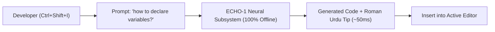

# ONE Language for Visual Studio Code (v1.5.0)
### Sovereign IDE with Offline AI Copilot (ECHO-1), OLTO Reactive Frontend & 3-6-9 Tokenizer

[-white.svg?style=for-the-badge&logo=html5&color=222222)](https://github.com/aayyaz3d-166/ONE-language)

 

 

**ONE Language for VS Code** delivers an all-in-one sovereign development suite for **ONE Language** (`.one`) and **OLTO** (`.olto`). Featuring built-in offline artificial intelligence (**ECHO-1**), sovereign mathematical tokenization (**3-6-9 Vortex Spine**), instant reactivity, real-time compiler diagnostics, autocompletion, hover docs, and one-click binary execution.

---

## 🔮 1. Sovereign 3-6-9 Branching Tokenizer Engine

New in **v1.5.0**, the extension integrates the **Sovereign 3-6-9 Branching Tokenizer & Vocabulary Engine**:
* **Exact Power-of-2 Capacity ($2^{13} = 8,192$ Tokens):** Engineered with deterministic SHA-256 manifest hash `20d87a8714cf4447e7320aa58c4b15a443792aede85faf6984f1105badac0c89`.
* **Zero Third-Party Dependencies:** 100% sovereign mathematical implementation — no HuggingFace, no TikToken, zero npm network calls.
* **3-6-9 Vortex Branching Hierarchy:**
  * $\text{Branch}(1, 2) \to \text{Anchor } 3$ (Observation & Input $\to$ State Anchor)
  * $\text{Branch}(4, 5) \to \text{Anchor } 6$ (Context & Memory $\to$ Active Logic)
  * $\text{Branch}(7, 8) \to \text{Anchor } 9$ (Analysis & Verification $\to$ Collapsed Singularity)
* **100% Roundtrip Bit-Exact Fidelity:** Reconstructs natural English dialogues and code without `<UNK>` degradation.
* **C-Speed Tensor Serialization:** Outputs direct `Int32Array` buffers for instantaneous training ingestion in **3D Memory Studio**.

---

## 🌐 2. OLTO: Native Reactive Frontend Subsystem

Write complete reactive web applications directly inside your workspace without leaving the IDE:
* **Single-File Architecture (`.olto`):** Combine reactive state, declarative layout, event actions, and styles in a single clean grammar.
* **Zero-Dependency Single-File Bundler:** One click bundles your app into a standalone HTML package with **zero `node_modules`** and zero CDN scripts.
* **0.70µs Signal Reactivity:** Bypass Virtual DOM overhead entirely — mutating state instantly updates the targeted DOM node in sub-microseconds.
* **Live-Reload Dev Server:** Launch instant hot-reloading using `one olto dev <App.olto>`.
* **Security Invariant `E9001`:** Automatically flags client-side secret exposure at compile time.

---

## 🤖 3. Built-In ECHO-1 Autonomous Offline AI Copilot

Unlike extensions that require external API keys, OpenAI tokens, or active internet connections, **ONE Language carries its complete 24.56 MB neural network weights directly inside this extension**.

### How to use ECHO-1:
1. **Global Shortcut**: Press `Ctrl + Shift + I` (or `Cmd + Shift + I` on macOS) anywhere in VS Code.
2. **Status Bar**: Click the **`$(sparkle) Ask ECHO-1`** button on the bottom status bar.
3. **One-Click Insert**: Select **"Insert into Editor"** to paste generated code snippets.

---

## ✨ 4. Complete Feature Suite

### 🎨 Full TextMate Syntax Highlighting
* **Spatial & Memory Directives:** `@Space`, `@Grid777`, `@Slice`, `@memview`, `@seal`, `@gossip`, `@actuation_lock`
* **Declarations:** `let`, `const`, `struct`, `enum`, `class`, `function`, `fn`, `native`
* **Control Flow & Async:** `if`, `else`, `while`, `for`, `return`, `async`, `await`
* **Multi-File Modules:** `module`, `import`, `export`, `from`, `as`
* **OLTO Frontend:** `component`, `page`, `state`, `computed`, `action`, `view`, `Card`, `Button`, `Input`

### ⚡ Real-Time Compiler Diagnostics & Smart Auto-Fixer
* Real-time linting on typing and save (`checkOnSave: true`).
* Intercepts `E1001` - `E1016` syntax errors and provides actionable fix guidance powered by ECHO-1.
* Invariant enforcement for `ACTUATION_LOCK` and Address369 boundary guards (`[0..368]`).

### 🚀 Execution & Qplayer Engine Switcher
* **Qplayer Runtime:** 204M ops/sec fast `.obi` (ONE Binary Intelligence) execution.
* **UnifiedVM:** Deterministic 3D spatial memory execution with Address369 coordinates.
* **One-Click Run:** Press `Ctrl + F5` to run the active file instantly.

---

## ⌨️ Default Keybindings

| Command | Shortcut (Windows/Linux) | Shortcut (macOS) | Description |
| :--- | :--- | :--- | :--- |
| **Ask ECHO-1 Copilot** | `Ctrl + Shift + I` | `Cmd + Shift + I` | Query the 100% offline AI Assistant |
| **Run Current File** | `Ctrl + F5` | `Cmd + F5` | Execute active `.one` document |
| **Check Syntax & Types** | `Shift + F5` | `Shift + F5` | Static type analysis & linting |
| **Build Executable** | `Ctrl + Shift + B` | `Cmd + Shift + B` | Compile to standalone container |
| **Format Document** | `Shift + Alt + F` | `Shift + Option + F` | Deterministic code formatting |

---

## 📋 Requirements & Sovereign Guarantee
* Visual Studio Code version **1.80.0** or higher.
* **100% Sovereign Guarantee:** No cloud connection, no API keys, and no telemetry required. All models and compilers operate 100% locally.

---

## 📜 License
Licensed under either the **Apache License, Version 2.0** or the **MIT License** at your option.
