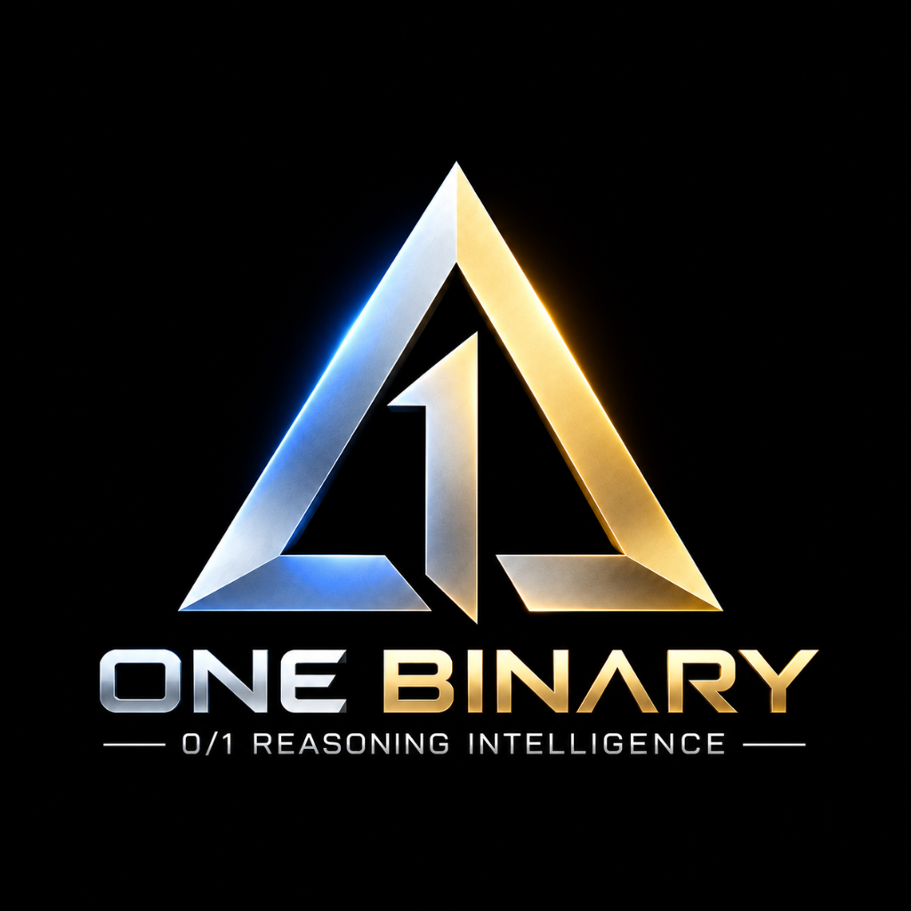

<div align="center">



# ONE Binary 0/1 Reasoning Intelligence

[](https://github.com/aayyaz3d-166/ONE-Binary-Reasoning-Intelligence/actions)
[](LICENSE)
[](package.json)

</div>

> An independent deterministic reasoning system combining ONE Binary Language (3-bit, 6-bit, and 9-bit encoding) with ONE 0/1 Reasoning Intelligence, including binary encoding/decoding, state-space exploration, rule-based reasoning, and a unified integration bridge. Designed for future integration with ONE Language.

---

## 1. Overview

**ONE Binary 0/1 Reasoning Intelligence** is an independent, self-contained TypeScript library that unites two foundational systems from the ONE Language sovereign architecture:

1. **3/6/9-Bit Binary Language Protocol:** Multi-tier framing protocol (3-bit categorical type tags, 6-bit planar triangle opcodes, and 9-bit Address369 pointers) featuring strict fail-closed validation, big-endian bitstring encoding, and zero-guessing decoding.
2. **0/1 Reasoning Intelligence Engine:** Bounded forward-chaining state explorer delivering discrete `0 | 1` decision signals, deterministic candidate ranking, budget enforcement, and structured derivation traces.
3. **Binary Reasoning Bridge & Session Coordinator:** Bidirectional serialization connecting reasoning states, candidate trajectories, and telemetry tokens to canonical binary bitstreams.
4. **Canonical Address369 Memory Map:** Strict `[0..368]` partition encompassing 26 symbolic registers (`0..25`) and 343 spatial voxel cells (`26..368`, $7 \times 7 \times 7$ lattice).

> [!IMPORTANT]
> **Scope & Safety Invariant:**  
> This engine implements **bounded, deterministic symbolic search** over explicitly registered rules and invariant predicates. It does **NOT** claim general artificial intelligence, unconstrained emergent reasoning, or autonomous self-learning.

> [!NOTE]
> **Zero External Runtime Dependencies:**  
> The core binary protocol and reasoning engine rely solely on standard Web/Node primitives (`DataView`, `ArrayBuffer`, `TextEncoder`, `TextDecoder`, `performance.now()`). TypeScript and Node type definitions are used strictly as `devDependencies`.

---

## 2. Quick Start

### Local Setup & Verification

> [!NOTE]
> This package is a local standalone project and has not been published to the public npm registry. It is built locally from source and can be integrated via `npm link` or local directory references.

```bash
# 1. Install development dependencies (TypeScript compiler)
npm install

# 2. Build TypeScript source into dist/
npm run build

# 3. Static type-checking (zero errors)
npm run typecheck

# 4. Run comprehensive test suite (28 tests across 4 suites)
npm test
```

### Targeted Test Scripts

```bash
# Run 3/6/9-bit Binary Language tests
npm run test:binary

# Run 0/1 Reasoning Engine tests
npm run test:reasoning

# Run End-to-End Integration & Binary Bridge tests
npm run test:integration

# Run Deterministic Reasoning Benchmarks
npm run test:benchmark
```

---

## 3. Usage Examples

All examples below compile and execute against the real library API.

### 3.1 Binary Language Encoding & Decoding

```typescript
import {
  BinaryEncoder,
  BinaryDecoder,
  TriangleOpcode,
} from 'one-binary-reasoning';

// 1. Encode a triangle opcode instruction into a canonical bitstring
const opcodeBits = BinaryEncoder.encode({
  kind: 'opcode',
  opcode: TriangleOpcode.OP_ADD,
});
console.log(opcodeBits); // '110001000' (3-bit tag 110 + 6-bit opcode 001000)

// 2. Decode the bitstring back with fail-closed validation
const decoded = BinaryDecoder.decode(opcodeBits);
console.log(decoded.value); // { kind: 'opcode', opcode: 8 }

// 3. Multi-element concatenated stream decoding
const streamBits = BinaryEncoder.encode(42) + BinaryEncoder.encode('Hello');
const values = BinaryDecoder.decodeStream(streamBits);
console.log(values); // [42, 'Hello']
```

### 3.2 0/1 Reasoning Intelligence Engine

```typescript
import {
  ReasoningEngine,
  ReasoningRule,
  ReasoningStatus,
} from 'one-binary-reasoning';

// 1. Define deterministic transition rules
const decRule: ReasoningRule<number> = {
  id: 'dec_1',
  description: 'Subtract 1',
  priority: 10,
  isApplicable: (n) => n > 0,
  apply: (n) => [n - 1],
};

const halveRule: ReasoningRule<number> = {
  id: 'halve_even',
  description: 'Divide even number by 2',
  priority: 25,
  isApplicable: (n) => n > 0 && n % 2 === 0,
  apply: (n) => [n / 2],
};

// 2. Initialize engine and register rules
const engine = new ReasoningEngine<number>();
engine.getRegistry().register(decRule).register(halveRule);

// 3. Solve with explicit goal and step budgets
const result = engine.solve({
  input: 16,
  goal: (n) => n === 1,
  maxSteps: 20,
});

console.log(result.status === ReasoningStatus.SOLVED); // true
console.log(result.bestCandidate?.value); // 1
console.log(result.metrics.stepsUsed); // 7 search steps (solution path: 16 -> 8 -> 4 -> 2 -> 1)
```

### 3.3 End-to-End Binary Reasoning Session

```typescript
import { ReasoningSession } from 'one-binary-reasoning';

const session = new ReasoningSession<number>({
  rules: [decRule, halveRule],
});

const bundle = session.solveWithBinaryTrace({
  input: 10,
  goal: (n) => n === 1,
  maxSteps: 15,
});

console.log(bundle.result.isSolved); // true
console.log(bundle.isBitExact); // true
console.log(bundle.solutionEnvelopes.length > 0); // true (binary envelopes generated)
```

---

## 4. Documentation & Specifications

- [3/6/9-Bit Binary Language Specification (v1.0)](docs/binary-language-v1.md)
- [0/1 Reasoning Intelligence Engine Specification (v1.0)](docs/reasoning-engine-v1.md)
- [System Architecture](docs/architecture.md)
- [Canonical Address369 Implementation](src/shared/address369.ts)

---

## 5. Licensing & Provenance

ONE Binary 0/1 Reasoning Intelligence is derived from the core ONE Language architecture and is dual-licensed under:
- **The MIT License** (`LICENSE-MIT`); and
- **The Apache License, Version 2.0** (`LICENSE-APACHE`).

Copyright © 2026 Ayyaz3D. All rights reserved.
