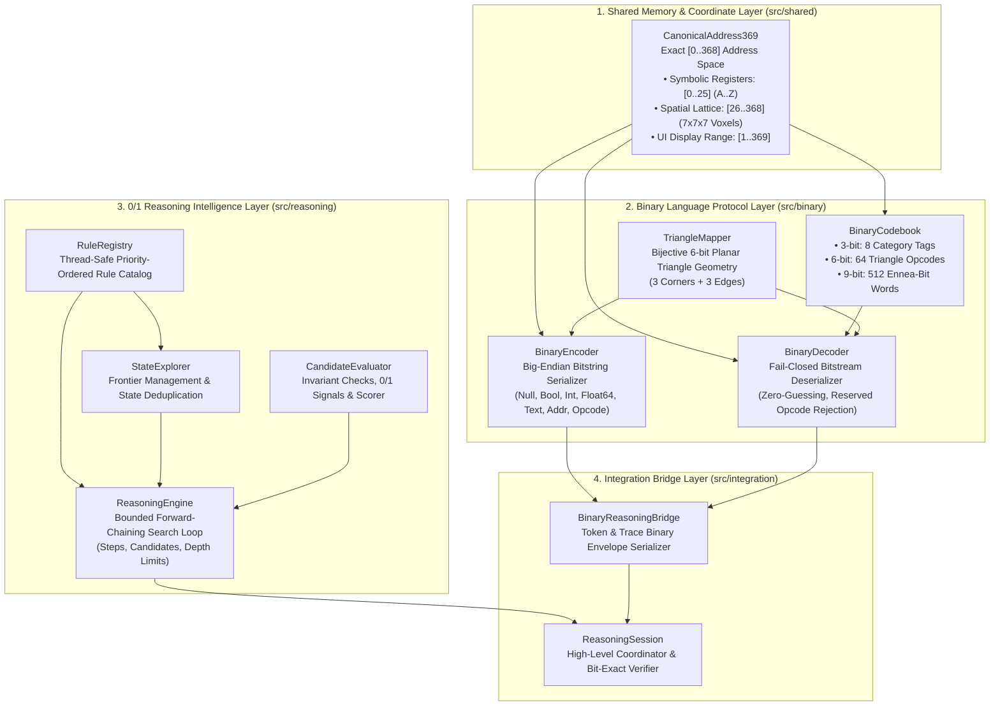

# ONE Binary 0/1 Reasoning Intelligence — Architectural Specification

**Document:** `docs/architecture.md`  
**Status:** Canonical Architecture Specification (v1.0)  
**Workspace:** `F:\one-binary-reasoning`  
**License:** Dual MIT / Apache-2.0 (Copyright © 2026 Ayyaz3D)

---

## 1. Architectural Philosophy & Decoupled Scope

The **ONE Binary 0/1 Reasoning Intelligence** library represents a self-contained extraction of two core computational systems originally developed within the ONE Language ecosystem:

1. The multi-tier **3/6/9-Bit Binary Language Protocol** (Phase 2).
2. The bounded, discrete **0/1 Reasoning Intelligence Engine** (Phase 3).

### Strict Boundary Isolation
To guarantee complete portability, zero runtime dependencies, and high execution speed, the following components from the parent repository are **intentionally and permanently excluded**:
- **Main Compiler & Parser:** No AST nodes, tokens, lexer, or `.one` file parsers are bundled.
- **UnifiedVM & Bytecode Runtime:** No instruction loops, stack evaluators, or virtual registers are included.
- **Developer CLI Toolchain:** Excluded from runtime footprint.
- **HybridConversationEngine & Neural Adapters:** All LLM adapters, neural weights (`.cubiomodel`), checkpoint files, and prompt engines are completely omitted.
- **External Dependencies:** Zero third-party npm packages in the production bundle; only standard ECMAScript / Node.js primitives (`ArrayBuffer`, `DataView`, `TextEncoder`, `TextDecoder`, `performance.now()`) are utilized.

---

## 2. System Layer Topology

---

## 3. Subsystem Detailed Analysis

### 3.1 Shared Memory & Coordinate Layer (`src/shared/`)
- Encapsulated in [`src/shared/address369.ts`](../src/shared/address369.ts).
- Preserves the exact 369-cell memory layout defined in ONE Language Gate CNL-P26.1-R1:
  - **Internal 0-indexed range:** `0..368` (exactly 369 addresses).
  - **Symbolic Layer:** Addresses `0..25` map to registers `SYM_A_00` through `SYM_Z_25`.
  - **Spatial Layer:** Addresses `26..368` map to 3D Cartesian coordinates $(i, j, k) \in [0..6]^3$ within a $7 \times 7 \times 7$ spatial grid using the canonical linear offset formula:
    $$\text{Address} = 26 + (i + 7j + 49k)$$
  - **UI Display Range:** `1..369`, converted via explicit bi-directional mappings `toDisplayIndex` and `fromDisplayIndex`.

### 3.2 Binary Language Protocol Layer (`src/binary/`)
- Encapsulated across [`types.ts`](../src/binary/types.ts), [`triangleMapper.ts`](../src/binary/triangleMapper.ts), [`binaryCodebook.ts`](../src/binary/binaryCodebook.ts), [`binaryEncoder.ts`](../src/binary/binaryEncoder.ts), and [`binaryDecoder.ts`](../src/binary/binaryDecoder.ts).
- **Multi-Tier Framing:**
  - **3-bit Category Header:** Categorizes incoming bits into 8 data types (`TYPE_NULL`, `TYPE_BOOL`, `TYPE_INT`, `TYPE_FLOAT`, `TYPE_TEXT`, `TYPE_ADDR369`, `TYPE_OPCODE`, `TYPE_CONTROL`).
  - **6-bit Triangle Opcodes:** Encodes 64 geometric states representing 3 corners and 3 edges of a planar triangle. Partitioned into 4 quartiles: 26 active VM operations and 38 strictly reserved opcodes.
  - **9-bit Ennea-Bit Words:** Directly envelopes the 369 Canonical Address369 space (`0..368`), leaving codes `369..511` explicitly reserved.
- **Fail-Closed Validation:**
  - Attempts to decode truncated streams throw `INCOMPLETE_STREAM`.
  - Attempts to decode unassigned or reserved opcodes throw `RESERVED_OPCODE`.
  - Attempts to reference out-of-bounds addresses throw `ADDRESS_OUT_OF_BOUNDS`.
  - Zero-guessing principle: decoding never coerces or guesses unknown bit patterns.

### 3.3 0/1 Reasoning Intelligence Layer (`src/reasoning/`)
- Encapsulated across [`types.ts`](../src/reasoning/types.ts), [`RuleRegistry.ts`](../src/reasoning/RuleRegistry.ts), [`StateExplorer.ts`](../src/reasoning/StateExplorer.ts), [`CandidateEvaluator.ts`](../src/reasoning/CandidateEvaluator.ts), and [`ReasoningEngine.ts`](../src/reasoning/ReasoningEngine.ts).
- **Core Functionality:**
  - Forward-chaining state space exploration governed by programmer-registered transition rules ([`ReasoningRule<T>`](../src/reasoning/types.ts)).
  - Discrete `0 | 1` decision signals: candidates violating domain constraints emit `0` (`REJECT`); valid candidates emit `1` (`ACCEPT`).
  - Deterministic candidate ordering based on validity, goal achievement, scoring, and lexicographical ID tie-breaking.
  - Fail-closed execution budget ceilings (`maxSteps`, `maxCandidates`, `maxDepth`, `timeoutMs`).

### 3.4 Integration Bridge Layer (`src/integration/`)
- Encapsulated in [`BinaryReasoningBridge.ts`](../src/integration/BinaryReasoningBridge.ts) and [`ReasoningSession.ts`](../src/integration/ReasoningSession.ts).
- Serves as the zero-copy serialization interface linking the symbolic reasoning search tree to verifiable binary bitstreams:
  - Transforms candidate values and trace telemetry tokens into canonical `BinaryReasoningEnvelope` instances.
  - Coordinates end-to-end problem solving via `ReasoningSession.solveWithBinaryTrace()`, capturing the exact binary representation of the winning derivation path while verifying roundtrip parity.

---

## 4. Public Export Architecture

The library exposes a layered barrel structure allowing consumers to import either the unified library or individual subsystems:

| Export Specifier | Target Entry Point | Description |
|---|---|---|
| `one-binary-reasoning` | [`src/index.ts`](../src/index.ts) | Master public entry point re-exporting all subsystems. |
| `one-binary-reasoning/binary` | [`src/binary/index.ts`](../src/binary/index.ts) | 3/6/9-bit Binary Language protocol codec and codebooks. |
| `one-binary-reasoning/reasoning` | [`src/reasoning/index.ts`](../src/reasoning/index.ts) | Bounded 0/1 Reasoning Engine, Rule Registry, and Evaluator. |
| `one-binary-reasoning/integration` | [`src/integration/index.ts`](../src/integration/index.ts) | Binary Reasoning Bridge and high-level Reasoning Session. |
| `one-binary-reasoning/shared` | [`src/shared/index.ts`](../src/shared/index.ts) | Canonical Address369 constants, converters, and types. |

All exports provide fully typed `.d.ts` declarations and ESM-compliant `.js` modules in `dist/`.
